# Changelog

User-facing changes of opendm40 per release. The release workflow
([.github/workflows/release.yml](.github/workflows/release.yml)) uses the
section named after the tag as the release notes; how to cut a release:
[firmware/README.md, Releasing](firmware/README.md#releasing).

## Unreleased

### New

- **Scope: a block per channel** on the right panel (CH1, DMM, GEN, MATH),
  each with its V/div and a zoom-in / zoom-out magnifier; a tap on the title
  opens its popup or switches the channel on and off. The graph reaches the
  left edge ([manual](docs/manual/README.md#the-scope-page)).

  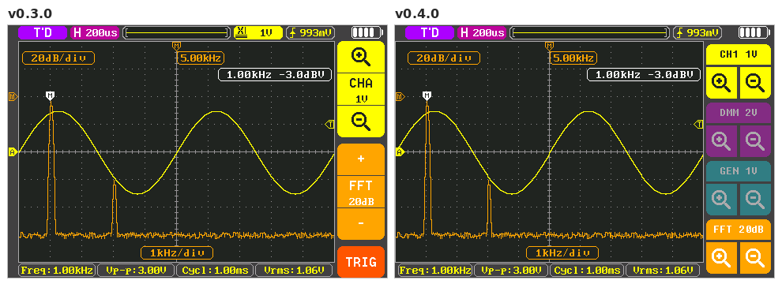
- **Scope: the multimeter as CH2** (MF > Display > CH2 (DMM)), drawn over
  CH1 on the same time axis in V, mV and AC A; the multimeter reading,
  alerts and Bluetooth pause meanwhile
  ([manual](docs/manual/README.md#display-settings)).
- **Scope: the generator as a channel:** a **GEN trace** on its own V/div,
  and **Source GEN** in MF > Trigger, which triggers on the generator with no
  wire ([manual](docs/manual/README.md#trigger)). SCPI `TRIGger:SOURce`,
  `GENerator:DISPlay`, `GENerator:SCALe`.

  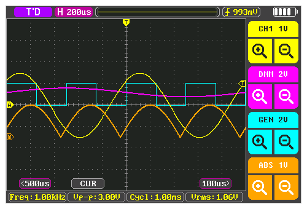
- **Protocol decoder:** UART (RS-232, RS-485, with Modbus RTU frames found by
  their CRC) and DALI, drawn under the trace, also in the Wave view; **Mode
  Log** lists every frame of a running stream. Scope MF > Decode; SCPI
  `DECode` ([manual](docs/manual/README.md#protocol-decoder)).

  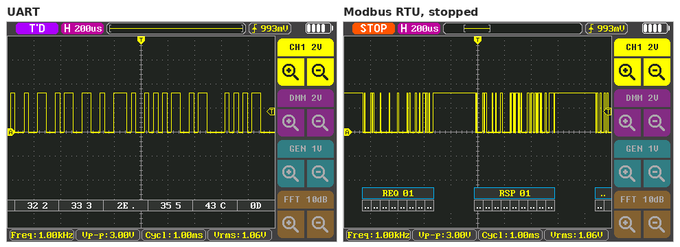

  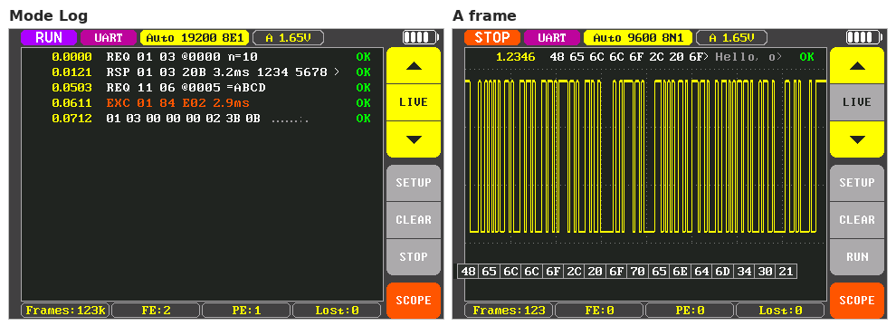
- **Scope: 5 and 2 mV/div**, a digital zoom of 10 mV/div: the same
  resolution, drawn larger. SCPI `CHAN1:SCAL 0.005` / `0.002`.

  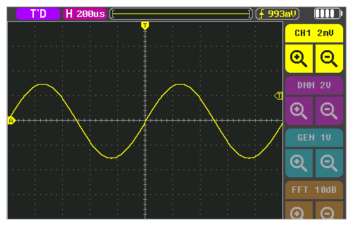
- **Scope: a longer capture** for the stopped zoom / pan, Save CSV and
  `WAV:DATA?`: 65 520 samples from 100 ms/div, 44 032 at the faster
  timebases (was 26 624); in roll, up to 262 144 samples, compressed as they
  come in ([manual](docs/manual/README.md#stop-zoom-and-pan)).
- **Wave button on the multimeter page:** in V and A, a **Wave** chip in the
  trend chart opens the
  [Wave view](docs/manual/README.md#wave-view-the-scope-on-the-multimeter-inputs).
- **σ in the MIN/MAX/AVG column:** the standard deviation since the
  statistics started; SCPI `CALCulate:AVERage:SDEViation?`.

  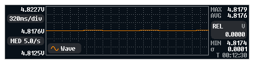
- **600 MΩ range, experimental:** on the range page or SCPI
  `RES:RANG 600E6`, never in AUTO; leave the leads open once to learn the
  meter's own leakage ([manual](docs/manual/README.md#resistance)).

  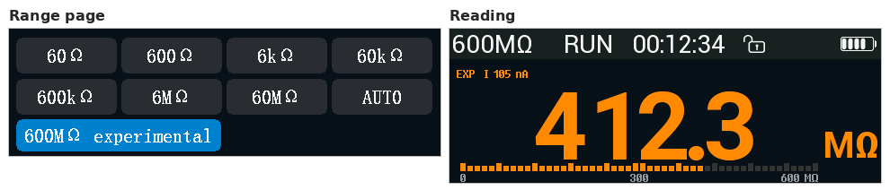
- **Continuity and diode: a green SHORT band** and green digits while the
  beeper sounds, also at volume 0 %; **BEEP** for a diode
  ([manual](docs/manual/README.md#continuity)). Continuity shows its test
  current, **I -0.26 mA**.

  
- **Each function button remembers its sub-mode** (V and A coupling, diode /
  continuity, Hz / °C, Ω test current), also after a power-off
  ([manual](docs/manual/README.md#choose-a-function)).
- **Mode Remember** (Settings > Power, default OFF as on the stock): after a
  power-off the multimeter and the scope start as you left them. SCPI
  `MEMory:STATe:RECall:AUTO`.
- **Record On change:** a row when the reading moves 0.1 / 1 / 5 % of the
  range, on OL / HI / LO, and at least once a minute. SCPI
  `LOG:CSV:INTerval CHANge`, `LOG:CSV:CHANge`.
- **Trend chart:** two slower timebases, 1.28 and 2.56 s/div.
- **Device page:** the factory serial number.
- **Russian README and user manual:** [README.ru.md](README.ru.md),
  [docs/manual/README.ru.md](docs/manual/README.ru.md).

### Changed

- **Extra digit at full size:** the reading starts further left, so the
  other digits stay put when it comes or goes
  ([manual](docs/manual/README.md#counts-rate-and-the-extra-digit)).

  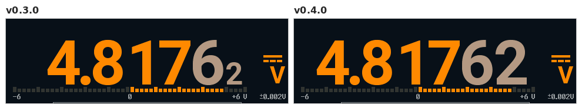
- **Scope drag as on a Rigol DHO800/900:** drag a marker to move it (large
  grab zones); elsewhere, sideways moves the trigger position, up / down the
  selected item. The **Drag** setting is gone; cursors move by their markers
  ([manual](docs/manual/README.md#moving-things-with-a-finger)).

  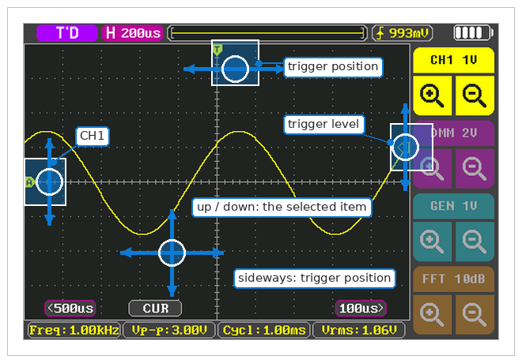
- **Scope:** the TRIG button, the V/div badge and MCX | DMM are gone: the
  trigger badge and MF > Trigger open the trigger settings, the CH1 title
  shows the probe and AC coupling, a long press on the DMM title opens the
  Wave view.
- **Settings in tabs** (Display, Alerts, Power, Multimeter, Scope, Other),
  taller rows; only the value side of a row reacts to a tap
  ([manual](docs/manual/README.md#settings)).

  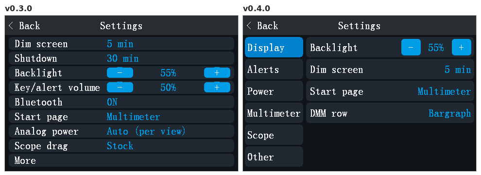
- **Record button on the range pages:** MF, then **Record** (red while
  recording); **Hold/Limits** is now **Limits**
  ([manual](docs/manual/README.md#the-record-page)).

  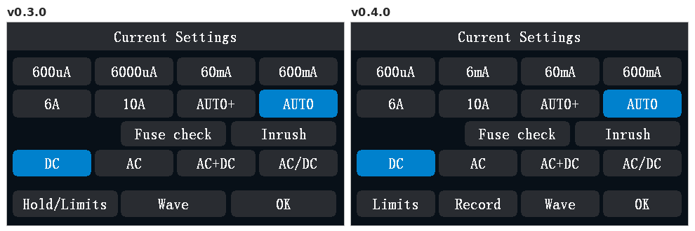
- **Long press on the A button** opens the
  [inrush page](docs/manual/README.md#inrush-current); the power meter's
  wiring picture stays under **MF > Wiring**.
- **Auto power-off on battery only:** on USB power the meter stays on; after
  the unplug the **Shutdown** time starts afresh
  ([manual](docs/manual/README.md#power-battery-and-sleep)).
- **Texts as on the stock firmware:** lowercase k (kΩ, kHz, kW), **6mA**,
  ℃ / ℉ symbols, several renamed titles and rows
  ([#136](https://github.com/opendm40/opendm40/issues/136)); **Overflow**
  next to the big `0L` (was Overload)
  ([manual](docs/manual/README.md#overflow)).
- **Smoother drawing:** pages, popups and functions draw over the old screen
  top to bottom in one pass; a pressed button shows in one pass; an MF tab
  redraws only the menu.
- On-screen help: two pages (gestures, side keys).
- **Update loader:** it no longer opens by itself after repeated hangs (a
  hang restarts the meter); opened by hand, it lets the installed firmware
  start again after a power cycle
  ([how to reach it](docs/manual/README.md#reach-the-update-loader)).
- **Test builds of pull requests:** each pull request gets a comment with
  its update file (version `0.4.0-pr<N>.<commit>`)
  ([manual](docs/manual/README.md#install)).
- Debug commands (`DBG:TOUCH?`, `DBG:PROF?`, `DBG:ACDC:TRACE`, `DBG:HYSPI`,
  `DBG:ACDC?`, `DBG:DIAG?`, `DBG:OHM6`, `DBG:SENTinel?`, `DBG:SRC`) are only
  in builds with their features
  ([SCPI reference](docs/manual/scpi-reference.md#debug-commands)).

### Fixed

- A firmware update keeps the multimeter function and the scope settings;
  they went back to the defaults.
- **Device page:** the bootloader and hardware versions were swapped.
- Capacitance AUTO: a small capacitor after a large one (600 µF and up) gets
  its own range again; open leads or a short after it no longer leave
  **0L mF** / **0.0 mF**.
- Capacitance: 6 mF and up read in µF (4700 µF, not 4.700 mF).
- Capacitance ranges: MF chooses 60 nF .. 60 000 µF or AUTO, the AUTO key
  steps them as in V / A / Ω; 6 nF and 60 nF are one range.
- Capacitance 1 .. 47 mF: the first value in about 1.5 to 5 s (was 9 to
  20 s; 47 mF did not settle); AUTO starts on the last value's range; grey
  until the slope settles; another capacitor on 6 / 60 mF ranges again.
- Capacitance 600 µF and up: a value every 0.25 s, grey until the ramp has
  run both ways; grey **Discharging... 0.85 V** while discharging, about
  twice as fast.
- Capacitance: the bargraph spans the range, not ten times it.
- Multimeter: a value that rounds to zero has no minus sign ("-0.0000").
- Multimeter A-jack detection: A-JACK also in AC mV, Hz, DC V, DC mV and
  for a current from COM into the A jack, LIVE? in Ω; a signal above the AC
  bandwidth on V-COM no longer raises A-JACK / A-PROT or "DC?" with the A
  jack empty ([manual](docs/manual/README.md#what-cannot-be-detected)).
- Key/alert volume 0 % also silences the continuity and diode beeper
  ([manual](docs/manual/README.md#alerts-tab)).
- Trend chart: keeps its points on REL on / off; a range change to another
  unit that reads OL starts it over in the new unit.
- Bargraph scale: the unit spelled as the reading (600 KΩ, not 600 kOhm).
- Temperature page: the cold junction line follows the readings and offset.
- Power meter: **Vb 0.000** not in the warning colour with open leads; PF
  "--" with no current in AC+DC (SCPI `+9.91E37`); no MAX / AVG / REL / MIN
  column while "I ranging..."; the combined view shows **POWER** and dashes
  meanwhile.
- Inrush: the auto power-off no longer switches the meter off while armed
  ([#144](https://github.com/opendm40/opendm40/issues/144)); Trigger - / +
  step the right way from a threshold set over SCPI.
- **Limits:** a huge limit set over SCPI no longer restarts the meter; MENU
  and Back return to the range page it was opened from.
- A function change over USB / Bluetooth closes the wiring, "Reset energy?"
  and fuse check dialogs.
- Settings: **Backlight** - / + keep to the 10, 15, 25 ... 95, 100 % steps
  ([#91](https://github.com/opendm40/opendm40/issues/91)).
- Generator: the square wave's preview follows the duty cycle
  ([#81](https://github.com/opendm40/opendm40/issues/81)).
- **Scope STOP** ends on one more complete capture with the trigger at the
  trigger position, as **Single**: no untriggered part, seam or empty record
  at fast timebases, and CH2 drawn to the right edge. It takes up to the
  screen's time + 1 s; over SCPI wait for `TRIG:STAT?` = `STOP`
  ([manual](docs/manual/README.md#stop-zoom-and-pan)).
- Scope, stopped: zoom stops at **Max zoom** (16 samples across); a pan,
  zoom or V/div change during a screenshot hold is drawn after it; a zoom or
  ended Single right after a screenshot no longer keeps the old trace; a
  drag back from either end of the record moves at once.
- Scope Save CSV while stopped: the header gives the record's timebase,
  V/div, coupling and trigger, not the shown ones.
- Scope: a setting changed over SCPI shows at once beside an open popup
  ([#82](https://github.com/opendm40/opendm40/issues/82)).
- Scope: Duty, Wid, Vtop, Vbas and Vamp are right on triangle and ramp
  signals; in roll the measurements show -- until there is data.
- Scope: the V/div label is right with x2, x5 and other non-decade probes.
- Scope: text stays readable in every channel colour.
- Scope CH2 (DMM): no wrong segment across a gap in the multimeter's stream.
- **Status bar:** charging shown (green battery, blinking top bar), a USB
  symbol, and on the scope page the **Bluetooth symbol**
  ([#167](https://github.com/opendm40/opendm40/issues/167),
  [manual](docs/manual/README.md#the-status-bar)).
- Recording: a blinking red dot and **REC** in the status bar, a red dot and
  **DMM** on the scope page ([#101](https://github.com/opendm40/opendm40/issues/101)).
- **Gallery:** the running recording reads **Recording**, and **Delete**
  says **Stop the recording**.
- **Bluetooth SCPI:** a host that disconnects mid-query no longer leaves its
  reply for the next host; pipelined `WAV:DATA?` / `LOG:DATA?` keep the last
  reply; lost input is reported (-363).
- **USB SCPI:** long replies (`MMEM:DATA?`) go out at full speed while the
  scope page draws.
- SCPI: `TRIGger:LEVel` keeps the level as given (0.1 V became 0.113 V).
- SCPI: `WAVeform:DATA?` BYTE is no longer 1.5 codes low on average.
- SCPI: `SCOPe:MEASure:...?` with no value answers `+9.91E37`.
- SCPI: `ACQ:SRAT?` of a stopped, zoomed scope gives the record's rate
  ([#158](https://github.com/opendm40/opendm40/issues/158)).
- SCPI: out-of-range numbers queue `-222 Data out of range` (`SYST:BEEP:VOL`,
  `SYST:ALER:ENAB`, `LOG:OSR`, `LOG:DUR`, `LOG:SRAT`, `LOG:CSV:INT` / `DUR`,
  `INRush:THReshold`, `POWer:PHASe`); `LOG:SOUR` takes any case;
  `MMEM:DATA?` with no name queues `-109`.
- `DBG:PING?`: the keepalive reads `4294967295` after boot
  ([#97](https://github.com/opendm40/opendm40/issues/97)).

## v0.3.0 (2026-10-27)

### New

- **Accuracy of the reading** under the unit, from the DM40 manual for your
  model; digits finer than it are grey. Settings > More > More > Accuracy
  ([manual](docs/manual/README.md#accuracy)).

  

- **60 Ω range** with milliohm digits, on the range page and in AUTO
  ([manual](docs/manual/README.md#resistance)).

  

- **Negative ohm** (Settings > More > More): shorted leads read below zero
  instead of 0.000. SCPI `RESistance:NEGative`.

  

- **Scope:** the timebase list shows each entry's sample rate
  ([manual](docs/manual/README.md#timebase)).

  

- **Start-up:** a splash with the version and a progress bar; the meter page
  comes up in about 0.7 s instead of 4 s.

  

### Fixed

- **Scope did not turn on** (a flat trace at the bottom) after power-on with
  Analog power set to Both always or a start page other than Multimeter: the
  analog supply was switched wrongly. Switching to Auto or opening the scope
  then could turn the meter off.
- **Frequency:** 2 Hz and 5 Hz gave no reading; it now reads down to 0.5 Hz,
  with one more (small) digit where the counter allows it
  ([manual](docs/manual/README.md#frequency-and-duty-cycle)).

  

- **Generator:** after OFF and ON the sine, triangle and ramp stayed flat
  until a restart.
- **Continuity / diode:** touching the probes together no longer shows
  A-JACK.
- **Scope:** closing a popup is about 4x faster; the tap's beep is short
  again.
- **AC V:** the first readings after a range step on a signal with a DC part
  read high; they are grey until settled.
- A calibration record with a bad CRC is ignored, as the stock firmware does.
- Holding AUTO shows AUTO at once, not the last manual reading.
- The rate chip and the message after a tap on the reading show the new rate
  at once.

### Changed

- No logo in the status and title bars.

## v0.2.0 (2026-10-25)

### New

- Touch calibration: **Calibrate** on the touch test page (Settings > More
  > More > Touch test) fits a correction to taps on its nine targets,
  shows the remaining error and applies it on Save; kept in the settings.
  Without one the touch points are used unchanged, as the stock does
  ([manual](docs/manual/README.md#touch-calibration); `DBG:TOUCH:CAL`).
- Multimeter: a 60 mV range (on the range page, and first in the mV AUTO).
- Ohm and diode: the test current is shown next to the reading, from
  currents measured on the meter (e.g. 0.756 mA for the diode test).
- "Overload" is shown next to `0L`.
- Scope touch: the trigger-level marker sits on the graph's right edge and
  moves the trigger point; a press near a marker grabs the nearest one; a
  drag stays on one item and one axis; pinch modes with one step per 1.25x.
- Power meter: the wiring dialog draws the meter's jacks (VΩ / COM / A) and
  the current path through the meter.
- SCPI: IEEE 488.2 suffix multipliers, an error queue with codes
  (`SYSTem:ERRor?`), no reply to a query in a message with a bad set value;
  `LOG:FORMat ROWS|PACKed|DLG` for compact `LOG:DATA?` replies
  ([SCPI reference](docs/manual/scpi-reference.md)).
- The settings are kept in `_SETTING.BIN` on the internal disk.
- The version comes from one place, `firmware/Cargo.toml`: `*IDN?`,
  Settings > Device, the USB disk texts, the CSV headers and the install
  file `dm40_opendm40_v<version>.bin` show the same string.
- Settings > More > More > Touch test: a page that shows every touch the
  controller reports, the points after the debounce and the touch keys,
  against crosshair targets, to check the touch calibration
  ([manual](docs/manual/README.md#touch-test)).

### Changed

- USB ID `1209:D040` (opendm40's own PID under the pid.codes VID) instead
  of the pid.codes test ID `1209:0001`; udev rules and VISA resource
  strings change accordingly. The host tools accept both.
- Multimeter rate (DC V, mV, A and Ω): every rate now rejects 50 Hz and
  60 Hz hum. FAST: 10 readings/s (Ω 5/s); in DC V / mV / A the converter
  runs without its chopper and the meter measures its offset itself (2 s
  after a change, then every 30 s; two readings skipped each time). MED: 5
  readings/s (Ω 2.5/s as before), the extra digit after 1.6 s. SLOW: 2.5
  readings/s. Before,
  FAST and MED ran a 50 ms conversion that did not reject 50 Hz
  ([manual](docs/manual/README.md#rate-fast-med-slow)).

- Resistance: the 60 Ω range is removed (the range page, the AUTO key cycle;
  `RES:RANG 60` and `RES:RANG MIN` select 600 Ω). It read about 2.7 % low
  against the 600 Ω range for a reason not known, and its entry in the
  calibration record is not a calibration. The lowest range is 600 Ω, as on
  the stock firmware.
- Multimeter AUTO key (voltage, current, resistance): a short press fixes
  the present range, then steps to the next higher range, wrapping from the
  highest to the lowest; held 1 s it returns to the default autorange
  (AUTO+ on volts). It still clears HOLD and REL; AutoHold stays on.
- Multimeter: with a fixed range the status bar shows the range (e.g.
  **6V**, **600mV**, **6000uA**, **6KΩ**) instead of **MANU**, as the stock
  firmware does; the meter strip's badge too.
- A power-off starts a new measurement: DC V, and the measurement settings
  (ranges, AutoHold, limits, rate, the scope's acquisition and trigger, the
  power meter, the Record page) at their defaults; the preferences are kept.
  A reset or a firmware update continues the measurement.
- The version is shown with three parts (`0.1.0`, `dm40_opendm40_v0.1.0.bin`,
  tag `v0.1.0`).
- The firmware is named opendm40 everywhere (device strings, image name).
- The "Leads in A jack? Move to V" reminder is removed.
- AUTO+ chosen on a mV range leaves mV at once for the 6 V range; AC mV steps
  up on a clipped input.
- Auto power-off: USB disk reads and writes count as host activity; the
  screen dims on input only.
- Wave view: the timebase starts at 1 ms/div. Scope: CH1 Type is removed.
- Wave view: V/div steps with one full-scale step per range (± the range on
  the 8 divisions: 1.5 V/div on 6 V, 15 V/div on 60 V, 2.5 A/div on 10 A)
  and 1-2-5 steps between that only rescale the screen; the range changes
  only where a step needs it. The pinch and AUTO work in the Wave view; 60 mV
  is in its list.

### Fixed

- Touch: a read of the touch controller while its INT line is still low
  returned the cleared buffer (status 0xAB), which was taken for a press of
  the MENU key between the real frames; taps were lost and keys mixed up.
  Such a read is now "no new data", as the stock reads only on INT edges.
- Side keys: a key pressed right after another one (within ~40 ms of its
  release, or with the release report lost) acted as the earlier key, and
  RUN's release was then never seen, so AutoHold turned on by itself 1 s
  later (AUTO after RUN gave HOLD and A-HOLD). Each key now reports its own
  release and press.
- Bluetooth: the module's start-up banner and its own text no longer reach
  the SCPI parser as commands; a host's first command right after the
  module starts is answered.
- No false A-JACK warning from a voltage on V-COM in ohm, continuity, AC mV
  and AC+DC mV (also after the source is switched off with the input left
  open), nor from a source on V-COM in resistance.
- RES AUTO: no endless range hunt; `FETCh?` answers `+9.91E37` right after an
  autorange step.
- SCPI numbers: `nr3` and powers of ten print exact values
  (`VOLT:RES?` gives `+9.999999E-06`).
- `MMEM`: a directory prefix must be the file's own directory; a host's
  `MMEM:DATA?` no longer stalls the Wave view's stream.
- First readings after a function change: every entry is checked; AC A too.
  AC V / mV: the first reading after the entry no longer comes from a
  conversion that began before the AC input was there (DC V -> AC V read
  1/√2 of a square), nor 0 or 1 % low after an autorange step.
- Inrush page: the zero is measured at the arm ("Armed: 0.069 A now" with
  nothing in A; the idle and the results were 0.07 A off).
- Logger: one 76.8 kS/s nominal rate; no hole in the panel at the 76.8 kS/s
  start.
- The 6 M ohm test-current label is cleared on 60 M.
- Scope: the trigger-level marker follows a drag more closely (each step
  repaints its guide line as whole rows, the marker before the trigger
  badge).
- AUTO from a manual range (the AUTO key, the range page, SCPI
  `<f>:RANG:AUTO ON` / `CONF:<f>`): the status bar shows AUTO at once and the
  readout dimmed dashes until AUTO's first reading, as after a function
  change. Before, the manual range's last value stayed with MANU until then
  (RES: through the whole autorange). Where AUTO stays on the manual range,
  the dashes now show until the next conversion.
- `DBG:SENT?` fields 14 / 15 (jack check verdict, OP1O peak): -1 / 0 after a
  range or function change and once the hit run is over (they kept the last
  verdict; after a source on V-COM goes off field 14 now goes to -1, not 1).
  `DBG:READout?` has a fifth field, the status bar's AUTO / AUTO+ / MANU.

### Docs

- A user manual in one file with a picture in every section
  ([docs/manual/README.md](docs/manual/README.md)); the root README is the
  front page with install, backup and recovery ([README.md](README.md)).
- Measured ohm test currents and the HY3131 node behaviour
  ([hw/README.md](hw/README.md)); copying `DEBUG/SPIFLASH.BIN` on Linux.
- Finished logs and investigations moved to [docs/history/](docs/history).

### Tools

- [`firmware/tools/reload.sh`](firmware/tools/reload.sh): the first upload no
  longer fails on an earlier client's error.
- [`firmware/tools/dm40scpi.py`](firmware/tools/dm40scpi.py) `log --format
  rows|packed|dlg`; [`firmware/tools/srcmap.py`](firmware/tools/srcmap.py)
  sweeps the `DBG:SRC` taps into a CSV;
  [`firmware/tools/linkcheck.py`](firmware/tools/linkcheck.py) checks the
  Markdown links.
- CI and releases on GitHub Actions ([.github/workflows/](.github/workflows)).
- `DBG:GENUINE?` (the stock genuine-device check, debug only) and
  `dm40dbg.py genuine` are removed.

## v0.1-pre1 (2026-10-24)

First pre-release ([release page](https://github.com/opendm40/opendm40/releases/tag/v0.1-pre1)),
published by hand. Its `*IDN?` and Device page show `0.0.1` (the crate
version then). The version scheme of
[Releasing](firmware/README.md#releasing) starts with the next release.
