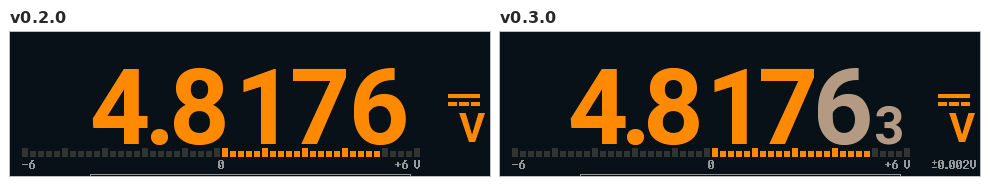
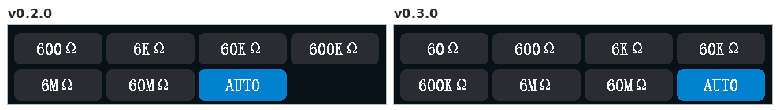
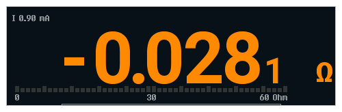
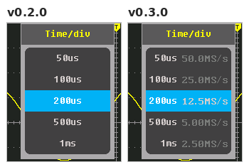
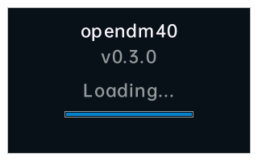
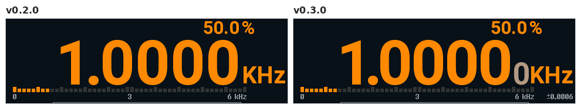

# Changelog

User-facing changes of opendm40 per release. The release workflow
([.github/workflows/release.yml](.github/workflows/release.yml)) uses the
section named after the tag as the release notes; how to cut a release:
[firmware/README.md, Releasing](firmware/README.md#releasing).

## Unreleased

### Fixed

- DMM trend chart: a range change to another unit that reads OL (6 V to
  600 mV on 3.3 V) starts the chart over in the new unit.

## v0.3.0 (2026-10-27)

### New

- **Accuracy of the reading** under the unit, from the DM40 manual for your
  model; digits finer than it are grey. Settings > More > More > Accuracy
  ([manual](docs/manual/README.md#accuracy)).

  

- **60 Ω range** with milliohm digits, on the range page and in AUTO
  ([manual](docs/manual/README.md#resistance)).

  

- **Negative ohm** (Settings > More > More): shorted leads read below zero
  instead of 0.000. SCPI `RESistance:NEGative`.

  

- **Scope:** the timebase list shows each entry's sample rate
  ([manual](docs/manual/README.md#timebase)).

  

- **Start-up:** a splash with the version and a progress bar; the meter page
  comes up in about 0.7 s instead of 4 s.

  

### Fixed

- **Scope did not turn on** (a flat trace at the bottom) after power-on with
  Analog power set to Both always or a start page other than Multimeter: the
  analog supply was switched wrongly. Switching to Auto or opening the scope
  then could turn the meter off.
- **Frequency:** 2 Hz and 5 Hz gave no reading; it now reads down to 0.5 Hz,
  with one more (small) digit where the counter allows it
  ([manual](docs/manual/README.md#frequency-and-duty-cycle)).

  

- **Generator:** after OFF and ON the sine, triangle and ramp stayed flat
  until a restart.
- **Continuity / diode:** touching the probes together no longer shows
  A-JACK.
- **Scope:** closing a popup is about 4x faster; the tap's beep is short
  again.
- **AC V:** the first readings after a range step on a signal with a DC part
  read high; they are grey until settled.
- A calibration record with a bad CRC is ignored, as the stock firmware does.
- Holding AUTO shows AUTO at once, not the last manual reading.
- The rate chip and the message after a tap on the reading show the new rate
  at once.

### Changed

- No logo in the status and title bars.

## v0.2.0 (2026-10-25)

### New

- Touch calibration: **Calibrate** on the touch test page (Settings > More
  > More > Touch test) fits a correction to taps on its nine targets,
  shows the remaining error and applies it on Save; kept in the settings.
  Without one the touch points are used unchanged, as the stock does
  ([manual](docs/manual/README.md#touch-calibration); `DBG:TOUCH:CAL`).
- Multimeter: a 60 mV range (on the range page, and first in the mV AUTO).
- Ohm and diode: the test current is shown next to the reading, from
  currents measured on the meter (e.g. 0.756 mA for the diode test).
- "Overload" is shown next to `0L`.
- Scope touch: the trigger-level marker sits on the graph's right edge and
  moves the trigger point; a press near a marker grabs the nearest one; a
  drag stays on one item and one axis; pinch modes with one step per 1.25x.
- Power meter: the wiring dialog draws the meter's jacks (VΩ / COM / A) and
  the current path through the meter.
- SCPI: IEEE 488.2 suffix multipliers, an error queue with codes
  (`SYSTem:ERRor?`), no reply to a query in a message with a bad set value;
  `LOG:FORMat ROWS|PACKed|DLG` for compact `LOG:DATA?` replies
  ([SCPI reference](docs/manual/scpi-reference.md)).
- The settings are kept in `_SETTING.BIN` on the internal disk.
- The version comes from one place, `firmware/Cargo.toml`: `*IDN?`,
  Settings > Device, the USB disk texts, the CSV headers and the install
  file `dm40_opendm40_v<version>.bin` show the same string.
- Settings > More > More > Touch test: a page that shows every touch the
  controller reports, the points after the debounce and the touch keys,
  against crosshair targets, to check the touch calibration
  ([manual](docs/manual/README.md#touch-test)).

### Changed

- USB ID `1209:D040` (opendm40's own PID under the pid.codes VID) instead
  of the pid.codes test ID `1209:0001`; udev rules and VISA resource
  strings change accordingly. The host tools accept both.
- Multimeter rate (DC V, mV, A and Ω): every rate now rejects 50 Hz and
  60 Hz hum. FAST: 10 readings/s (Ω 5/s); in DC V / mV / A the converter
  runs without its chopper and the meter measures its offset itself (2 s
  after a change, then every 30 s; two readings skipped each time). MED: 5
  readings/s (Ω 2.5/s as before), the extra digit after 1.6 s. SLOW: 2.5
  readings/s. Before,
  FAST and MED ran a 50 ms conversion that did not reject 50 Hz
  ([manual](docs/manual/README.md#rate-fast-med-slow)).

- Resistance: the 60 Ω range is removed (the range page, the AUTO key cycle;
  `RES:RANG 60` and `RES:RANG MIN` select 600 Ω). It read about 2.7 % low
  against the 600 Ω range for a reason not known, and its entry in the
  calibration record is not a calibration. The lowest range is 600 Ω, as on
  the stock firmware.
- Multimeter AUTO key (voltage, current, resistance): a short press fixes
  the present range, then steps to the next higher range, wrapping from the
  highest to the lowest; held 1 s it returns to the default autorange
  (AUTO+ on volts). It still clears HOLD and REL; AutoHold stays on.
- Multimeter: with a fixed range the status bar shows the range (e.g.
  **6V**, **600mV**, **6000uA**, **6KΩ**) instead of **MANU**, as the stock
  firmware does; the meter strip's badge too.
- A power-off starts a new measurement: DC V, and the measurement settings
  (ranges, AutoHold, limits, rate, the scope's acquisition and trigger, the
  power meter, the Record page) at their defaults; the preferences are kept.
  A reset or a firmware update continues the measurement.
- The version is shown with three parts (`0.1.0`, `dm40_opendm40_v0.1.0.bin`,
  tag `v0.1.0`).
- The firmware is named opendm40 everywhere (device strings, image name).
- The "Leads in A jack? Move to V" reminder is removed.
- AUTO+ chosen on a mV range leaves mV at once for the 6 V range; AC mV steps
  up on a clipped input.
- Auto power-off: USB disk reads and writes count as host activity; the
  screen dims on input only.
- Wave view: the timebase starts at 1 ms/div. Scope: CH1 Type is removed.
- Wave view: V/div steps with one full-scale step per range (± the range on
  the 8 divisions: 1.5 V/div on 6 V, 15 V/div on 60 V, 2.5 A/div on 10 A)
  and 1-2-5 steps between that only rescale the screen; the range changes
  only where a step needs it. The pinch and AUTO work in the Wave view; 60 mV
  is in its list.

### Fixed

- Touch: a read of the touch controller while its INT line is still low
  returned the cleared buffer (status 0xAB), which was taken for a press of
  the MENU key between the real frames; taps were lost and keys mixed up.
  Such a read is now "no new data", as the stock reads only on INT edges.
- Side keys: a key pressed right after another one (within ~40 ms of its
  release, or with the release report lost) acted as the earlier key, and
  RUN's release was then never seen, so AutoHold turned on by itself 1 s
  later (AUTO after RUN gave HOLD and A-HOLD). Each key now reports its own
  release and press.
- Bluetooth: the module's start-up banner and its own text no longer reach
  the SCPI parser as commands; a host's first command right after the
  module starts is answered.
- No false A-JACK warning from a voltage on V-COM in ohm, continuity, AC mV
  and AC+DC mV (also after the source is switched off with the input left
  open), nor from a source on V-COM in resistance.
- RES AUTO: no endless range hunt; `FETCh?` answers `+9.91E37` right after an
  autorange step.
- SCPI numbers: `nr3` and powers of ten print exact values
  (`VOLT:RES?` gives `+9.999999E-06`).
- `MMEM`: a directory prefix must be the file's own directory; a host's
  `MMEM:DATA?` no longer stalls the Wave view's stream.
- First readings after a function change: every entry is checked; AC A too.
  AC V / mV: the first reading after the entry no longer comes from a
  conversion that began before the AC input was there (DC V -> AC V read
  1/√2 of a square), nor 0 or 1 % low after an autorange step.
- Inrush page: the zero is measured at the arm ("Armed: 0.069 A now" with
  nothing in A; the idle and the results were 0.07 A off).
- Logger: one 76.8 kS/s nominal rate; no hole in the panel at the 76.8 kS/s
  start.
- The 6 M ohm test-current label is cleared on 60 M.
- Scope: the trigger-level marker follows a drag more closely (each step
  repaints its guide line as whole rows, the marker before the trigger
  badge).
- AUTO from a manual range (the AUTO key, the range page, SCPI
  `<f>:RANG:AUTO ON` / `CONF:<f>`): the status bar shows AUTO at once and the
  readout dimmed dashes until AUTO's first reading, as after a function
  change. Before, the manual range's last value stayed with MANU until then
  (RES: through the whole autorange). Where AUTO stays on the manual range,
  the dashes now show until the next conversion.
- `DBG:SENT?` fields 14 / 15 (jack check verdict, OP1O peak): -1 / 0 after a
  range or function change and once the hit run is over (they kept the last
  verdict; after a source on V-COM goes off field 14 now goes to -1, not 1).
  `DBG:READout?` has a fifth field, the status bar's AUTO / AUTO+ / MANU.

### Docs

- A user manual in one file with a picture in every section
  ([docs/manual/README.md](docs/manual/README.md)); the root README is the
  front page with install, backup and recovery ([README.md](README.md)).
- Measured ohm test currents and the HY3131 node behaviour
  ([hw/README.md](hw/README.md)); copying `DEBUG/SPIFLASH.BIN` on Linux.
- Finished logs and investigations moved to [docs/history/](docs/history).

### Tools

- [`firmware/tools/reload.sh`](firmware/tools/reload.sh): the first upload no
  longer fails on an earlier client's error.
- [`firmware/tools/dm40scpi.py`](firmware/tools/dm40scpi.py) `log --format
  rows|packed|dlg`; [`firmware/tools/srcmap.py`](firmware/tools/srcmap.py)
  sweeps the `DBG:SRC` taps into a CSV;
  [`firmware/tools/linkcheck.py`](firmware/tools/linkcheck.py) checks the
  Markdown links.
- CI and releases on GitHub Actions ([.github/workflows/](.github/workflows)).
- `DBG:GENUINE?` (the stock genuine-device check, debug only) and
  `dm40dbg.py genuine` are removed.

## v0.1-pre1 (2026-10-24)

First pre-release ([release page](https://github.com/opendm40/opendm40/releases/tag/v0.1-pre1)),
published by hand. Its `*IDN?` and Device page show `0.0.1` (the crate
version then). The version scheme of
[Releasing](firmware/README.md#releasing) starts with the next release.
