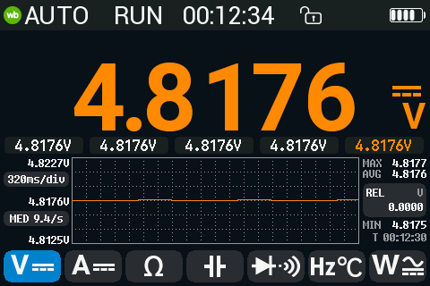
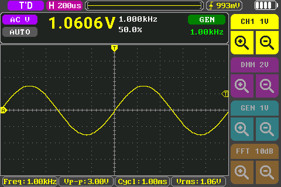
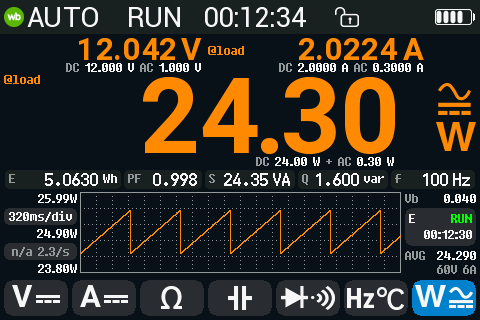
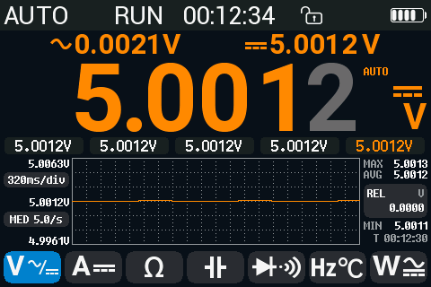
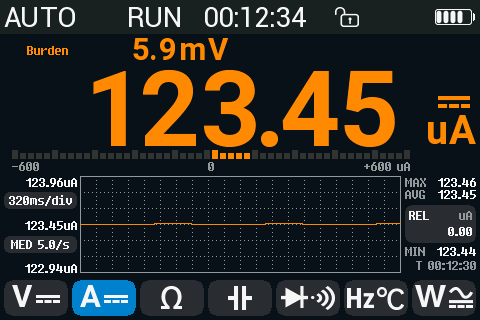
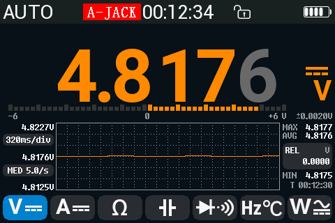
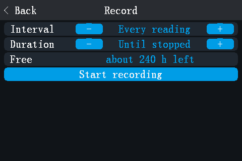

# opendm40: open firmware for the Alientek DM40

opendm40 is a replacement firmware, written in Rust, for the Alientek DM40
(DM40A / DM40B / DM40C) multimeter, oscilloscope and signal generator
(GD32F427, Cortex-M4F). The multimeter, the scope and the generator run at
the same time; you only switch what the screen shows. It keeps the stock look
and touch model and adds a power meter, data logging, USBTMC/SCPI and more.
It installs like a stock update file and leaves the vendor bootloader, the
vendor update loader and the calibration untouched.

**Status: experimental.** Developed and tested on one DM40A. DM40B and DM40C
ran only in the emulator. In the table, *device* means checked on that DM40A
([device check log](firmware/docs/device-check-2026-10-21.md)); *emulator* means
checked only in the emulator or in host tests.



## Features

| Feature | What it does | Checked |
|---|---|---|
| Multimeter | All 16 stock functions. 60000-count ranges and AC+DC on every model. HOLD, AutoHold, REL, MIN/MAX/AVG, limits, trend chart, bargraph. | device |
| DMM + scope at once | Combined view: the DMM reading in a strip above the live scope. | device |
| Scope | Stock timebases and V/div, Auto/Normal/Single, hardware trigger, 20 measurements, FFT, Save CSV; pulse and runt trigger, cursors. | device; pulse / runt trigger and cursors: emulator |
| Generator | Sine, triangle and ramp up to 50 kHz, square up to 10 MHz, DC offset; keeps running on every page. | ran on the device; output not measured there |
| Power meter (W) | V and I at the same time: P, S, Q, PF, f, Wh, VAh. DC, AC or AC+DC coupling, with the DC and AC parts. | device without current; with current: emulator |
| AUTO AC/DC | Shows the DC or the AC part, whichever the signal is. | device on V; on A: emulator |
| Inrush current | 10 A range: triggers on a current step, shows the RMS of the first 100 ms and the peak, saves the trace. | emulator |
| Burden voltage | Voltage drop across the shunt in the A / mA / uA functions (off by default). | device without current |
| Misconnect alerts | A-JACK (current in the A jack while measuring volts), A-PROT, "Leads in A jack?" reminder, fuse check. A-JACK, A-PROT and a current above 10 A sound a loud two-tone alarm, also at volume 0 (Settings: Danger alarm Loud / Volume / Off; tap the badge or press a key to silence it). | reminder: device; A-JACK / A-PROT and the alarm: emulator (no current through A on the device yet); fuse check: not yet |
| Record page | Logs the DMM to the internal disk: every reading, or the mean per 1 s / 10 s / 1 min, until stopped or for 10 min .. 24 h. | device |
| Fast logger | Raw ADC samples to the disk at up to 38.4 kS/s (76.8 kS/s if the SPI flash is fast enough). | device up to 38.4 kS/s; 76.8 kS/s: emulator |
| USB disk | Read-only drive with `LOGS/`, `SCOPE/`, `SHOTS/` (CSV and BMP files) and `INFO/` (calibration copy, running firmware). New files appear while it is mounted. Optional "PC can edit" mode: delete files, drop in an update file. | device (Linux); Windows 11 read-only (VM); macOS untested |
| USBTMC / SCPI | 34401A-style `CONF` / `MEAS?` / `READ?`, plus the scope, the generator, the power meter and the loggers. | device |
| sigrok | A libsigrok `scpi-dmm` profile for the DM40 (not upstream yet); a 34401A emulation for unpatched sigrok / SmuView. | profile: device (sigrok-cli, every selectable function); emulation: emulator |
| Bluetooth | The stock phone-app protocol, plus SCPI over the same link. | device |
| Screenshots, gallery | 3-finger swipe saves a BMP (as on stock); a gallery shows screenshots and logs on the meter. | device |

| | | |
|---|---|---|
|  DMM + scope, generator on |  Scope with FFT |  Generator |
|  Power meter, AC+DC parts |  AUTO AC/DC |  Inrush current |
|  Burden voltage |  A-JACK alert |  Record page |

The screens are renders of the firmware's own drawing code with synthetic
values (`firmware/tools/ui-render/run.sh OUT --readme`), not photos.

Known open issues ([firmware/TODO.md](firmware/TODO.md)): with 5-10 V on V-COM, the ohm and
temperature functions can show a false A-JACK. While the scope is powered
(combined view, scope page), a fast square on the DMM input reads about
0.2 % high. In the combined view, power units are clipped ("mW" looks like
"mV").

## Differences from the stock firmware (V2.6)

| | Stock | opendm40 |
|---|---|---|
| Instruments | One at a time (the generator keeps running with the scope) | DMM, scope and generator together; combined view |
| Ranges | By model: 400 mV, 4 V ... (A), 500 mV ... (B), 600 mV ... (C) | 600 mV, 6 V ... (60000 counts) on every model |
| AC+DC | DM40B / C only | Every model |
| Power meter, inrush, burden, AUTO AC/DC, misconnect alerts | No | Yes |
| Data logging | No | Record page, fast logger |
| USB | Mass storage ("USB Connect") | USBTMC/SCPI + a generated drive with CSV files |
| Bluetooth | Phone-app protocol | Same, plus SCPI |
| Languages | Chinese (simplified, traditional), English | English only |

Item by item: [firmware/docs/parity.md](firmware/docs/parity.md).

## Install

Back up first: see [Back up with opendm40](#back-up-with-opendm40). Charge the
battery.

1. Build `opendm40.bin` ([firmware/README.md, Build](firmware/README.md#build)).
2. On the stock meter: Settings > Other Settings > USB Connect.
3. Copy the file onto that USB disk as `dm40_fwrs.bin`, as the only
   `dm40*.bin` there ([why](#recovery)). Eject.
4. Power the meter off and on (a cold boot): the stock update procedure.
   `firmware/tools/reload.sh --from-stock` stages the file for you and waits for opendm40.
5. **The first boot is dark for a few seconds.** Do not power-cycle in the
   first 10 s.

Tested: opendm40 installs from a running opendm40 ([`firmware/tools/reload.sh`](firmware/tools/reload.sh))
and from the vendor loader's update screen. Steps 2-4 were used on this meter
with a stock-size image (the patched stock of the memrw kit) but **not yet
with an opendm40 image**. The stock app can also flash a `dm40*.bin` from its
disk by itself when USB is unplugged; that is not checked for an opendm40 image
either. If the meter stops on the loader's update screen, copy the file onto
the loader's USB disk and press "update" (see [Recovery](#recovery)).

**USB on a PC.** The drive needs no driver. After Eject it stays ejected
until the cable is re-plugged. SCPI is USBTMC: Linux has a driver, Windows
has none (the interface sits under "Other devices", code 28). On Windows,
install NI-VISA or Keysight IO Libraries, or bind WinUSB with Zadig and use
pyvisa-py ([firmware/docs/bt-scpi.md](firmware/docs/bt-scpi.md#usbtmc-on-windows)).
Each meter has its own serial number: the chip's unique ID as 24 hex
digits (USB serial, the disk's SCSI serial, the third field of `*IDN?`; the
same digits as `INFO/UID.BIN`). Two meters on one PC are two drives
([firmware/docs/native-boot.md](firmware/docs/native-boot.md#usb-serial-number-srcuidrs)).

## Back up with opendm40

- **Installing opendm40 first is safe.** The vendor FS-loader rewrites only the
  application area from `0x08004000`. The Alientek bootloader (`0x08000000`),
  the FS-loader (`0x080A0000`), its UID-bound boot data (`0x080A4000`) and the
  calibration record (`0x080C0000`) are not touched
  ([firmware/docs/native-boot.md](firmware/docs/native-boot.md)). opendm40 reads the
  calibration in place and never writes it.
- **Then copy to the PC**, from the opendm40 USB drive:
  - the whole `INFO/` folder (read-only, generated from the MCU memory):

    | File | What |
    |---|---|
    | `CALIB.BIN` | settings + calibration record, `0x080C0000`, 4 KiB. **Unit-specific** |
    | `BOOTDATA.BIN` | UID-bound FS-loader data, `0x080A4000`, 16 KiB. **Unit-specific** |
    | `UID.BIN` | the chip's 96-bit unique ID; says which unit the boot data belongs to. **Unit-specific** |
    | `ROMBOOT.BIN` | the Alientek bootloader, `0x08000000`, 16 KiB |
    | `LOADER.BIN` | the FS-loader incl. the boot data, `0x080A0000`, 128 KiB |
    | `OPTBYTES.BIN`, `OTP.BIN` | option bytes, OTP area |
    | `FIRMWARE.BIN` | the running firmware as a vendor update file |
    | `BACKUP.TXT` | addresses, sizes, CRC-32s and the restore notes |

  - `DEBUG/SPIFLASH.BIN`: the raw 16 MiB SPI flash (the meter's own disk).

  `CALIB.BIN`, `BOOTDATA.BIN` and `UID.BIN` cannot be rebuilt: no update
  file contains them. opendm40 also writes one copy of these three files, once
  and never overwritten, to the root of its internal SPI-flash disk
  ([`firmware/src/calbackup.rs`](firmware/src/calbackup.rs)), because the SPI flash
  survives an SWD mass erase of the MCU.
- **Full restore after an SWD mass erase** (from `BACKUP.TXT`): write
  `ROMBOOT.BIN` at `0x08000000`, then `LOADER.BIN` at `0x080A0000` and
  `CALIB.BIN` at `0x080C0000`, then install a firmware. The loader data only
  works on the unit whose `UID.BIN` it was made with.
- Keep backups off the meter. Dumps contain personal data (calibration, chip
  UID, boot data): keep them in `private/` or `stock/re/dumps/` (both
  ignored by git); never commit them.

## Recovery

An update only rewrites the application area. The vendor bootloader and the
vendor update loader stay, so a bad image cannot brick the meter: after a
failed or bad file, the loader shows its update screen with a working USB
disk on every boot until a good file is installed.

To reach the update screen:

- `python3 firmware/tools/dm40dbg.py update` (`DBG:UPDATE`) while opendm40 answers on USB;
- with opendm40's drive in "PC can edit" mode (Settings 3/3, "USB disk"), copy a
  `dm40*.bin` onto it and answer "Install it now?" with Yes: opendm40 hands that
  file to the loader directly;
- from off, hold the power key ~5 s: the screen lights, ~4 s later the
  backlight blinks and it beeps; keep holding at least 0.5 s after the beep.
  Letting go during those 0.5 s cancels (normal start). Checked in the
  emulator ([`emu/recoverytest.py`](emu/recoverytest.py)), not yet on the device;
- automatically after a second hang (watchdog reset) before opendm40 has run
  60 s since the first one: the first hang only reboots opendm40, a second one
  with less than 60 s of running in between opens the update screen. Each
  watchdog reset comes ~20 s after the hang, so the two resets can be up to
  ~80 s apart. Checked in the emulator, not yet on the device;
- if opendm40 is too broken for any of these, whatever the firmware does: open
  the case and short the debug header's TX pad (PA2) to GND at power-on, see
  [hw/README.md, Hardware recovery](hw/README.md#hardware-recovery).

Then copy a good image onto the loader's disk as `dm40_fwrs.bin` and press
"update". The loader deletes the file after a successful install.
`INFO/FIRMWARE.BIN` on the opendm40 USB drive is the running image as an update
file; keep a copy.

**One update file at a time.** Keep exactly one `dm40*.bin` on the disk: the
loader installs the first match in directory order (not the newest, no
version check), so a second file can install the wrong image
([firmware/docs/fsloader-install-trigger.md](firmware/docs/fsloader-install-trigger.md)). The
stock firmware also installs any `dm40*.bin` it finds on its USB disk, so do
not leave files with that name there by accident.

**Back to stock:** copy the official
[`dm40_v_2_6.bin`](stock/vendor/dm40_v_2_6.bin)
onto the loader's disk and press "update", or run
`firmware/tools/reload.sh --stock FILE` while opendm40 runs (tested with a patched stock
image). Design and rationale: [firmware/docs/native-boot.md](firmware/docs/native-boot.md).

## Build and develop

[firmware/README.md](firmware/README.md): build, toolchain, source layout,
host tools and the index of the firmware docs. The emulator
([emu/README.md](emu/README.md)) runs both the stock firmware and opendm40.

## Supporting material

| Path | What |
|---|---|
| [stock/](stock/README.md) | Stock-firmware tooling: [`dm40fw.py`](stock/dm40fw.py) (update file decode / encode / pack incl. header CRCs), [`merge_boot.py`](stock/merge_boot.py) |
| [stock/patch/](stock/patch/AGENTS.md) | Patch kit for the stock firmware (BT memory read/write, USB live stream); needs `gcc-arm-none-eabi`, `make`, `zip` |
| [stock/patch/kit/](stock/patch/kit/README.md) | memrw backup kit: [`dm40_memrw.py`](stock/patch/kit/tools/dm40_memrw.py), tests, [`mkkit.sh`](stock/patch/kit/mkkit.sh) (builds `dist/`) |
| [stock/re/](stock/re/README.md) | Reverse-engineering notes on the stock firmware V2.6, the bootloader and the update format ([ANALYSIS.md](stock/re/ANALYSIS.md), `analysis/*.h`), capstone helpers, Ghidra scripts |
| [stock/vendor/](stock/vendor/README.md) | The latest official stock firmware, [`dm40_v_2_6.bin`](stock/vendor/dm40_v_2_6.bin) (Alientek's, unmodified, not under the MIT licence) |
| [hw/](hw/README.md) | Hardware: chips, pins, front ends, power; teardown photos ([`hw/photos/`](hw/photos)) and datasheets ([`hw/datasheets/`](hw/datasheets)) |
| [emu/](emu/README.md) | Renode emulator of the DM40 (stock firmware and opendm40) |
| [docs/bt-protocol.md](docs/bt-protocol.md) | Bluetooth protocol of the stock DM40 (opendm40 keeps it) |
| [docs/dm40-feature-request.md](docs/dm40-feature-request.md) | DM40C feature request and UX gap analysis (Russian) |
| [docs/history/](docs/history/README.md) | Archived plans, reviews and handover notes (done or superseded) |

The vendor update file returns a meter to stock and feeds the emulator and
the stock-firmware tools. Older versions live in `wirenboard/alientek-dm40-tools`
(`vendor/`). The Android app and the manuals are not in this repo.
`emu/run.py stock` and [`firmware/tools/mkstockfont.py`](firmware/tools/mkstockfont.py) need the decoded body at
the repo root (ignored by git):

```
python3 stock/dm40fw.py decode stock/vendor/dm40_v_2_6.bin dm40_v_2_6.dec.bin
```

Bluetooth tools need a Python with `AF_BLUETOOTH` sockets
(`/usr/bin/python3` on Linux; the linuxbrew one has none).

## License

MIT, see [LICENSE](LICENSE). [`stock/re/`](stock/re) and [`stock/patch/`](stock/patch) contain
addresses, symbols and decompiled code of the vendor firmware. The vendor
update file in [`stock/vendor/`](stock/vendor/README.md) is unmodified
and under its own notice. [`firmware/fonts/`](firmware/fonts) carries its own font
license.

[`hw/photos/`](hw/photos) and [`hw/datasheets/`](hw/datasheets) are third-party material under their
owners' copyright (the review author, the chip manufacturers), kept for
reference and not covered by the MIT license; see [hw/photos/README.md](hw/photos/README.md),
[hw/datasheets/README.md](hw/datasheets/README.md) and [stock/vendor/README.md](stock/vendor/README.md).
