[English](README.md) | [Русский](README.ru.md) | **中文**

> 本页是 [README.md](README.md) 的机器翻译，尚未经中文母语者审校；以英文版为准。

# opendm40

Alientek（正点原子）DM40 万用表、示波器和信号发生器（DM40A、DM40B、DM40C）的开源替代固件。

万用表、示波器和发生器同时运行；屏幕只决定你看到哪一个，组合视图则在实时示波器上方显示万用表读数。opendm40 保留原厂的外观和触摸操作，并增加了功率计、涌流捕获、接错线告警、数据记录、通过 USB（USBTMC / SCPI）和蓝牙的远程控制，以及一个 U 盘，其中的记录和截图以 CSV 和 BMP 文件提供。

它的安装方式与原厂升级文件相同，不改动 Alientek 的 bootloader、升级加载器和表的校准，所以随时可以回到原厂固件。

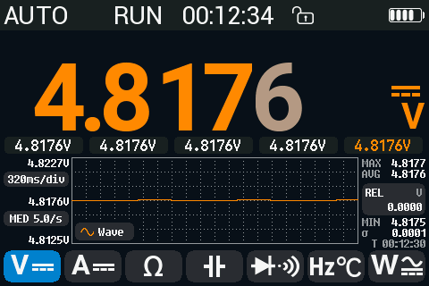

*DM40A 上的 opendm40：万用表页面。*

## 状态

实验阶段。在 DM40A 上开发，并在 DM40A、DM40B 和 DM40C 上测试。所有尚未在实机上运行过的内容，主要是 A 插孔有电流的所有情况，都列在手册的[已知限制](docs/manual/README.zh.md#已知限制)中。对照校准器测得的准确度（DC V、DC A、频率、电阻）：[firmware/docs/data](firmware/docs/data/README.md)（英文）。

下载：[Releases](https://github.com/opendm40/opendm40/releases)。各版本的变更：[CHANGELOG.md](CHANGELOG.md)（英文）。

## 功能

| | |
|---|---|
| 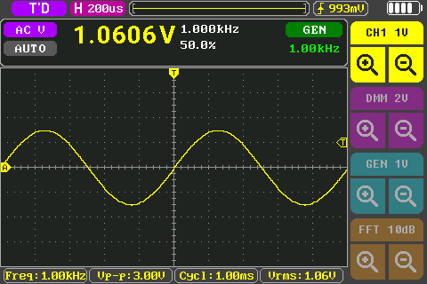 | 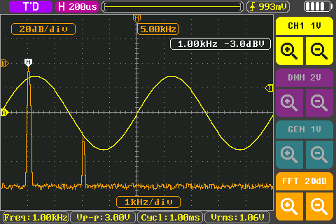 |
| 万用表和示波器同时运行 | 示波器：硬件触发、20 项测量、FFT、光标、Save CSV |
| 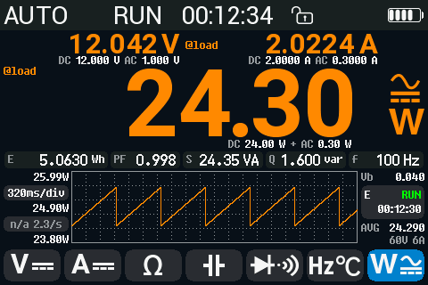 | 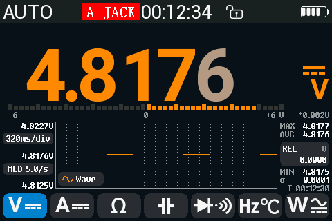 |
| 功率计：P、S、Q、PF、f、Wh，DC、AC 或 AC+DC 耦合 | 接错线告警，危险连接时发出响亮警报 |
| 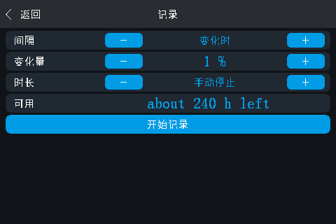 | 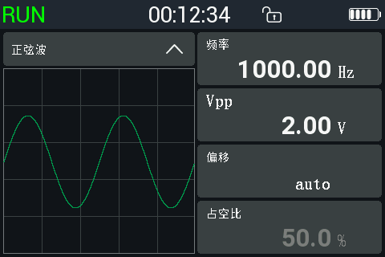 |
| 记录到内部磁盘，通过 USB 以 CSV 读取 | 发生器，在所有页面上运行 |
| 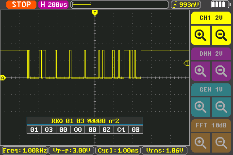 | 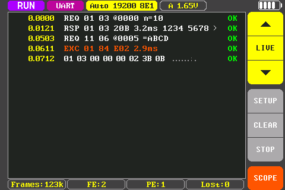 |
| 协议解码器：UART 和 DALI；通过 CRC 识别 Modbus RTU 帧 | 帧日志：运行中数据流的每一帧，带时间和状态 |
| 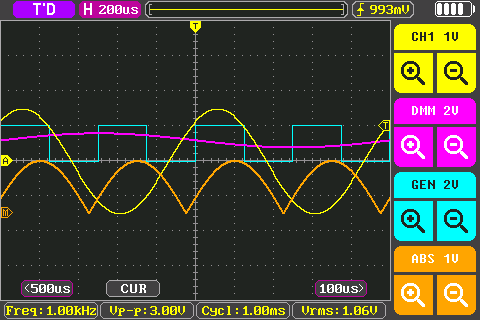 | 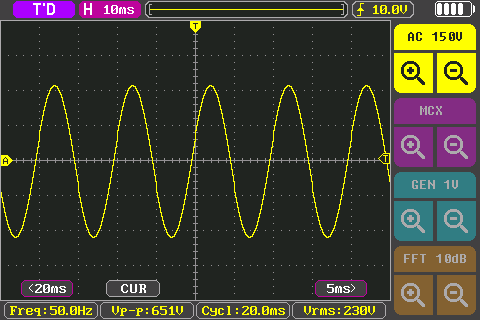 |
| 示波器通道：CH1、万用表作为 CH2、发生器波形、数学 | Wave 视图：万用表插孔上的波形，隔离 |

- **万用表**：全部 16 个原厂功能；所有型号都有 60000 计数量程和 AC+DC；AUTO AC/DC；HOLD、AutoHold、REL、MIN/MAX/AVG、限值、趋势图；负担电压。
- **示波器**：原厂的时基和 V/div，Auto / Normal / Single，边沿、脉宽和 Runt 触发；2 和 5 mV/div；发生器可作为触发源和波形；万用表作为 CH2；带帧日志的协议解码器（UART 含 Modbus RTU、DALI）；万用表插孔上隔离的慢速 Wave 视图。
- **发生器**：正弦波、三角波和锯齿波最高 50 kHz，方波最高 10 MHz，直流偏置。
- **功率计和涌流**，在 10 A 量程上。
- **数据**：Record 页、原始采样的快速记录（最高 38.4 kS/s）、截图和屏幕图库。
- **电脑**：无需驱动的 U 盘；34401A 风格的 USBTMC / SCPI；通过蓝牙的 SCPI 和原厂手机 App 协议；libsigrok 配置文件（尚未进入上游）和用于未打补丁 sigrok 的 34401A 模拟。

与原厂固件相比的新功能（逐项列出），以及原厂固件有而 opendm40 没有的功能（简而言之：菜单只有英文）：[手册，新功能](docs/manual/README.zh.md#与原厂固件相比的新功能)。与原厂固件 V2.6 的逐项对照：[parity.md](firmware/docs/parity.md)（英文）。

## 安装

你需要一台运行原厂固件的 DM40、一根 USB 线和充好电的电池。

1. 从最新的 [release](https://github.com/opendm40/opendm40/releases/latest) 下载 `dm40_opendm40_v<version>.bin`（旁边有 `SHA256SUMS`），或自行构建（[firmware/README.md，Build](firmware/README.md#build)，英文）。
2. 在表上：**设置 > Other Settings > USB Connect**，然后接上 USB 线。出现一个 U 盘。
3. 把文件复制上去，作为盘上唯一的 `dm40*.bin` 文件。弹出 U 盘。
4. 关机再开机。原厂升级流程会安装这个文件。第一次启动需要几秒钟（opendm40 显示进度条）：前 10 秒内不要关机。
5. 备份你的表：把 opendm40 U 盘上的 `INFO/` 文件夹复制到电脑并保存（[备份](#back-up-with-opendm40)）。

带图片的相同步骤，以及在运行中的 opendm40 上升级：[手册，快速上手](docs/manual/README.zh.md#快速上手)。

## 备份、恢复和回退原厂固件

升级只重写表内存中的固件部分。错误的升级文件不会让表变砖：此时升级加载器显示升级界面和自己的 U 盘，直到装上正确的文件。

- **备份**：安装后立即复制 opendm40 U 盘上的 `INFO/` 文件夹。它保存这台表的校准和启动数据，这些内容不包含在任何升级文件中（[其中有什么](docs/manual/README.zh.md#备份你的表)）。
- **回退原厂**：用同样的方法安装官方的 [`dm40_v_2_6.bin`](stock/vendor/dm40_v_2_6.bin)。你的校准从未改变。
- **如果 opendm40 不启动**：在关机状态下按住电源键，直到表蜂鸣，再按住半秒，然后从升级加载器安装文件；或者打开外壳使用调试接口（[进入升级加载器](docs/manual/README.zh.md#进入升级加载器)）。

分步说明：[手册，备份、恢复和回退原厂固件](docs/manual/README.zh.md#备份恢复和回退原厂固件)。

## 安全和保修

- opendm40 是实验性软件，**不提供任何保证**（[LICENSE](LICENSE)）。安装它可能使厂商保修失效。
- 它未经认证。表的安全额定值来自其硬件和 Alientek 的用户手册；opendm40 不改变输入保护和额定值。请遵守 Alientek 用户手册中的安全规则和限值。
- 接错线告警依据表测到的结果工作，不可能发现所有错误（[无法检测的情况](docs/manual/README.zh.md#无法检测的情况)）。不要依靠它们保障你的安全。

## 从电脑使用

表显示为一个 U 盘（无需驱动）和一台 USBTMC 仪器。[在 Linux、Windows 和 macOS 上连接，PyVISA、sigrok、蓝牙](docs/manual/README.zh.md#远程控制和电脑连接)；所有命令：[SCPI 参考](docs/manual/scpi-reference.md)（英文）。

## 文档

- [用户手册](docs/manual/README.zh.md)
- [SCPI 参考](docs/manual/scpi-reference.md)（英文）
- 开发者文档、硬件、模拟器和归档文档：[docs/README.md](docs/README.md)（英文）

## 构建和开发

固件用 Rust 为 GD32F427（Cortex-M4F）编写。构建、调试连接、测试和发布：[firmware/README.md](firmware/README.md)。[模拟器](emu/README.md)无需实机即可运行 opendm40 和原厂固件。已知的硬件信息：[hw/README.md](hw/README.md)。原厂升级文件的工具：[stock/README.md](stock/README.md)。错误报告和 pull request：[CONTRIBUTING.md](CONTRIBUTING.md)。以上文档均为英文。

## 发布

版本遵循 [Semantic Versioning](https://semver.org/)，发布在 [GitHub Releases](https://github.com/opendm40/opendm40/releases) 上，附带安装文件 `dm40_opendm40_v<version>.bin`；各版本的变更见 [CHANGELOG.md](CHANGELOG.md)，规则见 [firmware/README.md，Releasing](firmware/README.md#releasing)（英文）。

## 许可证

opendm40 采用 MIT 许可证（[LICENSE](LICENSE)），© opendm40 贡献者。

不属于 MIT 许可证的内容：

- [`stock/vendor/dm40_v_2_6.bin`](stock/vendor/README.md)：Alientek 未经修改的升级文件，保留用于把表恢复到原厂固件。
- 原厂固件 V2.6 的点阵字体，opendm40 把它们复制到固件映像中以保持原厂外观（[`firmware/src/stockfont_data.rs`](firmware/src/stockfont_data.rs)，[制作方法](firmware/docs/fonts.md)）。
- [`hw/photos/`](hw/photos/README.md) 和 [`hw/datasheets/`](hw/datasheets/README.md)：第三方资料，版权归其所有者（评测作者、芯片厂商），仅供参考。

[`stock/patch/`](stock/patch) 包含原厂固件 V2.6 的地址和符号名称。

Alientek 和 DM40 的名称属于其所有者，这里仅用于标识硬件。opendm40 与 Alientek 没有关联，也未获其认可。
