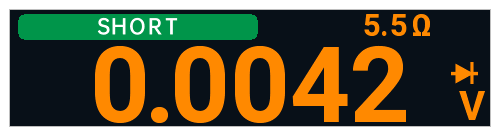

# opendm40 v0.4.1

Перевод [заметок к выпуску v0.4.1](https://github.com/opendm40/opendm40/releases/tag/v0.4.1). [English](https://github.com/opendm40/opendm40/releases/tag/v0.4.1) · [中文](RELEASE.zh.md)

opendm40 v0.4.1 — замена прошивки для Alientek DM40 (A / B / C), собрана CI из коммита 2cf3b7f.

**Сначала резервная копия:** после установки скопируйте `INFO/` и `DEBUG/SPIFLASH.BIN` с USB-диска прибора на компьютер; калибровку и загрузочные данные восстановить нельзя ([Резервная копия](https://github.com/opendm40/opendm40/blob/v0.4.1/docs/manual/README.ru.md#резервная-копия)).

**Установка:** скопируйте `dm40_opendm40_v0.4.1.bin` на USB-диск прибора так, чтобы это был единственный файл `dm40*.bin`, выключите и включите прибор; первый запуск занимает несколько секунд ([Установка](https://github.com/opendm40/opendm40/blob/v0.4.1/README.ru.md#установка)).

**Восстановление и возврат к штатной прошивке:** неудачный образ не превратит прибор в кирпич: экран обновления в загрузчике производителя примет исправный файл ([Резервная копия, восстановление и возврат к штатной прошивке](https://github.com/opendm40/opendm40/blob/v0.4.1/docs/manual/README.ru.md#резервная-копия-восстановление-и-возврат-к-штатной-прошивке)); официальный [`dm40_v_2_6.bin`](https://github.com/opendm40/opendm40/blob/v0.4.1/stock/vendor/dm40_v_2_6.bin) возвращает штатную прошивку.

Руководство: [docs/manual/README.ru.md](https://github.com/opendm40/opendm40/blob/v0.4.1/docs/manual/README.ru.md). `SHA256SUMS`: sha256 образа.

## Изменения

Выпуск с исправлениями: обновление или перезапуск со страницы осциллографа
или генератора больше не выключает прибор; ёмкость измеряется при зарядке
по USB; предупреждение о разряде и выключение при пустой батарее; меню MF
осциллографа не оставляет следов; множитель щупа сохраняется.

Надписи на экране в 0.4.1 английские, ниже они даны как на приборе.

### Исправлено

- Обновление прошивки или перезапуск со страницы осциллографа или
  генератора могли выключить прибор; теперь он перезапускается так же, как
  со страницы мультиметра.
- **Ёмкость при зарядке от ноутбука по USB:** сетевые пульсации больше не
  гоняют большой конденсатор (примерно 50–600 мкФ) между диапазонами с
  «Discharging...» и неверным значением; при слишком сильных пульсациях —
  прочерки и **Unstable: unplug USB?** (с пульсациями проверено только в
  эмуляторе; [руководство](https://github.com/opendm40/opendm40/blob/v0.4.1/docs/manual/README.ru.md#ёмкость)).
- **Разряд батареи:** сообщение **Low battery! Please charge** на 3 с и
  сигнал примерно при 17 % и 8 %, красный значок батареи; ниже примерно 1 % —
  обратный отсчёт 30 с и аккуратное выключение. При питании от USB не
  срабатывает ([руководство](https://github.com/opendm40/opendm40/blob/v0.4.1/docs/manual/README.ru.md#питание-аккумулятор-и-сон)).
- **Заряд батареи на зарядке:** не прыгает вверх при подключении; растёт
  медленно, вместе с настоящим зарядом.
- **Осциллограф:** меню MF не оставляет пикселей на правой панели, и после
  смены вкладки панель больше не рисуется поверх меню.
- **Осциллограф:** множитель щупа сохраняется после выключения и при
  выключенном Mode Remember.
- **Осциллограф:** значок триггера сразу принимает цвет нового источника.
- **Диод:** сопротивление остаётся на экране, пока горит полоса SHORT / BEEP
  (0.4.0 скрывала его ниже 22 мВ).

  
- **Кнопки функций:** V и A показывают запомненный DC / AC / AC+DC / AUTO;
  прозвонка / диод и Hz / °C ставят запомненный подрежим первым.

  
- **Ваттметр из совмещённого вида:** подсказка о подключении возвращает в
  совмещённый вид, а не на страницу мультиметра.

### Изменено

- **Мультиметр:** показание с дополнительной цифрой сдвинуто на 4 пикселя
  вправо.

**Все изменения:** https://github.com/opendm40/opendm40/compare/v0.4.0...v0.4.1
