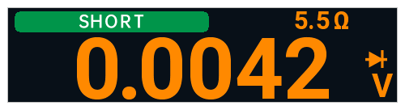

# opendm40 v0.4.1

[v0.4.1 发布说明](https://github.com/opendm40/opendm40/releases/tag/v0.4.1)的中文译本（机器翻译，尚未经母语者审校）。[English](https://github.com/opendm40/opendm40/releases/tag/v0.4.1) · [Русский](RELEASE.ru.md)

opendm40 v0.4.1 是 Alientek DM40（A / B / C）的替代固件，由 CI 从提交 2cf3b7f 构建。

**先备份：** 安装后，把仪表 USB 磁盘上的 `INFO/` 和 `DEBUG/SPIFLASH.BIN` 复制到电脑；校准数据和启动数据无法重建（[Back up your meter](https://github.com/opendm40/opendm40/blob/v0.4.1/docs/manual/README.md#back-up-your-meter)，英文）。

**安装：** 把 `dm40_opendm40_v0.4.1.bin` 复制到仪表的 USB 磁盘上，并确保它是唯一的 `dm40*.bin` 文件，然后关机再开机；首次启动需要几秒钟（[Install](https://github.com/opendm40/opendm40/blob/v0.4.1/README.md#install)，英文）。

**恢复与还原原厂固件：** 损坏的固件不会让仪表变砖：厂家引导程序的升级界面可以接受正确的文件（[Backup, recovery and back to stock](https://github.com/opendm40/opendm40/blob/v0.4.1/docs/manual/README.md#backup-recovery-and-back-to-stock)，英文）；官方的 [`dm40_v_2_6.bin`](https://github.com/opendm40/opendm40/blob/v0.4.1/stock/vendor/dm40_v_2_6.bin) 可恢复原厂固件。

使用手册：[docs/manual/README.md](https://github.com/opendm40/opendm40/blob/v0.4.1/docs/manual/README.md)（英文；中文手册将随 0.5.0 提供）。`SHA256SUMS`：固件的 sha256。

## 变更

这是一个修复版本：在示波器或信号发生器页面升级或重启时不再关机；USB 充电时可以测电容；低电量提醒并在电量耗尽时关机；示波器的 MF 菜单不再留下残影；探头倍率得以保留。

0.4.1 的屏幕文字为英文，下文按仪表上的原样给出。

### 修复

- 在示波器或信号发生器页面升级固件或重启时，仪表可能会关机；现在会像在万用表页面一样正常重启。
- **USB 线接笔记本充电器时测电容：** 市电纹波不再让大电容（约 50–600 µF）在各量程之间来回切换并显示 "Discharging..." 和错误数值；纹波过强时显示横线和 **Unstable: unplug USB?**（纹波情况仅在仿真器中检查过；[手册](https://github.com/opendm40/opendm40/blob/v0.4.1/docs/manual/README.md#capacitance)）。
- **低电量：** 电量约 17 % 和 8 % 时显示 3 秒 **Low battery! Please charge** 并鸣响，电池图标变红；低于约 1 % 时倒计时 30 秒后正常关机。USB 供电时不触发（[手册](https://github.com/opendm40/opendm40/blob/v0.4.1/docs/manual/README.md#power-battery-and-sleep)）。
- **充电时的电量显示：** 插上充电器时不再跳升；随实际充电缓慢上升。
- **示波器：** MF 菜单不再在右侧面板上留下像素，切换标签页后面板也不再画在菜单上方。
- **示波器：** 即使 Mode Remember 为 OFF，关机后探头倍率也会保留。
- **示波器：** 触发标记立即使用新触发源的颜色。
- **二极管：** 显示 SHORT / BEEP 色带时电阻值仍保留在屏幕上（0.4.0 在 22 mV 以下会隐藏它）。

  
- **功能按钮：** V 和 A 显示记住的 DC / AC / AC+DC / AUTO；通断 / 二极管和 Hz / °C 把记住的子模式放在最前。

  
- **从组合视图进入功率计：** 接线提示返回组合视图，而不是万用表页面。

### 变更

- **万用表：** 带额外一位数字的读数向右移 4 像素。

**完整变更：** https://github.com/opendm40/opendm40/compare/v0.4.0...v0.4.1
