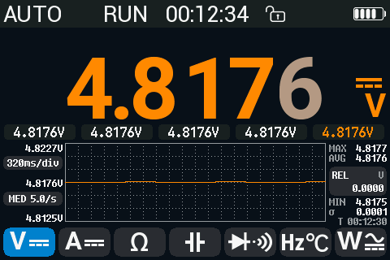

# opendm40 user manual

opendm40 is an open replacement firmware for the Alientek DM40 multimeter,
oscilloscope and signal generator (DM40A, DM40B, DM40C). This manual is for
owners who want to use it.

## Contents

1. [Getting started](getting-started.md): install and update, keys,
   gestures, the main menu, touch lock, battery and sleep.
2. [What's new compared with the stock firmware](whats-new.md)
3. [Multimeter](multimeter.md): every function, ranges, rate and
   resolution, HOLD, AutoHold, REL, MIN/MAX/AVG, limits, the bargraph and the
   trend chart, burden voltage.
4. [Oscilloscope](scope.md): timebase, V/div, triggers, cursors,
   measurements, FFT, Save CSV, and the oscilloscope on the multimeter
   inputs (Wave view).
5. [Combined view](combined-view.md): the multimeter and the scope on one
   screen.
6. [Signal generator](generator.md)
7. [Power meter](power-meter.md): P, S, Q, PF, frequency, energy; inrush
   current.
8. [Recording](logging.md): the Record page and the fast recorder.
9. [USB disk, screenshots and the gallery](usb-disk.md)
10. [Safety and alerts](safety-and-alerts.md): wrong-connection alerts, the
    danger alarm, the fuse check.
11. [Settings](settings.md): every settings item, and the Device page.
12. [Remote control](remote-control.md): Bluetooth and the phone app.
13. [Connecting from a computer](connecting-from-a-computer.md): step by
    step for Linux, Windows and macOS.
14. [SCPI reference](scpi-reference.md): every command.
15. [Backup, recovery and back to stock](recovery.md)

## Safety first

opendm40 does not change the meter's input protection or its ratings.
Follow the safety rules and limits in Alientek's user manual. opendm40 adds warnings for wrong connections
([Safety and alerts](safety-and-alerts.md)), but they cannot catch every
mistake.

## Status

opendm40 is experimental. It has been developed and used on one DM40A;
DM40B and DM40C have only run in an emulator. Features that have not yet
been tried on a real meter are listed under "Known limitations" at the end
of each page.
