[English](README.md) | [Русский](README.ru.md) | **中文**

> 本手册是[英文手册](README.md)的机器翻译，尚未经中文母语者审校；功能行为以英文手册为准。部分术语和措辞取自社区手册 [xingyan4117-sketch/OpenDM40-Chinese](https://github.com/xingyan4117-sketch/OpenDM40-Chinese)（MIT 许可，Copyright (c) 2026 xingyan4117-sketch）。屏幕文字、SCPI 命令、单位和文件名保留英文原文，与默认界面一致。

# opendm40 用户手册

opendm40 是 Alientek（正点原子）DM40 万用表、示波器和信号发生器（DM40A、DM40B、DM40C）的开源替代固件。它保留原厂固件的外观和触摸操作。万用表、示波器和信号发生器同时运行，屏幕只决定你看到哪一个。它还增加了功率计、数据记录、USB 和蓝牙远程控制等功能。

固件的安装方式与原厂升级文件相同。它不改动 Alientek 的 bootloader、升级加载器和表的校准数据，所以随时可以回到原厂固件（[回退到原厂固件](#回退到原厂固件)）。

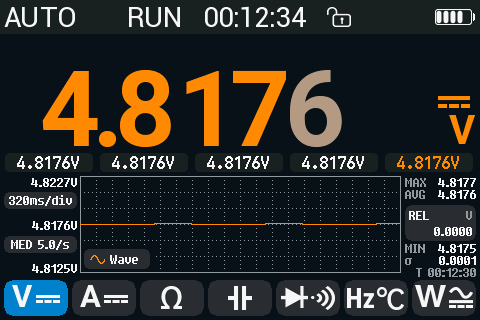

**安全第一。** opendm40 不改变表的输入保护和额定值。请遵守 Alientek 用户手册中的安全规则和限值。opendm40 增加了接错线告警（[安全与告警](#安全与告警)），但不可能发现所有错误。

**状态。** opendm40 还处于实验阶段。它在 DM40A 上开发，并在 DM40A、DM40B 和 DM40C 上测试。尚未在实机上测试的内容列在[已知限制](#已知限制)中。

## 目录

1. [快速上手](#快速上手)：安装和升级、按键、手势、主菜单、状态栏、触摸锁定、电池和休眠。
2. [与原厂固件相比的新功能](#与原厂固件相比的新功能)
3. [万用表](#万用表)：所有功能、量程、速率和分辨率、HOLD、AutoHold、REL、MIN/MAX/AVG、限值、柱状图和趋势图、负荷电压。
4. [安全与告警](#安全与告警)：接错线告警、危险警报、保险丝自检。
5. [示波器](#示波器)：时基、V/div、触发、光标、测量项、FFT、Save CSV、[协议解码器](#协议解码器)，以及万用表输入端上的 [Wave 视图](#wave-视图万用表输入端上的示波器)。
6. [组合视图](#组合视图)：万用表和示波器在同一屏；模拟电源。
7. [信号发生器](#信号发生器)
8. [功率计](#功率计)：P、S、Q、PF、频率、电能。
9. [涌流](#涌流)
10. [记录](#记录)：Record 页和快速记录。
11. [U 盘、截图和图库](#u-盘截图和图库)
12. [设置](#设置)：所有设置项、Device 页和触摸测试。
13. [远程控制和电脑连接](#远程控制和电脑连接)：手机 App，在 Linux、Windows 和 macOS 上使用 USB 和蓝牙，sigrok。
14. [备份、恢复和回退原厂固件](#备份恢复和回退原厂固件)
15. [关机后保留什么](#关机后保留什么)
16. [已知限制](#已知限制)

所有 SCPI 命令见单独的 [SCPI 参考](scpi-reference.md)（英文）。

## 快速上手

### 安装

开始之前：

- 给电池充电。
- 阅读[备份你的表](#备份你的表)。备份要用 opendm40 本身在安装之后进行，只需复制一个文件夹。

在运行原厂固件的表上安装 opendm40：

1. 从最新的 [release](https://github.com/opendm40/opendm40/releases/latest) 下载升级文件 `dm40_opendm40_v<version>.bin`，例如 `dm40_opendm40_v0.4.0.bin`。也可以从源码构建（[firmware/README.md，Build](../../firmware/README.md#build)，英文）。文件名以 `-zh`、`-ru`、`-it`、`-fr` 结尾的文件以中文、俄文、意大利文、法文显示界面。
2. 在表上：**Settings > Other Settings > USB Connect**。用 USB 线把表连到电脑，出现一个 U 盘。
3. 把文件复制到这个 U 盘（任何 `dm40*.bin` 文件名都可以）。盘上只保留这一个 `dm40*.bin` 文件（[原因](#从升级加载器安装文件)）。
4. 在电脑上弹出 U 盘。
5. 关机再开机。原厂升级流程会安装这个文件。
6. 第一次启动需要几秒钟，opendm40 显示进度条。前 10 秒内不要关机。

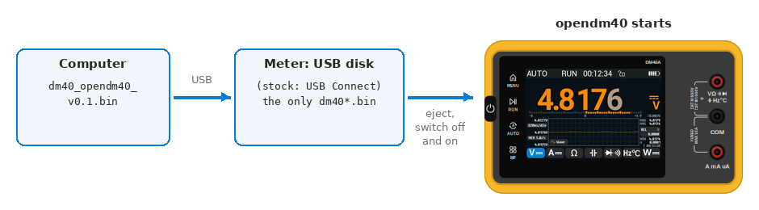

*安装：把文件复制到原厂固件的 U 盘，然后重启。*

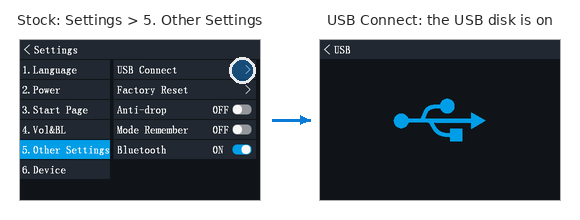

*原厂固件上的第 2 步：USB Connect。*

如果表停在加载器的升级界面，请从那里安装文件（[从升级加载器安装文件](#从升级加载器安装文件)）。

想在发布前试用某项改动：未合并的 [pull request](https://github.com/opendm40/opendm40/pulls) 有一条带升级文件的 **Test build** 评论（全部文件：[PR test builds](https://github.com/opendm40/opendm40/releases/tag/pr-builds)）；其版本号形如 `0.4.0-pr148.1a2b3c4`。这些构建没有在实机上测试过。

### 升级

在运行中的 opendm40 上安装较新的 opendm40（或其他 DM40 升级文件）：

1. **Settings > Other > USB disk**：点击直到显示 **PC can edit (replug)**。
2. 拔下 USB 线再插上。U 盘现在可写。
3. 把升级文件复制到 U 盘的顶层文件夹（`dm40_opendm40_v<version>.bin`；任何 `dm40*.bin` 文件名都可以）。
4. 表检查文件并询问 **Firmware received. Install it now?**，点 **Yes**。表重启进入升级加载器，安装文件并启动新固件。设置、万用表功能和示波器设置都会保留，与重启后相同。

如果 60 秒内不回答，就视为 No，文件被删除。不是 DM40 升级文件的文件会被拒绝，并显示 **Not a DM40 update file**。

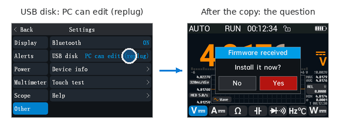

*第 1 步和第 4 步：USB disk 行和安装询问。*

### 按键

DM40 在屏幕左侧有四个触摸键，左侧边缘有一个电源键。

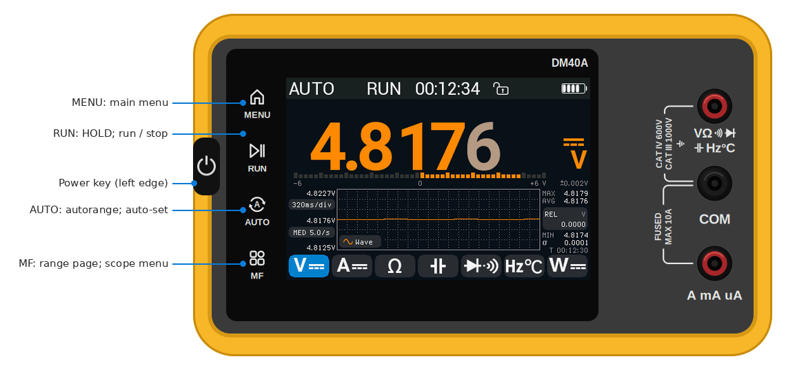

*四个触摸键和电源键。*

| 按键 | 作用 |
|---|---|
| **MENU** | 打开主菜单。在主菜单中：回到刚才的仪器。 |
| **RUN** | 万用表：HOLD 开 / 关。长按 1 秒：AutoHold 开 / 关。示波器：运行 / 停止。发生器：输出开 / 关。 |
| **AUTO** | 万用表的电压、电流、电阻和电容：在自动量程下固定当前量程；再按一次跳到高一档的量程，从最高档回到最低档（包括 60 mV 和 60 Ω）。长按 1 秒：回到默认自动量程（电压为 AUTO+，电流、电阻和电容为 AUTO）。这两种操作都会清除 HOLD 和 REL；AutoHold 不变。其他万用表功能：回到自动量程。示波器：自动设置。 |
| **MF** | 万用表：当前功能的量程页。示波器：示波器菜单。 |
| **Power** | 短按：开机，或唤醒变暗的屏幕。长按 1.5 秒：屏幕变黑并蜂鸣，松手后关机。快速按两次：触摸锁定开 / 关。 |

每次按键也会让[危险警报](#危险警报)静音。

### 手势

| 手势 | 位置 | 作用 |
|---|---|---|
| 左右滑动 | 万用表、组合视图（从表条上开始）、发生器 | 下一个 / 上一个视图 |
| 单指向下滑动 | 万用表 | 开始 / 停止[记录](#记录) |
| 长按 **A** 按钮 | 万用表 | [涌流](#涌流)页 |
| 三指向下滑动 | 任何位置，触摸锁定关闭时 | [截图](#截图)到磁盘 |
| 两指向下滑动 | 任何位置，触摸锁定关闭时 | 询问 **Power off?**，点 **Yes** 关机。询问 3 秒后自动消失。 |

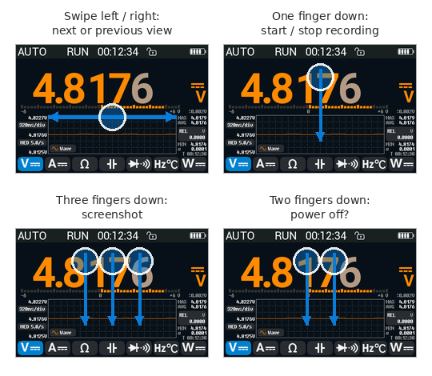

*手势。*

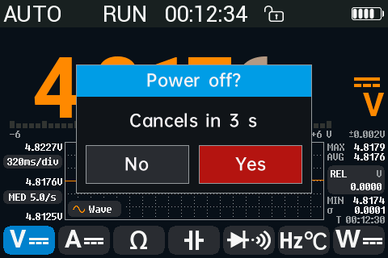

*两指向下滑动：关机询问。*

示波器有自己的拖动和点击操作，见[用手指移动对象](#用手指移动对象)。

### 主菜单和视图

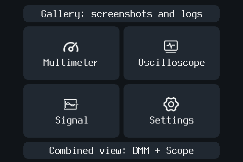

*主菜单。*

主菜单有六个图块：

- **Gallery: screenshots and logs**：存储在表上的截图和 Record 页的记录（[图库](#图库)）。
- **Multimeter**（[万用表](#万用表)）。
- **Oscilloscope**（[示波器](#示波器)）。
- **Signal**：信号发生器（[信号发生器](#信号发生器)）。
- **Settings**（[设置](#设置)）。
- **Combined view: DMM + Scope**：万用表读数显示在实时示波器上方（[组合视图](#组合视图)）。

四个仪器视图按以下顺序排列：

**万用表 → DMM + Scope → 示波器 → 发生器 → 万用表**

在万用表、发生器和组合视图（要从表条上开始滑动）上，向左滑动到下一个视图，向右滑动到上一个视图。在示波器页上拖动会移动波形，所以滑动不切换视图：请用 **MENU** 离开，或打开 **Settings > Scope > Swipe**，这样从顶栏或侧面板开始的滑动就能切换视图。

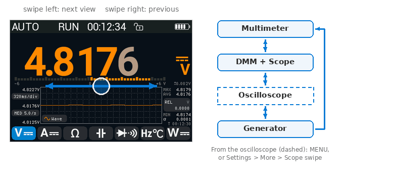

*滑动切换视图；从示波器离开只能用 MENU 或 Scope swipe。*

### 状态栏

万用表页的顶行从左到右显示：

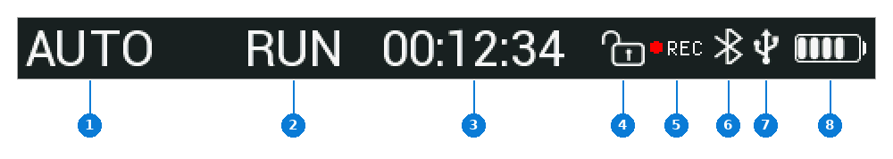

*状态栏。*

1. 量程：表自动选量程时为 **AUTO** 或 **AUTO+**，否则为固定的量程本身，例如 **6V**、**600mV**、**60mA**、**6kΩ**（与原厂固件的显示方式相同）；
2. **RUN**、**HOLD** 或 **A-HOLD**，或在此位置显示接错线[告警](#安全与告警)；
3. 开机以来的时间（时:分:秒）；
4. 锁图标：打开，或触摸锁定时闭合；
5. 记录到磁盘时显示红点和 **REC**；红点闪烁；
6. 手机或电脑通过蓝牙连接时显示蓝牙图标；
7. 电脑连接着表时显示 USB 图标（充电器不显示）；
8. 电池电量；接充电器时为绿色：充电时最上面一格闪烁，充满后常亮。接充电器时电量缓慢上升，最多每 15 分钟一格，拔掉后几秒内恢复准确。

### 触摸锁定

要锁定屏幕和触摸键（例如放进口袋时）：快速按两次电源键。状态栏的锁图标闭合。再快速按两次解锁。

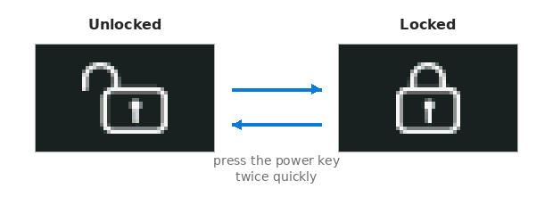

*锁图标，打开和闭合。*

锁定期间，在万用表或组合视图上单按一次电源键，会切换到当前功能的下一个子模式（例如 DC V → AC V），与原厂固件相同。

### 电源、电池和休眠

- **Dim screen**（**Settings > Display**，默认 5 min）：这段时间内没有触摸或按键，背光就会变暗。任何触摸或按键都能恢复；这第一次触摸只唤醒屏幕，不做其他事。
- **Shutdown**（**Settings > Power**，默认 30 min）：使用电池时，这段时间内没有输入，表就关机；有 USB 供电（电脑或充电器）时永不关机，拔线后重新计时。关机前 30 秒，表蜂鸣并显示 **Auto power-off in 30 s**（然后是 20、10）；触摸屏幕或按键可保持开机。
- 已连接的电脑或手机也会让表保持开机（通过 USB 或蓝牙的 SCPI、手机 App 请求、读写 U 盘），所以远程会话或固件升级期间不会关机。屏幕仍会变暗，这些请求也不会让它重新点亮。
- 正在记录、MIN/MAX/AVG 会话进行中、功率计在有电流时累计电能，或涌流页处于预备状态时，表不会自动关机。屏幕仍会变暗。
- 要关机：长按电源键 1.5 秒，或用两指向下滑动并点 **Yes**。
- 电池通过 USB 口充电。
- **电量低**（约为刻度的 17 %，在 8 % 时再次提示，与原厂固件相同）：显示 3 秒 **Low battery! Please charge** 信息，并以 Key/alert 音量蜂鸣，每个电量级一次；电池符号保持红色，直到接上 USB 电源。记录期间只改变符号，信息在记录结束后出现。
- **电池耗尽**（低于约 1 %，3.31 V，持续 30 秒，与原厂固件相同）：显示 **Battery empty: off in 30 s**（然后是 20、10）并蜂鸣，然后表结束记录、保存设置并关机。接上 USB 电源可中止。

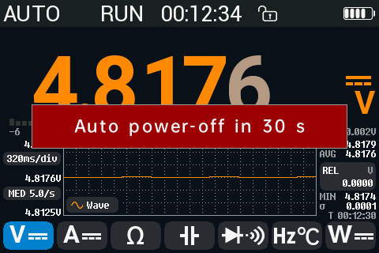

*自动关机前 30 秒的警告。*

### 屏幕帮助

**Settings > Other > Help** 打开两页简短的帮助：手势和侧面按键。点击翻页。

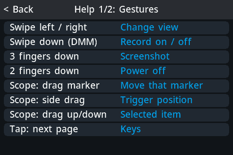

*第一页帮助：手势。*

## 与原厂固件相比的新功能

opendm40 替换原厂固件 V2.6。它保留其外观、触摸操作和蓝牙手机 App 协议。这一部分列出不同之处，详情见所链接的章节。

#### 全部同时运行

万用表、示波器和发生器同时运行；原厂固件上只有发生器能与示波器一起运行。[组合视图](#组合视图)在实时示波器上方显示万用表读数。

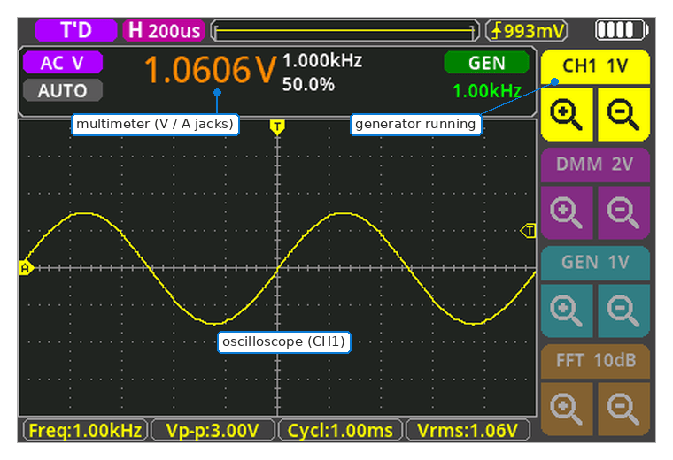

*组合视图：万用表、示波器和发生器同时运行。*

#### 万用表方面

| | 原厂 | opendm40 |
|---|---|---|
| 计数 | 按型号：40000（DM40A，400 mV、4 V ...）、50000（B）、60000（C） | [所有型号都是 60000](#计数速率和附加位)（硬件相同）；量程 600 mV、6 V ... |
| AC+DC | 仅 DM40B 和 C；第一个值可能只根据直流部分算出 | 所有型号；只有两部分都测完才显示，并显示交流和直流部分 |
| AUTO 耦合 | — | 根据信号显示直流或交流部分 |
| 电压自动量程 | 从 mV 开始 | 默认 **AUTO+**：永不降到 mV |
| 速度 | 固定 | [FAST / MED / SLOW](#速率fastmedslow) |
| 分辨率 | 最多 60000 计数 | MED 和 SLOW 下有一个[附加位](#计数速率和附加位)（600000 计数） |
| 平滑 | — | 可选的显示[平滑](#平滑) |
| AutoHold | — | [AutoHold](#autohold)：自动保持稳定的读数 |
| 限值 | — | [限值](#限值和-autohold)：读数旁显示 **OK**、**HI** 或 **LO**，越限蜂鸣 |
| AVG | — | MAX 和 MIN 旁显示[平均值](#minmaxavg)和 σ（标准差） |
| 统计会话 | — | 带计时器的 [MIN/MAX/AVG 会话](#minmaxavg)；进行中不会自动关机 |
| 柱状图 | — | 50 段[柱状图](#柱状图和历史行)，默认显示 |
| 温度传感器 | K 型热电偶 | 另有 [PT100、PT1000、三种 NTC 和自定义 NTC](#温度) |
| 温度偏移 | — | 每种传感器一个偏移 |
| °F | 乘以 1.82 而不是 1.8：100.3 °C 时显示 214.5 °F | °F 计算正确（212.5 °F），屏幕和蓝牙都如此 |
| 4-20 mA % | 总是显示，也会显示负值 | 带标签，只在有用的范围内显示 |
| 60 mV 量程 | 量程页上没有，AUTO 从不选择 | 量程页上有；AUTO 会进入 |
| 60 Ω 量程 | 从不选择 | 量程页上有；AUTO 会进入（仅 0.90 mA） |
| 负荷电压 | — | 可选 |
| 读数的准确度 | — | [显示](#准确度)在单位下方 |
| 切换功能 | 新单位下显示旧值或 0.0000 | 立即显示灰色横杠，数值确定前保持灰色 |
| HOLD 时的历史 | 不能存储保持的值 | 可以存储 |

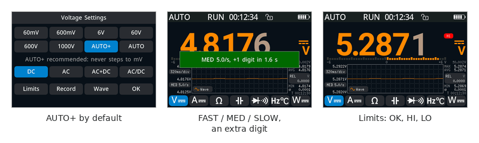

*AUTO+、速率、限值。*

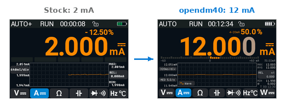

*4-20 mA：2 mA 时原厂显示不带标签的 -12.50 %；opendm40 给百分比加标签，并在低于 3.6 mA 时隐藏。*

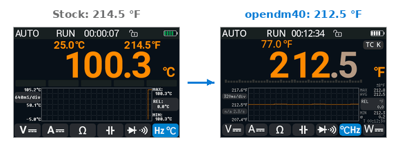

*100.3 °C 时的 °F：原厂 214.5 °F，opendm40 212.5 °F。*

#### 新增仪器

- [功率计](#功率计)：P、S、Q、PF、频率、Wh、VAh；DC、AC 或 AC+DC；直流和交流部分。
- [涌流](#涌流)：开机电流前 100 ms 的有效值和峰值，保存到磁盘。
- [Wave 视图](#wave-视图万用表输入端上的示波器)：隔离的万用表输入端上的示波器。

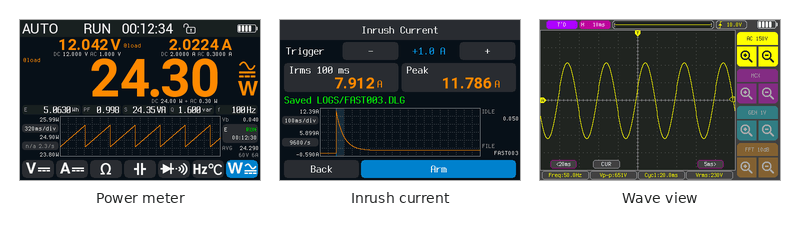

*功率计、涌流、Wave 视图。*

#### 安全

原厂固件只有高压警告（30 V 起变红，100 V 起显示闪电）。opendm40 增加了：

- [接错线告警](#告警一览)（A-JACK、V-JACK?、LIVE? 和各种提示）；
- 小电流分流器的保护（**A-PROT**、**OVLD**）；
- 响亮的[危险警报](#危险警报)；
- [保险丝自检](#保险丝自检)。

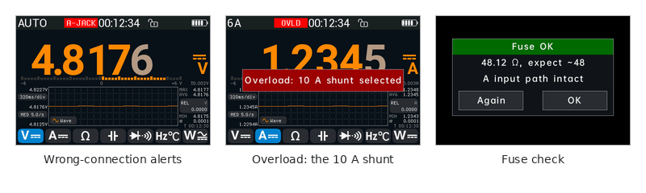

*告警、过载切到 10 A 分流器、保险丝自检。*

#### 示波器方面

| | 原厂 | opendm40 |
|---|---|---|
| 顶栏 | 不可触摸 | 可点击运行状态、时基、触发 |
| 时基点击 | 点左半边或右半边 | 带标签的[角落区域](#时基)（或原厂的半边） |
| 时基列表 | — | 点顶栏的时基 |
| 捏合 | — | 捏合改变时基或 V/div |
| V/div 按钮 | 上面的 "+" 把波形变小 | 每个通道一个方块（CH1、DMM、GEN、MATH），带放大镜：左边的是放大 |
| 触发位置 | 总在中央 | 可拖动 |
| 触发 | 边沿 | 边沿、脉宽、Runt（欠幅脉冲）；发生器可作触发源 |
| 通道 | CH1 | CH1、万用表输入作为 CH2、发生器输出（计算得出） |
| 自动设置 | 把 AC 耦合切成 DC | 保持 AC 耦合 |
| 光标 | 经由 Measure 标签页 | 点一下 **CUR** |
| FFT 读数 | 没有刻度 | [刻度、中心频率和峰值读数](#fft) |
| FFT 窗函数 | — | 另有 Flat-top |
| 采集长度 | 65 520 点 | 100 ms/div 起 65 520 点或更多，最多 262 144（取决于信号）；更快时 44 032 |
| 串行解码 | — | 波形下方的 [UART 和 DALI](#协议解码器) |

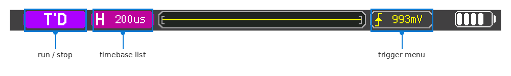

*可触摸的顶栏。*

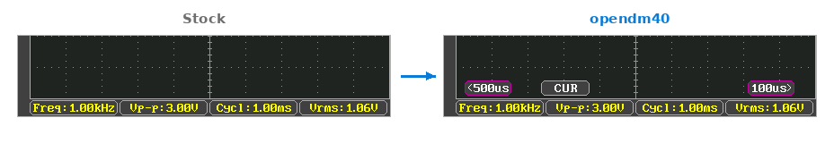

*时基角落标签和 CUR 标签。*

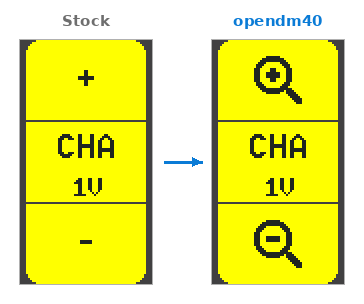

*通道方块：左边的放大镜是放大。*

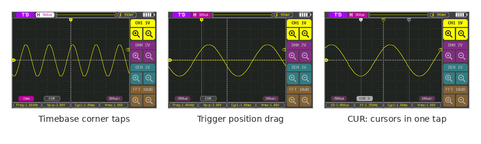

*点击角落、拖动触发位置、一键光标。*

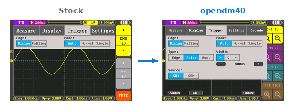

*Trigger 标签页：脉宽和 Runt 类型。*

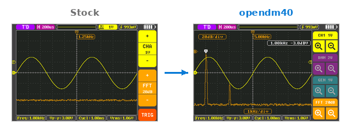

*FFT：刻度、中心频率和峰值。*

#### 发生器方面

| | 原厂 | opendm40 |
|---|---|---|
| 高于 50 kHz 的正弦波 / 三角波 / 锯齿波 | 输出停止，没有提示 | 以 50 kHz 运行，并有提示 |
| 50 到 100 kHz 的方波 | 向下取到 50 kHz | 取硬件能产生的最接近频率 |
| 显示的频率 | 输入的值 | 实际输出频率 |
| 锯齿波 | 下降，与图标相反 | 上升 |
| 幅度 | 0.5 到 3 Vpp | 0 到 3 Vpp |
| 偏移 | 固定 | [可调](#偏移) |
| 直流输出 | — | 0 Vpp 加偏移 |
| 运行 | 与示波器页一起 | 在所有页面 |

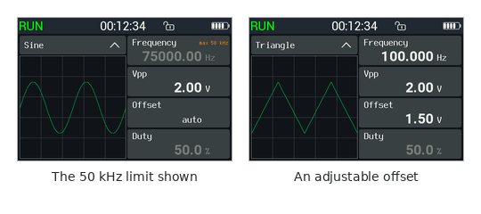

*显示 50 kHz 限制；围绕 1.5 V 的三角波。*

#### 数据、USB 和蓝牙

| 原厂 | opendm40 |
|---|---|
| 没有记录功能 | [Record 页](#record-页)：记录每个读数，或每 1 秒到 1 分钟的平均值，可持续数小时 |
| — | 原始采样的[快速记录](#快速记录) |
| U 盘仅在 **USB Connect** 模式下可用 | [U 盘](#u-盘)和 SCPI 仪器同时可用，并提供 CSV 文件、截图和备份 |
| — | 通过 USB（USBTMC）和蓝牙使用 SCPI |
| 蓝牙手机 App 仅在万用表页可用 | 所有视图中都可用手机 App |
| — | 表上的截图和记录[图库](#图库) |

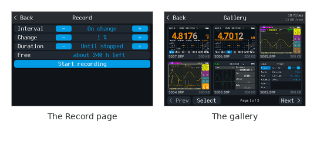

*Record 页和图库。*

#### 其他

- 自动关机前 30 秒的警告。
- [屏幕帮助](#屏幕帮助)。
- [Device 页](#device-页)显示 opendm40 版本和主板温度。

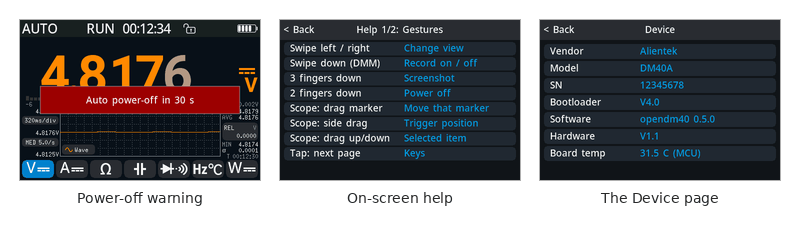

*关机警告、帮助、Device 页。*

#### 原厂固件有而 opendm40 没有的功能

- 中文菜单：opendm40 只有英文。
- 快于 100 ms/div 的时基下 65 520 点的示波器采集（opendm40 在这些时基下为 44 032 点）。

## 万用表

### 万用表页面


*带柱状图的 DC V。*

从上到下：

- [状态栏](#状态栏)；
- 读数，右侧是单位和耦合符号，上方最多两个小值（例如频率和占空比）；
- 一行[柱状图或最近存储的五个读数](#柱状图和历史行)；
- [趋势图](#趋势图)，左侧是其时基和速率，右侧是 MAX、AVG、REL 和 MIN；
- 七个功能按钮：**V**、**A**、**Ω**、电容、二极管 / 通断、**Hz / °C** 和 **W**（[功率计](#功率计)）。

### 选择功能

点击功能按钮。再次点击已选中的按钮，进入下一个子模式：

| 按钮 | 子模式，按点击顺序 |
|---|---|
| **V** | DC → AC → AC+DC → AUTO (AC/DC) → DC |
| **A** | DC → AC → AC+DC → AUTO (AC/DC) → DC |
| **Ω** | 测试电流 0.90 mA → 0.28 mA (ON) → 0.90 mA |
| 电容 | （无） |
| 二极管 / 通断 | 二极管 → 通断 → 二极管 |
| **Hz / °C** | 频率 → 温度 → 频率 |
| **W** | 功率计：DC → AC → AC+DC → DC |

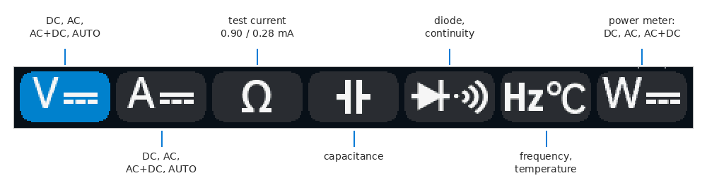

*功能按钮及其子模式。*

功能总是从自动量程开始。每个按钮会回到上次所用的子模式，关机后也是如此（新表：DC、二极管、频率、0.90 mA），其图标显示该子模式（两个中它排在前面）；SCPI `CONF` 也能设置。耦合也可以在[量程页](#量程量程页mf)上选择。

切换后，新单位立即出现，数值显示灰色横杠。尚未确定的值（第一个读数、正在找量程时）显示为灰色。只有确定的值（白色或橙色）才进入统计、REL、限值、趋势图、记录以及 USB 或蓝牙读数。

### 各功能

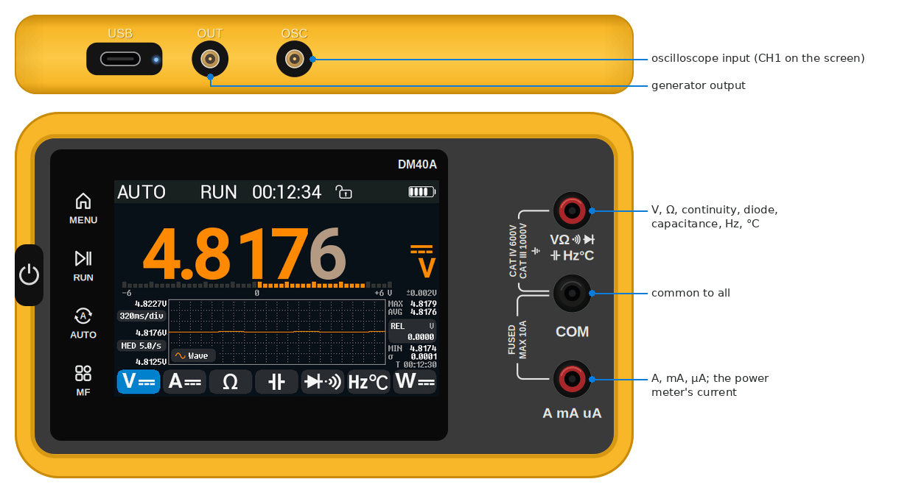

*插孔：正面是 V Ω、COM 和 A，顶边是 OUT 和 OSC。*

#### 直流和交流电压

- DC V：带符号的电压。
- AC V：真有效值电压，上方显示频率和占空比。
- 量程：60 mV、600 mV、6 V、60 V、600 V、1000 V。
- 从 30 V 起数值变红；从 100 V 起出现闪电符号。

没有单独的 mV 按钮：在量程页上选 60 mV 或 600 mV 量程，或者用 AUTO（不是 AUTO+），它会降到 mV。AUTO 在低于 58.3 mV 时从 600 mV 降到 60 mV，高于 61.8 mV 时返回。60 mV 量程不显示附加位。

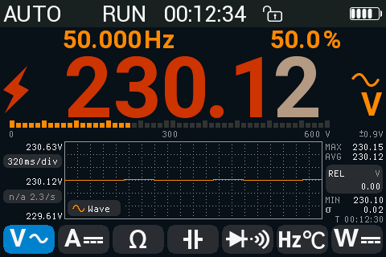

*市电上的 AC V：30 V 起变红，100 V 起显示闪电。*

#### AC+DC

用于同时含直流和交流成分的信号，例如电源轨上的纹波。表依次测量交流部分和直流部分，并显示：

- 总值 √(AC² + DC²)，作为主值；
- 上方是交流部分（左）和直流部分（右）。

一个完整周期约 2 秒；第一个值约 1.3 秒后出现。两部分都测完之前，它们显示为灰色。换量程后，表会等交流部分稳定。AC+DC 没有速率选择，也没有附加位。

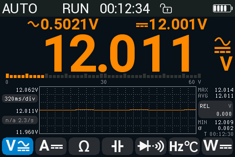

*AC+DC：12 V 带 0.5 V 纹波；上方是交流部分和直流部分。*

#### AUTO 耦合（AC/DC）

AUTO 耦合根据信号显示直流部分或交流部分：

- 带少量纹波的直流电压：显示带符号的直流值；
- 直流成分很小的交流电压：显示交流部分的有效值。

单位上方的耦合符号表示你看到的是哪一部分，其上方标有 **AUTO**。两部分始终显示在读数上方。

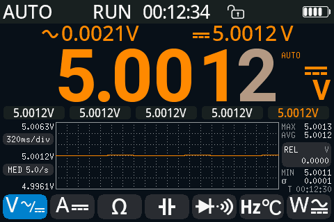

*直流电源上的 AUTO 耦合。*

- 当交流部分超过直流部分的 1.5 倍且高于下限（电压为量程的 1 %，电流为 3 %）时，AUTO 切到 AC。当交流部分低于直流部分的 0.75 倍或低于更低的下限（电压 0.5 %，电流 2 %）时，切回 DC。
- 切换需要 2 到 4 秒（必须连续两个周期结果一致）。
- 表笔开路时读作 DC。开路表笔拾取的工频干扰可能读作 AC。
- AUTO 切换时，REL 和 MIN/MAX/AVG 重新开始。

#### 电流：A、mA、µA

所有电流量程都用 **A** 插孔和 **COM**。表在内部切换分流器。

- 量程：600 µA、6 mA、60 mA、600 mA、6 A、10 A。
- DC A：带符号的电流。在 mA 量程上，上方的值显示 **4-20 mA** 环路百分比：4 mA = 0 %，20 mA = 100 %。低于 3.6 mA 和高于 125 % 时隐藏。
- AC A：有效值电流，并显示频率和占空比。
- 可选：[负荷电压](#负荷电压)。

A 功能以自动量程从 mA 量程开始。在 AUTO 下，对 µA 或 mA 量程过大的电流会直接跳到 6 A 量程。在固定的 µA 或 mA 量程上，过载会让表切到 10 A 分流器并显示 [**OVLD**](#过载10-a-分流器)。

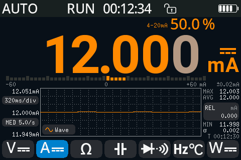

*4-20 mA 环路中的 DC mA：12 mA 为 50 %。*

#### 电阻

- 量程：60 Ω、600 Ω、6 kΩ、60 kΩ、600 kΩ、6 MΩ、60 MΩ（以及实验性的 600 MΩ，见下文）。60 Ω 显示毫欧，并总是使用 0.90 mA；AUTO 只在 0.90 mA 时进入该量程。
- 两种测试电流。**0.90 mA**（默认）和 **0.28 mA ON**（再点一次 Ω，或在量程页上点 **0.28 mA ON**）：较小的电流用于在路测量。使用 0.28 mA 时，Ω 按钮上显示小的 **ON** 标记。
- 左上角小字：所选量程的测试电流，例如 6 kΩ 上的 **I 197 uA**。这是短路电流，即该量程通过表笔的最大电流；接上电阻后电流更小。60 MΩ 上不显示（尚未测量）。

  | 量程 | 600 Ω | 6 kΩ | 60 kΩ | 600 kΩ | 6 MΩ | 60 MΩ |
  |---|---|---|---|---|---|---|
  | 0.90 mA | 0.90 mA | 197 µA | 20 µA | 2.2 µA | 0.22 µA | — |
  | 0.28 mA ON | 0.28 mA | 58 µA | 6.6 µA | 0.66 µA | 86 nA | — |

  短路电流，在一台表上把插孔短接测得。600 Ω 上的开路电压约 2.1 V（ON 时 0.67 V）。
- 表寻找量程时，数值显示为灰色。
- **600MΩ experimental**（仅量程页，AUTO 从不进入）：约每 2 秒一个读数，没有准确度指标。开机后让表笔开路一次：它会学习自身的漏电。


| 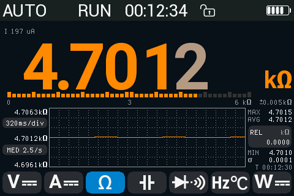 | 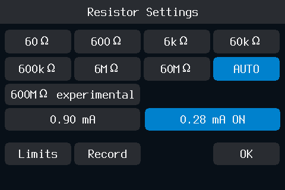 |
|---|---|
| 6 kΩ 上的 4.7 kΩ：测试电流 197 µA | 开启 0.28 mA (ON) 的量程页 |
| 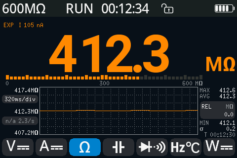 | 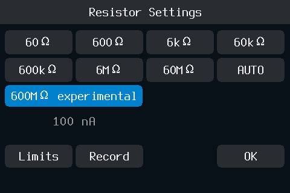 |
| 实验性的 600 MΩ：测试电流 105 nA | 选中 600 MΩ 的量程页 |

#### 通断

- 以两位小数显示电阻；高于 1000 Ω 时显示 **0L**（[超量程](#超量程)）。
- 电阻低于约 67 Ω 时蜂鸣器发声（根据测量芯片的设置*推断*，与原厂固件相同）。由芯片自己开关：蜂鸣随接触起停。[Key/alert volume](#alerts-标签页) 为 0 % 时静音。
- 发声时（音量 0 % 时也一样）读数上方显示绿色 **SHORT** 带，数字变绿，至少持续 0.15 秒。
- 左上角小字：测试电流 **I -0.26 mA**（短路电流；负值：方向与二极管测试相反）。
- 反应有多快、多短的接触还能听到，未经实机测试。
- 读数变化时每 50 ms 更新，稳定后每 0.4 秒更新。
- 负值表示电路上有外部电压：表显示 [**LIVE?**](#告警一览)。


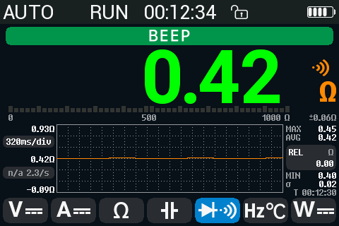

*通断：短路，蜂鸣器发声。*

#### 二极管

- 以四位小数显示正向电压；高于 3.12 V 时显示 **0L** 和 **Overflow**（表笔开路、二极管接反或电容已充电）。
- 左上角小字：测试电流 **I 0.76 mA**（短路电流，在一台表上测得；开路电压为 3.2 V）。
- 按正向电压蜂鸣，与原厂固件相同：低于 22 mV 时连续响（短路），低于 0.45 V、0.75 V 和 1.5 V 时分别是三种不同的蜂鸣样式，再高则静音。样式只在最初几个读数时播放。Key/alert volume 为 0 % 时静音。
- 右上角：电阻 **V / 0.765 mA**；高于约 0.8 V 时为 **0L**。
- 蜂鸣时显示同样的绿色带：低于 22 mV 为 **SHORT**，样式蜂鸣为 **BEEP**，位于电阻左侧。


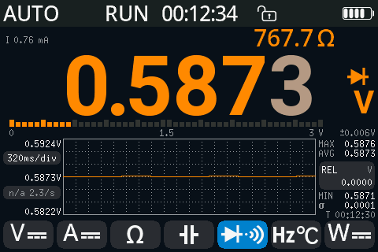

*硅二极管。*

#### 电容

- 量程：60 nF 到 60 000 µF；**MF** 选择某一量程或 AUTO。低于 6 nF 时数值有 3 位小数；从 6 mF 起以 µF 为单位（4700 µF）。
- 从 600 µF 起，表先给电容放电（**Discharging... 0.85 V** 并显示其上的电压，高于此电压时显示 **>1.2 V**），然后每 0.25 秒更新；斜坡双向走完之前数值为灰色。

  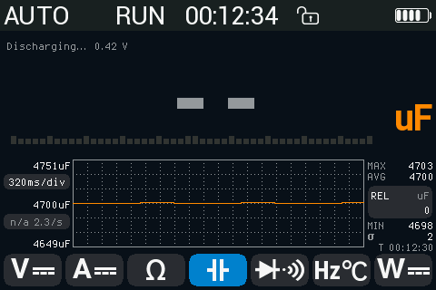
- 表笔开路时停在 60 nF 量程；短路显示 **0L**。


| 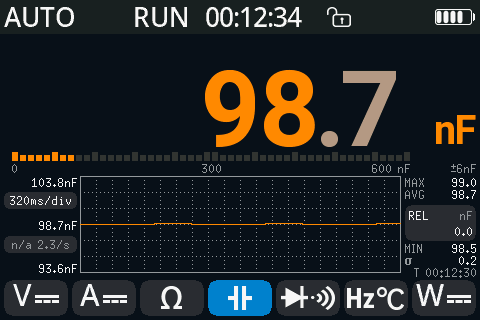 | 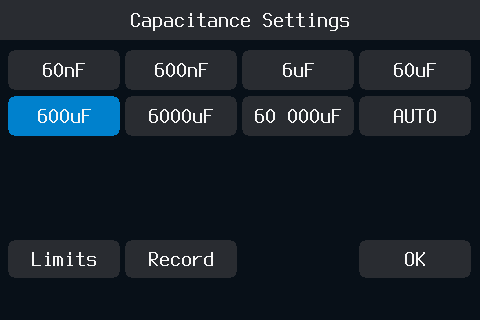 |
|---|---|
| 100 nF 电容 | 电容量程页，选中 600 µF |

#### 频率和占空比

- 频率，上方显示占空比，从 0.5 Hz 起。
- 每 0.35 秒一个新值；低于约 7 Hz 时，每一到两个周期一个（2 Hz 时约 1 秒）。
- 第一个结果出来之前显示 **--**；信号停止时显示 **0.000 Hz**。
- 计数器能分辨时多显示最后一位：10.0000 Hz，但 50.000 Hz。
- MF 打开 Hold & Limits 页（没有量程可选）。


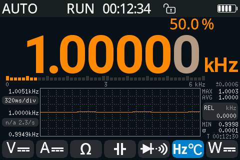

*1 kHz，50 % 占空比。*

#### 温度

点击 **Hz / °C** 两次。按 **MF** 打开温度页。

| 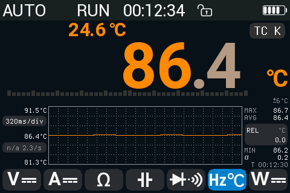 | 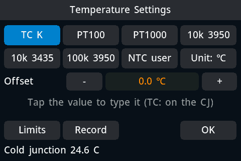 |
|---|---|
| K 型热电偶；上方是冷端 | 温度页 |

| 传感器 | 说明 |
|---|---|
| **TC K**（K 型热电偶） | -40 到 1000 °C。读数上方的值是冷端温度（表自身的传感器）。每个读数约 2 秒。 |
| **PT100**、**PT1000** | -200 到 850 °C，两线制。 |
| **10k 3950**、**10k 3435**、**100k 3950**（NTC 热敏电阻，B 值 3950 或 3435） | -55 到 300 °C。 |
| **NTC user** | 用键盘设置 **R25**（100 Ω 到 10 MΩ）和 **Beta**（1000 到 10000）。 |

| 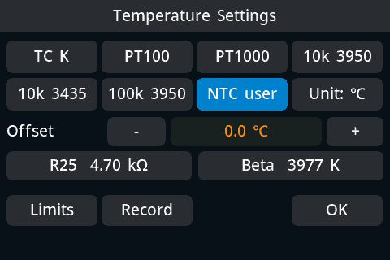 | 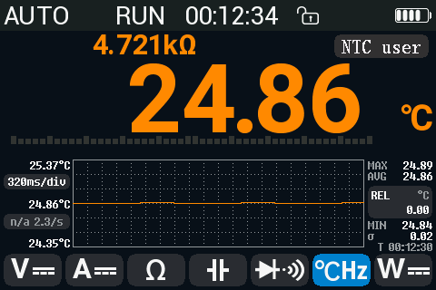 |
|---|---|
| 选中 NTC user：下方是 R25 和 Beta | 读数；上方是传感器电阻 |

| 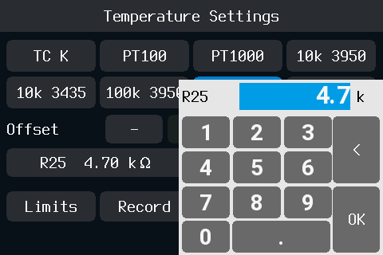 | 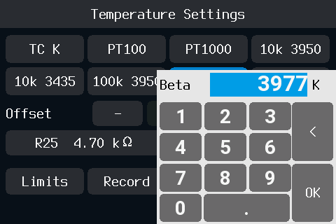 |
|---|---|
| 点 R25：键盘，单位 kΩ | 点 Beta：键盘，单位 K |

- 读数上方的值是传感器电阻（电阻型传感器）或冷端温度（TC K）；右侧的标签显示传感器名称。
- **Offset**：-20 到 +20 °C，步进 0.1 °C，每种传感器一个。点 **-** / **+**，或点数值直接输入。对 TC K，偏移修正的是冷端。
- **Unit: ℃** / **Unit: ℉** 在整台表上切换 °C 和 °F（也可在 **Settings > Multimeter > Temp unit** 设置）。
- 两线制表笔会引入自身电阻：在 PT100 上每 0.1 Ω 约 0.4 °C。用偏移或 REL 修正。
- 随附的热电偶额定 300 °C。

有用户反映，早期的表热电偶读数偏低 3.6 到 6 °C：设置一次偏移即可。

### 量程：量程页（MF）

按 **MF** 打开当前功能的量程页（通断、二极管和频率时，MF 打开 [Hold & Limits](#限值和-autohold)）。

|  |  |
|---|---|
| 电压量程页 | 电流量程页 |

- 点某个量程将其固定（状态栏显示该量程，例如 **60V**）。点 **AUTO** 或 **AUTO+** 回到自动量程，或长按 **AUTO** 键 1 秒。
- 短按 **AUTO** 键固定当前量程，或跳到高一档；最高档之后是最低档（详见[按键表](#按键)）。
- 耦合行：**DC**、**AC**、**AC+DC**、**AC/DC**（AUTO 耦合）。
- **Limits** 打开 [Hold & Limits 页](#限值和-autohold)，**Record** 打开 [Record 页](#record-页)（记录时为红色）。
- **OK** 或 **MF** 返回。
- 仅电流页：[**Fuse check**](#保险丝自检) 和 [**Inrush**](#涌流)。
- 电压和电流页：**Wave** 在万用表输入端打开示波器（[Wave 视图](#wave-视图万用表输入端上的示波器)）。

选择量程会关闭 REL。

#### AUTO 和 AUTO+

| | 电压 | 电流 |
|---|---|---|
| **AUTO+** | 只用伏特量程；永不降到 600 mV。**默认。** | 降到 mA 量程，不降到 µA。 |
| **AUTO** | 也会降到 600 mV 和 60 mV。 | 降到 µA。**默认。** |

电压使用 AUTO 时，量程页以橙色警告：**AUTO starts on mV: AUTO+ is safer**。


*电压选择 AUTO：警告。*

电压默认用 AUTO+，是因为有用户反映，输入损坏与表停在 mV 量程时接入高压有关。

#### 超量程

- 读数显示 **0L**，旁边是 **Overflow** 一词：数值超出量程（或该功能的极限）。柱状图变红并带 **OL** 标记。在[组合视图](#组合视图)的表条中，**Overflow** 在读数右侧的小字中。
- 在 **Overflow** 上方显示溢出的量程：**>60V**、**>600MΩ**（温度和 Hz 下不显示）。
- 超过极限的小值（例如二极管的 Ω 值）显示 **0L**，前面有小字 **Overflow**。
- 超量程值永远不会存入 MIN/MAX/AVG、趋势图或历史行。


|  |
|---|
| 超量程：0L、Overflow |

### 计数、速率和附加位

opendm40 在所有型号上都使用 60000 计数（量程 60 mV、600 mV、6 V ...）。


*4.8176 V 和附加位 2。*

#### 速率：FAST、MED、SLOW

速率决定 DC V、DC mV、DC A 和 Ω 下的速度和分辨率：

| 速率 | 效果 |
|---|---|
| **FAST** | 10 读数/秒，60000 计数。Ω 下：5 读数/秒。 |
| **MED**（默认） | 5 读数/秒（Ω：2.5/秒）。在适用的量程上，1.6 秒的平均值给出一个附加位（600000 计数）。 |
| **SLOW** | 2.5 读数/秒，在每个 DC V、DC A 和 Ω 量程上做 6.4 秒平均（附加位只在下文所列量程上）。 |

每种速率都能抑制直流读数上的 50 Hz 和 60 Hz 工频干扰：每次转换对输入积分 100 ms（FAST、MED）或 200 ms（SLOW），正好是两者的整数个周期。

在 DC V、DC mV 和 DC A 下，FAST 跳过转换器内置的偏移抵消，因此比 MED 快一倍；表在功能或量程切换 2 秒后，以及之后每 30 秒，在输入稳定时自行测量该偏移（每次读数暂停 0.2 秒）。在某量程上最初 2 秒的读数可能略有偏差。FAST 的噪声比 MED 略大；要附加位请用 MED 或 SLOW。

在 Ω 的 60 Ω 到 60 kΩ 上，平均时间更长（MED 6.4 秒，SLOW 12.8 秒；60 Ω 没有附加位）。输入跳变或换量程后平均重新开始，所以变化会立即显示。

- 趋势图左侧的**速率标签**显示速率和实测的每秒读数（刚切换时为 **--/s**）。点击它：FAST → MED → SLOW → FAST。
- **点击读数**以同样方式切换速率；消息说明效果，例如 **MED 5.0/s, +1 digit in 1.6 s**。
- 其他功能（AC、AC+DC、电容、频率、温度、通断、二极管）速度固定：标签显示 **n/a**；点击读数显示 **Fixed rate in this function**。
- 也可在 **Settings > Multimeter > DMM rate** 中设置。


*点击读数切换速率。*

附加位显示在主数字之后，适用于以下量程：DC 600 mV、6 V、60 V、600 V 和 Ω 600 Ω、6 kΩ、60 kΩ，在输入稳定后约 1.6 秒（DC 的 MED）或 3.2 秒（SLOW 以及 Ω）出现。在可能出现附加位的地方，读数从更靠左的位置开始，所以其他数字不会移动。

#### 平滑

**Settings > Multimeter > Smoothing**：**OFF**（默认）、**LOW**、**HIGH**。对显示的读数做滑动平均，让显示更稳定。遇到真实跳变时重新开始，所以变化仍会立即显示。平滑作用于读数、限值、趋势图以及 USB 或蓝牙读数；不作用于 MIN/MAX/AVG、AutoHold、记录和柱状图。通断从不平滑。


*Settings 的 Multimeter 标签页中的 Smoothing LOW。*

### HOLD、AutoHold 和 REL

#### HOLD

按 **RUN**。状态栏显示 **HOLD**；读数、统计和趋势图冻结。柱状图继续随实时输入移动。再按 **RUN** 释放。

如果在切换功能后立即按 RUN，HOLD 会等到第一个确定的读数并保持它。


*HOLD。*

#### AutoHold

要开关 AutoHold：长按 **RUN** 1 秒（或用 Hold & Limits 页的第一行）。状态栏显示 **A-HOLD**：等待时为蓝色，显示捕获值时为橙色。

读数稳定约一秒后（例如 DC V 下 1 秒内变化在 0.1 % 以内），AutoHold 捕获该读数并蜂鸣，在你抬起表笔时保持显示。输入消失（表笔开路、OL）或变化超过约 0.5 % 后，它再次捕获。统计和趋势图继续使用实时值。


*带捕获值的 AutoHold。*

#### REL

点右侧的 **REL** 方框。当前读数成为零点；方框显示 REL 值。再点一次关闭。

- REL 在所有功能下都可用。在 V、A、Ω 和 Hz 下它也会固定量程。
- HOLD 开启或读数为 OL 时不可用。
- 改变功能、选择量程、按 AUTO 或 AUTO 耦合切换时，REL 结束。
- 打开或关闭 REL 会让 MIN/MAX/AVG 重新开始。


*REL：4.8176 V 为零点。*

### MIN、MAX、AVG

趋势图右侧的一列显示上次复位以来的 **MAX**、**AVG**、**MIN** 和 **σ**（样本标准差），以及计时器 **T hh:mm:ss**。

- **点击这一列**（REL 方框之外）：开始会话。统计被清除，计时器变橙色，会话期间表不会[自动关机](#电源电池和休眠)。再点一次停止。
- **长按这一列**：复位 MIN/MAX/AVG。


*运行了 5 分 12 秒的 MIN/MAX/AVG 会话。*

### 柱状图和历史行

**Settings > Display > DMM row** 选择读数下方这一行显示什么：**Bargraph**（默认）或 **History**。在趋势图的绘图区双击也可切换（功率计下无效）。

- **Bargraph**：50 段，每段为量程的 2 %；DC V 和 DC A 下零点居中（每边 25 段，每段 4 %），其他功能从零开始，温度时为空。它随每次测量更新，不经平滑和 REL，HOLD 时也继续移动。
- **History**：五个方框。点这一行存储显示的值（也包括保持的值）；最新的为橙色。长按这一行清除。


*历史行：存了四个值。*

### 准确度


单位下方：该读数在此型号上的标称准确度（[详情](../../firmware/docs/dmm-accuracy.md)，英文）。比它更细的数字显示为灰色。使用 History 行、AC+DC、60 mV 和 60 Ω 量程、PT / NTC、功率计或 REL 时不显示。**Settings > Multimeter > Accuracy** 可将其关闭。

### 趋势图

趋势图绘制读数随时间的变化，宽 321 点。

- 点趋势图左列（时基标签）切换 160 → 320 → 640 ms/div → 1.28 → 2.56 s/div；趋势图重新开始。
- 刻度随数据变化。
- HOLD 时停止，AutoHold 时继续。
- 改变功能或切换到单位不同的量程（6 V 到 600 mV）时重新开始。
- 打开或关闭 REL 不会让它重新开始：之前的点保留，与原厂固件相同。


*趋势图。*

### 限值和 AutoHold

打开方法：**MF**，然后 **Limits**（通断、二极管和频率时，MF 直接打开）。标题显示物理量，例如 **Hold & Limits: DC V**。

|  |  |
|---|---|
| Hold & Limits，DC V：4.8 到 5.2 V | 读数高于上限 |

| 行 | 作用 |
|---|---|
| **Auto Hold** | AutoHold 开 / 关。 |
| **Limits** | 限值判定开 / 关。 |
| **Upper limit**、**Lower limit** | 用键盘输入数值。 |
| **Upper = reading**、**Lower = reading** | 把当前读数作为限值，并打开判定。 |
| **Clear limits** | 清除两个限值。 |
| **Fail beep** | 读数越出限值时蜂鸣（默认 ON）。 |
| **Record** | 打开 [Record 页](#record-页)。 |

- 每个物理量有自己的限值：DC V、AC V、DC A、AC A、Ω、二极管、电容、Hz、温度、功率。AC+DC 使用 AC 的限值，通断使用 Ω 的限值。
- 限值比较的是显示的值（REL 之后）。
- 读数旁边：绿色 **OK**，红色 **HI** 或 **LO**。
- 读数越出限值时发出越限蜂鸣，每秒最多一次。

### 负荷电压

电流表会在分流器上产生一个小压降（负荷电压），被测电路因此损失这部分电压。要显示它：**Settings > Multimeter > Burden voltage: ON (A, mA, uA)**。默认 OFF。

- DC：负荷电压显示在读数上方左侧，标有 **Burden**。
- AC：显示在读数上方右侧，代替占空比。
- AC+DC、AUTO 耦合和功率计中不显示。
- 它只根据分流器电阻算出（A 为 10 mΩ，mA 为 0.5 Ω，µA 为 47.5 Ω）；保险丝和接线还会再增加一点。
- 满量程时：100 mV（10 A）、60 mV（6 A）、300 mV（600 mA）、30 mV（60 mA）、285 mV（6 mA）、28.5 mV（600 µA）。


*123.45 µA；上方是负荷电压 5.9 mV。*

## 安全与告警

原厂固件只警告高压（30 V 起数值变红，100 V 起显示闪电符号）。opendm40 保留这些，并增加接错线告警、针对危险连接的响亮警报和保险丝自检。

DM40 看不到插头插在哪个插孔。告警依据表测到的结果工作，所以不可能发现所有错误（[无法检测的情况](#无法检测的情况)）。

### 告警的样子

- 状态栏中的**徽标**，位于平时显示 **RUN** 的位置（组合视图中在表条上）。
  - 红色（白字）：**A-JACK**、**A-PROT**、**OVLD**。
  - 琥珀色：**V-JACK?**、**LIVE?**、**10A**。
  - 灰色：提示 **DC?**、**AC?**、**FUSE?**。
- 告警开始时显示一次**消息**（1.5 秒）。
- HOLD 期间，A-JACK、A-PROT、LIVE? 和 OVLD 每秒与 **HOLD** 交替显示。
- 同一时间只显示一个告警，即最严重的那个。


*A-JACK：测量 DC V 时 A 插孔有电流。*

### 告警一览


*测量电压时表笔还插在 A 和 COM：A-JACK。*

| 徽标 | 消息 | 条件 | 出现位置 |
|---|---|---|---|
| **A-JACK** | Current in A jack: check leads | 在测量其他量时有电流（约 0.5 mA 起；DC V：约 9 mA；从 A 流入 COM 的方向仅限 DC V、DC mV 和温度，其中温度为*推断*）流过 A 插孔，例如测电压时表笔还插在 A 和 COM。 | DC V（6 V 量程）、DC mV、AC V、AC mV、温度、电容 6 nF 到 60 µF、AC+DC V（600 mV 和 6 V）、频率（直流约 4 mA 起）。 |
| **A-PROT** | A jack current: 10 A shunt on | 流过 A 插孔的电流会使小电流分流器过热（立即 300 mA，或 125 mA 持续 0.4 秒）。表把 A 插孔切到 10 A 分流器加以保护。 | DC V、DC mV。 |
| **OVLD**，然后 **10A** | Overload: 10 A shunt selected | 在固定的 µA 或 mA 量程上电流过大：表切到 10 A 分流器（[过载](#过载10-a-分流器)）。 | A 功能和功率计，固定量程。 |
| **V-JACK?** | Voltage on V jack, no current | 在电流功能下：没有电流，但 V 插孔有电压（直流高于约 21 V，或交流约 2 V 起）。表笔可能插错了插孔。 | 电流功能（DC、AC、AC+DC、AUTO）。 |
| **LIVE?** | Voltage on circuit - power off | 只有外部电压才会造成的读数（负电阻），或在 Ω 下 V/Ω 插孔有电压（约 3-5 V 起）或 A 插孔有电流。 | Ω、通断、二极管。 |
| **DC?** | DC voltage here: use DC V? | AC V 看到直流电压，几乎没有交流。 | AC V；AC+DC 下的功率计（[耦合](#耦合dcacacdc)）。 |
| **AC?** | AC voltage here: use AC V? | DC V（6 V 量程）看到双向摆动的电压。 | DC V；DC 下的功率计。 |
| **FUSE?** | 0 A for 60 s: check the fuse? | 电流功能持续一分钟读数为零。保险丝可能已熔断。 | A 功能。 |

告警如何结束：

- A-JACK、LIVE?、DC?、AC?：原因消失 1 秒后；V-JACK? 和 FUSE? 在 0.5 秒后。
- A-PROT 一直保持，直到你选择功能、量程或按 AUTO，并且电流低于 50 mA 持续 1 秒。选择电流功能会立即结束它。
- OVLD / 10A：见[过载](#过载10-a-分流器)。

声音：A-JACK 和 A-PROT 触发[危险警报](#危险警报)。LIVE? 响一声。OVLD 响一声（300 ms）。其他告警无声。


*Ω 下的 LIVE?：电路上有电压。*

|  |  |
|---|---|
| A-PROT：10 A 分流器保护小分流器 | V-JACK?：有电压，无电流 |

|  |  |
|---|---|
| DC?：AC V 看到直流电压 | AC?：DC V 看到交流电压 |


*FUSE?：一分钟 0 A。*

**Settings > Alerts > Jack alerts** 选择开启哪些告警：**ON**（以上全部，默认）、**A-JACK only**（A-JACK 和 A-PROT）、**OFF**（全部关闭，也没有 A-PROT 保护）。OVLD 和 10 A 警报始终开启。

### 过载：10 A 分流器

所有电流量程都用 **A** 插孔。其后是一个 10 A 陶瓷保险丝和三个串联的分流器：47 Ω、0.5 Ω 和 10 mΩ。两个 MOSFET 选择分流器：µA 量程时两个都断开（47.5 Ω）；mA 量程时一个短接 47 Ω（0.5 Ω）；A 量程时另一个把两者都短接（10 mΩ）。元件的顺序和哪个 MOSFET 短接什么，是根据分流器阻值和物料清单*推断*的。


*A 插孔后面的电流通路（此布局为推断）。*

**原因。** 保险丝要到 10 A 左右才熔断，而 0.5 Ω 和 47.5 Ω 分流器没有自己的保险丝。它们的发热随电流平方增长：0.3 A 流过 47.5 Ω 是 4.3 W，2 A 流过 0.5 Ω 是 2 W。这些电阻的额定值*未知*；47 Ω 约 1 W 是*推断*的。

**何时触发。**

- 在固定（手动）的 µA 或 mA 量程上：DC A、AC A、AC+DC A 和 AUTO 耦合，以及功率计的固定电流量程。
- 读数高于 1.03 × 量程时（读数为 OL）。
- 在第一个超量程读数时：直流约在过载后 0.35 秒，交流约 0.75 秒（根据转换和稳定时间得出；未经实机测试）。

在自动量程下，同样的超量程只是正常换档：从最高的 µA 或 mA 量程直接到 6 A 量程，没有告警、蜂鸣或锁存；高于 6.18 A 时继续升到 10 A。

**表的动作。**

- 立即把 A 插孔切到 10 mΩ 分流器和 10 A 量程，并继续在那里测量。
- 以 key/alert 音量蜂鸣一次 300 ms，显示消息 **Overload: 10 A shunt selected** 和红色徽标 **OVLD**。3 秒后徽标变为琥珀色 **10A**：读数是对的，但在 10 A 量程上，不是你选的量程。
- 过载持续期间不使用 µA 和 mA 分流器。
- 高于 10 A 持续 1 秒时，[危险警报](#危险警报)也会响。


*OVLD：表已切到 10 A 分流器。*

**如何结束。**

- 你选择量程或功能，或按 **AUTO**：立即结束。
- 或者电流低于所选量程的 85 %（至少 2 mA）持续 5 秒：表自动回到该量程。OL 读数会让这 5 秒重新计时。
- 如果返回后 30 秒内再次触发，表就停留在 10 A，直到你选择量程或功能。

**原厂固件。** 原厂固件没有这种保护：在固定的 µA 或 mA 量程上显示 OL，电流继续流过小分流器（*推断*：其中没有任何在过载时切换分流器的逻辑）。

**A-PROT** 在电压功能下做同样的切换，因为留在 A 和 COM 的表笔会把 47.5 Ω 分流器直接接到电源两端：

| | OVLD | A-PROT |
|---|---|---|
| 功能 | A 功能和功率计，固定的 µA 或 mA 量程 | DC V、DC mV |
| 触发点 | 读数高于 1.03 × 量程 | 流过 A 插孔的电流立即 300 mA，或 125 mA 持续 0.4 秒 |
| 声音 | 一声 300 ms 蜂鸣 | [危险警报](#危险警报) |
| 结束 | 回到量程内 5 秒，或你选择量程、功能或 AUTO | 你选择量程、功能或 AUTO，并且低于 50 mA 持续 1 秒 |
| 能否关闭 | 否 | **Jack alerts OFF** 可关闭 |

### 危险警报

针对可能损坏表或电路的连接，发出响亮的双音警报：

- **A-JACK**，在确实有电流流过 A 插孔的功能中：DC V、DC mV、AC V、AC mV、热电偶、AC+DC V。（在电容、频率和电阻型温度传感器中，A-JACK 只静默显示。）
- **A-PROT**，且电流仍在流动。
- 在 10 A 量程上**电流高于 10 A** 持续 1 秒（功率计中也一样）。

响法：高-低-高-低，前 30 秒每秒一次，之后每 10 秒一次，直到原因消失。


*A-JACK 开始：徽标、消息和警报。*

要让它静音（仅针对本次事件）：点击徽标或消息，或按任意键（按键功能照常执行），或按电源键。新的事件会再次响起。

**Settings > Alerts > Danger alarm**：

- **Loud**（默认）：最大音量，key/alert 音量为 0 时也一样。
- **Volume**：使用 key/alert 音量。
- **Off**：只有徽标和消息。

只有万用表侧供电时警报才会响。

### 保险丝自检

无需拆机即可检查保险丝和表内的电流通路。

1. **A** 功能，**MF**，**Fuse check**。
2. 用一根表笔把 **V/Ω** 插孔接到 **A** 插孔。不接其他东西：拔掉另一根表笔。
3. 点 **Start**。表测量这条通路（经过保险丝和分流器约 48 Ω）。


*保险丝自检通过。*

| 结果 | 含义 |
|---|---|
| **Fuse OK**（约 48 Ω） | 保险丝和 A 输入通路完好。 |
| **Fuse open**（OL） | V 到 A 之间不通：更换保险丝（10 A 陶瓷）。 |
| **Check leads** | 读数远离 48 Ω 或没有读数：只接一根从 V/Ω 到 A 的表笔。 |

**Again** 重测，**OK** 回到原来的功能。取消或按任意键停止。

它无法判断 10 A 分流器是否完好：其 10 mΩ 在 48 Ω 中分辨不出来。

### 无法检测的情况

- A 插孔插着表笔但没有电流。
- 测量电流时 A 和 COM 两端接着电压源：会读成电流。接市电时保险丝不到一毫秒就会熔断。
- 保险丝已熔断：表读 0 A。一分钟后出现 FUSE?；用保险丝自检确认。
- Ω 下电路上低于约 3 V 的正电压，或二极管下的任何正电压：看起来像开路。此时 LIVE? 需要负电压或交流电压，或（Ω）约 3-5 V 及以上。
- Ω 下 A 插孔有电流：显示 LIVE?，不是 A-JACK，V/Ω 插孔空着时也如此。
- A 插孔有电流，同时 V/Ω 插孔也有电压：AC mV 什么都不显示（读数超量程）；A-JACK 只在 V/Ω 插孔空着时显示。在 AC mV 和 DC mV 下，V/Ω 上高于表交流带宽（数十 kHz）的信号也算那里有电压。
- 在 DC V、DC mV 和温度下电流从 COM 流入 A 插孔（温度为*推断*）：没有 A-JACK，也没有 A-PROT。
- DC V 下的交流电流没有 A-PROT：只有 A-JACK。
- 以下情况没有 A-JACK：通断和二极管；DC V 高于 6 V 量程（60 V、600 V、1000 V）；AC+DC V 高于 6 V；频率下低于约 4 mA（从 COM 流入 A 时为 6 mA）或交流电流；较高的电容量程。功率计没有插孔告警。


*任何告警都看不到的两种情况。*

## 示波器

示波器输入是顶边的 **OSC** 插孔（屏幕上为 **CH1**）。[Wave 视图](#wave-视图万用表输入端上的示波器)则显示万用表输入端上的信号。


*顶边：OSC 插孔。*

打开方法：主菜单，**Oscilloscope**，或从组合视图滑动。


*示波器页面：1 kHz 正弦波，已触发。*

### 示波器页面


*示波器页面。*

- **顶栏**，从左起：运行状态、时基（**H 200us**）、记录条、触发（边沿和电平）、手机或电脑通过蓝牙连接时的蓝牙图标、电脑连接着表时的 USB 图标、电池。
  - 运行状态：**WAIT**（等待触发）、**AUTO**（没有触发，照样显示帧）、**T'D**（已触发）、**RUN**（滚动）、**STOP**。
  - 记录条：停止时，方括号表示屏幕上是存储记录的哪一部分；滚动模式下为 **ROLL**；[发生器](#信号发生器)运行时为 **G 1.00kHz**。
- **图形区**：10 × 8 格。左边缘内侧是标记 **A**（波形零点）和 **M**（数学 / FFT）；右边缘内侧是 **T**（触发电平）。上边缘的 **T** 标出触发位置。
- **时基标签**在图形区底部两角，例如 **<500us** 和 **100us>**：下一个更慢和更快的时基。
- **CUR** 标签在图形区底部：光标。
- **右侧面板**：每个通道一个方块，**CH1**、**DMM**（CH2）、**GEN**、**MATH**（标题为 **FFT** 或 **ABS**）。每个方块有名称和 V/div，然后是放大（放大镜 +，左）和缩小（放大镜 −）。关闭的通道变暗。探头不是 ×1 或耦合为 AC 时，**CH1** 标题还显示探头和耦合符号。
  - 点标题：**CH1** 打开通道弹窗（弹窗打开时再点一次，将隐藏 CH1，与 **MATH** 对数学通道的作用相同）；**DMM** 和 **GEN** 开关各自的波形；**MATH** 打开数学弹窗。
  - 长按 **DMM** 标题：[Wave 视图](#wave-视图万用表输入端上的示波器)。
- **测量行**在底部：最多四项测量。


*四个通道全开：CH1、DMM、GEN、ABS 数学。*

| 按键 | 作用 |
|---|---|
| **RUN** | 运行 / 停止。也可点顶栏的运行状态。 |
| **AUTO** | [自动设置](#自动设置)。 |
| **MF** | 示波器菜单，Measure 标签页。 |
| **MENU** | 主菜单。也用于关闭弹窗。 |

### 时基

- 范围：100 ns/div 到 50 s/div。最高 50 MS/s。
- **点图形区的角落**：左下 = 更慢，右下 = 更快。手指停在角落可连续步进。每次改变时，顶栏的时基都会闪一下。
- **点顶栏的时基**：弹出列表，每项带采样率（例如 **200us 12.5MS/s**）；拖动滚动，点击选择。
- 用两指水平**捏合**：张开 = 更快，捏合 = 更慢。气泡显示新值；抬起手指时生效。
- **滚动模式**：从 200 ms/div 起波形连续滚动（默认开启；**MF > Display > Roll**）。不用滚动时，最慢的时基是 1 s/div。仅滚动模式可用的时基在列表中为橙色。


|  |  |
|---|---|
| 点左下角：慢一档 | 时基列表 |

**Settings > Scope > Tap step** 设置哪些点击能改变时基：**Corners**（默认，只有两个角步进）、**Halves (stock)**（点图形区左半或右半步进）、**Off**。

### 垂直：V/div、位置、耦合、探头

- V/div：每格 2 mV 到 10 V（再乘以探头倍率）。5 和 2 mV/div 是 10 mV/div 的数字放大：步长相同，约 0.1 mV，只是画得更大。
- 点 **CH1** 方块的**放大镜 +** 放大（V/div 变小），**放大镜 −** 缩小。也可以垂直捏合。
- 在图形区**上下拖动**移动波形（或你选中的对象；见[用手指移动对象](#用手指移动对象)）。
- 点 **CH1** 标题打开通道弹窗：
  - **Coupling**：DC 或 AC。
  - **Probe**：×0.1 到 ×1000（13 档）。只改变标签和读数，不改变硬件。
  - 波形的 **Color**。
- 弹窗打开时再点 **CH1** 标题可隐藏 CH1：不显示波形和 **A** 标记，方块变暗；触发、测量和 MATH 照常工作。点变暗的标题可重新显示。重启后保留。
- 带宽：有用户反映约 3 MHz 以内平坦。


|  |  |
|---|---|
| 放大：500 mV/div | 通道弹窗：耦合 AC |

### 触发

- 上下**拖动**右边缘的 **T** 标记设置触发电平。也可以点击它，然后在图形区任意位置上下拖动。
- 触发电平以伏特保存：改变 V/div、探头或位置只移动其标记，不改变电平。电平在屏幕外时，标记显示在边缘。
- 在图形区任意位置**左右拖动**移动触发位置（上边缘的 **T**）。在 Single 等待时，这决定即将到来的采集在何处触发。
- **长按**标记使其居中：触发电平移到信号中部，触发位置移到中央，波形移到中央的 0 V。
- 在点击不起作用的地方**双击**：波形移到中央，触发位置移到 50 %。


|  |  |
|---|---|
| 拖动触发电平：右边缘的 T | 拖动触发位置：上边缘的 T |

打开 Trigger 标签页：点顶栏的触发，或 **MF**，然后 **Trigger**。

| 项目 | 选项 |
|---|---|
| **Edge** | Rising、Falling。 |
| **Mode** | **Auto**（没有触发也显示信号）、**Normal**（等待触发）、**Single**（一帧，然后 STOP）。选择模式也会启动示波器。 |
| **Type** | **Edge**、**Pulse**、**Runt**。 |
| **Source** | **CH1**、**GEN**：发生器自身的输出，或 **DMM**：万用表通道（CH2）。 |


|  |  |
|---|---|
| Trigger 标签页 | Pulse：宽于 400 µs |

- **Pulse**：在脉冲宽于（**>**）、窄于（**<**）或等于（**=**，5 % 以内）某宽度时触发。用 **-** / **+** 设置宽度，20 ns 到 10 s。Rising = 正脉冲。
- **Runt**（欠幅脉冲）：在脉冲越过第一电平但未越过第二电平时触发。拖动左边缘橙色的 **T** 设置第二电平。
- Pulse 和 Runt 触发检查每次完整的采集；采集之间短暂间隙中的脉冲可能被漏掉。它们在滚动模式下不工作。

边沿触发尽可能使用触发硬件，所以不会漏掉采集之间的边沿。

**Source GEN** 无需接线即可在发生器上触发：表根据发生器的定时器知道其输出何时越过触发电平，并把触发放在那里。电平以发生器的伏特为单位（0 到 3 V；高于 50 kHz 的方波在 0 和 3 V 之间切换）；超出输出摆幅的电平永远不会触发。它是边沿触发（Rising / Falling）；触发徽标和 T 标记变为青色。适用于电路对发生器的响应接在 CH1 上、但噪声太大或太小而无法触发的情况。发生器关闭时不能选 **GEN**；之后再关闭，则不会触发（Auto 仍显示帧）。SCPI `TRIGger:SOURce GENerator`。

**Source DMM** 在万用表通道（[CH2 (DMM)](#显示设置)）上触发，只支持边沿，精度为一个 CH2 采样（最高 38.4 k 采样/秒）。电平按 CH2 的刻度，随其 **2** 标记移动；徽标和 T 标记变为品红色。选择 **DMM** 会打开 CH2；关闭 CH2 会把触发放回 CH1。SCPI `TRIGger:SOURce CHANnel2`。


*Runt 触发：第二电平，橙色的 T。*

### 用手指移动对象


*拖动：标记从其阴影区开始；其他位置左右为触发位置，上下为选中的对象。*

一次拖动沿一个轴移动一样东西，直到你抬起手指，与 Rigol DHO800/900 相同：

- **在标记上**（其周围约 8 mm 的区域，伸入图形区）：沿该标记自身的轴移动它。上下：波形（**A**）、触发电平（右侧的 **T**）、Runt 电平、Y 光标、**M**。左右：触发位置（上方的 **T**）、X 光标、FFT 中心。
- **其他任何位置**：第一下移动（约 8 像素）决定轴。**左右**移动触发位置；示波器停止时平移存储的记录。**上下**移动选中的对象：波形，除非你点过另一个标记（触发电平、**M**、Y 光标）。拖动标记不会选中它；只有点击才会。

点击标记选中它；点击已选中的标记，选中手指下的下一个。

拖动时第二根手指按下会撤销这次拖动。

### 自动设置

按 **AUTO**。示波器寻找信号，并设置 V/div、位置、触发电平（信号中部）和时基（屏幕上约 2 到 6 个周期）。耗时 1 到 2 秒，触发模式留在 Auto。**MENU** 取消（恢复原设置）并打开主菜单。

- AC 耦合保持 AC。只有在 AC 下找不到信号时才切到 DC，并显示 **AUTO: DC (no AC signal)**。
- 找不到信号：**AUTO: no signal found**，设置不变。


|  |  |
|---|---|
| 1 kHz 方波上自动设置之后 | 自动设置没有找到信号 |

### 测量项

按 **MF**：**Measure** 标签页列出 20 项测量。点击最多选四项；点已选中的项将其移除。**Clear** 全部移除，**Default** 恢复 Freq、Vp-p、Cycl、Vrms。


*Measure 标签页。*

| 项目 | 含义 |
|---|---|
| **Freq** | 频率。信号穿过触发电平时由硬件计数，任何时基都可用；否则按屏幕计算。 |
| **+Duty**、**-Duty** | 正、负占空比。 |
| **+Wid**、**-Wid** | 一个周期内的高、低电平时间。 |
| **+Pul**、**-Pul** | 屏幕上高、低脉冲的个数。 |
| **X2-1** | 两个 X 光标之间的时间。 |
| **Xf** | 1 / (X2-1)。 |
| **Cycl** | 周期。 |
| **Vp-p** | 峰峰值；信号被削顶时为 **--**。 |
| **Vrms** | 屏幕内的有效值。 |
| **Vmax**、**Vmin** | 最高值和最低值。 |
| **Vtop**、**Vbas** | 顶部和底部电平（上、下 30 % 中最常见的值）。 |
| **Vamp** | Vtop − Vbas。 |
| **Y2-1** | 两个 Y 光标之间的电压。 |
| **Vcrm** | 整周期的有效值。 |
| **Vavg** | 平均值。 |

测量使用屏幕上那部分信号，每秒最多更新约三次。波形滚动时，以及停止的记录缩小到超出其长度时，显示 **--**。

### 光标

点图形区底部的 **CUR**：**CUR X**（两条时间光标）、**CUR Y**（两条电压光标）、关闭。测量行显示 X2-1 和 Xf，或 Y2-1。拖动 **1** / **2** 标记。


|  |  |
|---|---|
| X 光标：相距 800 µs | Y 光标：相距 3.01 V |

### FFT

点 **MATH** 方块的标题（**FFT**）。频谱画在波形上面；弹窗打开时再点标题可将其关闭。

- 方框显示 dB/div、中心频率、Hz/div 和最强的峰值，例如 **1.00kHz -3.0dBV**。
- **MATH** 方块的放大镜：每格 dB 数。
- 上下拖动 **M** 标记移动频谱；左右拖动移动中心频率。
- 数学弹窗：**Mode** FFT 或 ABS（波形的绝对值）、**Color**、**Hz/Div**，以及 **Other** 下的 **Window**（Rectangular、Blackman、Hanning（默认）、Hamming、Triangular、Flat-top）和 **FFT Unit**（dB 或 Vrms）。
- 2048 点。滚动模式下没有 FFT。


|  |  |
|---|---|
| 1 kHz 正弦波的 FFT | 数学弹窗，Other：窗函数和单位 |

### 停止、缩放和平移

按 **RUN**（或点运行状态）停止。示波器再做一次采集（触发点在触发位置，与 **Single** 相同；最长为屏幕时间 + 1 秒），然后停止；再按一次立即停止。采集留在内存中（从 100 ms/div 起的滚动采集：至少 65 520 点，平滑信号最多 262 144 点）。运行时的触发采集在 5 ms/div 及更快时保存 44 032 点，从 10 ms/div 起 26 624 点（软件触发的采集，即 CH2 打开或以发生器为触发源时，可能更短）；**Single** 采集 44 032 点，从 100 ms/div 起 26 624 点：

- 改变时基可放大或缩小存储的采集（放大到 **Max zoom** 为止，即屏幕宽度 16 个采样点）；
- 改变 V/div 可缩放幅度；
- 左右拖动可平移；
- 双击可把触发点居中。


*已停止，放大到 100 µs/div；方括号表示屏幕上的部分。*

### 显示设置

**MF > Display**：**Roll** 开 / 关；**Persist** OFF、MIN、1S、INF；**Brightness** 和 **Grid** 亮度；**GEN trace** 开 / 关。

**GEN trace**（或点 **GEN** 标题）在 CH1 下方以青色绘制发生器的输出，使用 CH1 的位置和自己的 V/div（**GEN** 方块的放大镜；初始值与 CH1 相同）：它根据发生器的设置和定时器计算得出，不是测量值（波形是理想波形；用探头接输出才能看到真实波形）。滚动模式下、缩小到超出记录时，以及拖动或捏合进行中都不绘制。它打开时，边沿触发不使用触发硬件。

**CH2 (DMM)** 把万用表的输入绘制为第二个通道（品红色），叠加在 CH1 上，时间轴相同：即 [Wave 视图](#wave-视图万用表输入端上的示波器)的信号，与示波器并排。其开关和 V/div（A/div）也在 **DMM** 方块上。拖动左侧的 **2** 标记可移动波形（长按：回到中心）；保存在设置中。它可用于 V、mV 和 AC A / mA / µA（直流耦合）；在 DC A 下请把万用表切到 AC A。CH2 打开时万用表读数暂停（万用表芯片改为输出波形），接错线告警和蓝牙连接也随之暂停；CH2 关闭或离开页面后恢复。CH2 最高 38.4 k 采样/秒：快于 2 ms/div 时显示为台阶。它打开时，边沿触发不使用触发硬件。


|  |  |
|---|---|
| Display 标签页 | 500 ms/div 的滚动模式 |

### Save CSV

**MF > Settings**：

- **Save CSV**：保存整个存储的采集（最多 262 144 点，不只是屏幕上的部分）。要先停止示波器（否则显示 **Stop the scope first**）。表显示 **Saved SCOP004.DLG**；U 盘上显示为 `SCOPE/SCOP004.CSV`。
- **PriScr**：[截图](#截图)。
- **Decode**：[协议解码器](#协议解码器)。


*Settings 标签页。*

CSV 开头是注释行（时基、V/div、探头、耦合、采样率、触发），然后是 `time_s,volts`。时间 0 是触发点（采集未触发时为屏幕中央）；数值是探头尖端的伏特数。在 A 功能的 [Wave 视图](#wave-视图万用表输入端上的示波器)中保存的采集为 `time_s,amperes`：流过 A 插孔的电流。

### 协议解码器

**MF > Decode**：UART（也包括 RS-232，以及探头跨接 A-B 的 RS-485）或 DALI，绘制在波形下方：每字节一个方框，错误为红色。UART 通过 CRC 识别 Modbus RTU 帧，并显示在字节上方。每次采集解码一次：运行时解码已触发的采集（不包括 Auto 扫描中未触发的采集，也不包括滚动）；以及在 STOP 时。缩放和平移显示已解码的采集。


|  |  |
|---|---|
| UART：每个方框中的十六进制和字符 | 带 Modbus RTU 帧的 UART，已停止 |

- **Mode**：**Band**（波形下方）或 **Log**：输入持续传输时列出每一帧，只要它在运行（最高 115200 波特）。点某一帧：显示其波形和字节（再点：回到列表）。列表填充示波器的记录内存，最旧的帧最先被覆盖：约 270 个 Modbus 帧及其波形。**SCOPE** 返回：列表消失，示波器开始新的采集。

  |  |  |
  |---|---|
  | 帧日志 | 点击一帧：其波形 |

- **DALI**（照明总线，1200 bit/s，没有 Format / Baud）：每帧一个方框，`FF16:FE 80` 为前向（地址、数据），`BF8:FF` 为后向，`FF24:…` 为 24 位，**ERR** 为红色。
- 设置：协议（**Off**、**UART**、**DALI**）、波特率（**Auto** 或 300 到 115200）、格式、极性（RS-232 电平用 **Inverted**）、阈值（**Auto** 或某一电平）。
- 缩小时，字节变成一条横条。每位的采样点太少时显示 **Rate too low for N baud**：请用更快的时基。
- 在 [Wave 视图](#wave-视图万用表输入端上的示波器)中：浮地的万用表输入上 A 和 B 之间的 RS-485，最高 4800 波特（1 ms/div 时 9600），例如低速 Modbus 总线；在 STOP 时解码。
- 通过 USB 或蓝牙：[`DECode` 命令](scpi-reference.md#protocol-decoder)（英文）。

### Wave 视图：万用表输入端上的示波器

Wave 视图把万用表 **V** 或 **A** 插孔上的信号显示为波形：隔离的万用表输入端上的慢速示波器，用于电压和电流，在表的额定值范围内使用。

打开方法：

- 在万用表的 V 或 A 功能（DC 或 AC）下：点趋势图左下角的 **Wave**，或 **MF**，然后 **Wave**；或者
- 在示波器页上长按 **DMM** 方块的标题。在 Wave 视图中，该方块显示 **MCX**：点击它回到 **OSC** 输入。

|  |  |
|---|---|
| Wave 视图上的市电，10 ms/div | 相同信号，50 ms/div |

- 第一个方块显示功能名，例如 **AC V**。
- V/div：视图以万用表量程的**满量程步进**打开：± 量程正好占满 8 格（6 V → 1.5 V/div，60 V → 15 V/div，600 mV → 150 mV/div，10 A → 2.5 A/div，60 mA → 15 mA/div）。这些步进之间是 1-2-5 步进；合起来从 15 mV/div（60 mV 量程）到 250 V/div（1000 V），以及从 150 µA/div 到 2.5 A/div。
- **放大镜 +** / **−** 和捏合每次走一步。当前量程能显示的步进只重新缩放屏幕；只有步进需要别的量程时才换量程（例如 2 V/div → 5 V/div 从 6 V 量程切到 60 V，波形上有短暂缺口）。在 A 功能下，500 mA/div → 1 A/div 会从 mA 插孔切到 A 插孔。
- **AUTO** 回到当前量程的满量程步进，并把波形居中。
- 如果万用表处于自动量程，信号接近顶部时 Wave 视图会升一档（到其满量程步进）。
- 时基：1 ms/div 到 50 s/div。采样率：1 ms/div 时 76 800/s，从 200 ms/div 起降到 1200/s。第一次以 10 ms/div 打开，之后使用你上次在其中用的时基（直到关机）。
- 耦合：AC V 为交流耦合；点第一个方块的标题可在 DC V 和 AC V 信号通路之间切换。AC mV 和电流通路为直流耦合。DC A 使用 AC A 通路（直流耦合）。
- 触发（边沿、脉宽、Runt）、测量（电流通路上以安培为单位）、光标、FFT 和 Save CSV 都可用。每个采样点都检查触发，所以帧之间不会漏掉。
- Wave 视图运行时不显示万用表读数；万用表的告警和蓝牙手机协议暂停。


|  |  |
|---|---|
| 2 ms/div：一个周期 | 6 A 量程上的 1.5 A 电流，1.5 A/div |

离开方法：点 **MCX** 方块（回到 OSC 输入）、按 **MENU** 或切换视图。

Wave 视图在 AC+DC、AUTO 耦合和功率计中不可用，记录进行中也不可用；表会说明原因。

## 组合视图

组合视图在实时示波器上方的一条表条中显示万用表读数。两者同时测量：万用表用 V / A 插孔，示波器用 **OSC** 插孔。发生器也可以同时运行。

打开方法：主菜单，**Combined view: DMM + Scope**（最下面一行），或从万用表页向左滑动。


*表条中的 AC V，下方是示波器。*

### 表条


*表条。*

从左起：

- 功能（**DC V**、**AC V**、**AC+DC**、**AutoDC** / **AutoAC**、**DC A**、**FREQ**、**TEMP**、**POWER** ...）；
- 一个状态徽标，取以下最重要的一个：**HOLD** / **A-HOLD**、[告警](#告警一览)、**HV**（30 V 及以上）、**REL**、限值结论（**PASS**、**HI**、**LO**）、量程（**AUTO+**、**AUTO** 或固定量程，例如 **6V**）。告警每秒与 HOLD 交替显示；
- 读数及其单位，与万用表页面一样为橙色；
- 最多两个小值：交流和直流部分、频率和占空比、负荷电压（**Bd**）、4-20 mA 百分比、冷端温度，或功率计的电压和电流；
- 发生器运行时显示 **GEN** 和频率。

从 100 V 起表条带红框。

### 组合视图的操作

| 操作 | 作用 |
|---|---|
| 点表条左列 | REL 开 / 关。 |
| 点表条其他位置 | 打开功能带：万用表的七个功能按钮，覆盖在图形区底部。与万用表页一样点选功能。最后一次点击 4 秒后关闭，或点其他位置、按 MENU 时关闭。 |
| 长按表条 | 完整的万用表页。 |
| **RUN** | 万用表 HOLD；长按 1 秒为 AutoHold。 |
| **AUTO** | 与万用表页相同（[按键](#按键)）：固定或步进量程；长按 1 秒回到自动量程。 |
| **MF** | 万用表的量程页（或 Hold & Limits）。 |
| 点顶栏的运行状态 | 示波器运行 / 停止。 |
| 顶栏的触发 | 示波器菜单，Trigger 标签页。 |
| 从表条开始左右滑动 | 切换视图。在图形区上拖动与示波器页相同。 |

图形区、右侧面板和示波器菜单的用法与[示波器页面](#示波器)相同。这里不能用示波器自动设置：AUTO 属于万用表。


*点击表条打开的功能带。*

### 模拟电源

DM40 的万用表和示波器 / 发生器有各自独立的电源。**Settings > Power > Analog power**：

- **Auto (per view)**（默认）：万用表页给万用表侧供电，示波器和发生器页给示波器侧供电，组合视图两侧都供电。记录、功率计或蓝牙 / USB 客户端需要时，万用表侧也保持供电；发生器运行时，示波器侧保持供电。
- **Both always**：所有视图中两侧都保持供电。更耗电。


*Auto (per view) 下各视图给哪一侧供电。*

万用表侧断电时，万用表显示最后的读数，回来后继续测量。

## 信号发生器

发生器的输出是顶边的 **OUT** 插孔。它在所有页面上持续运行，使用万用表或示波器时也一样（示波器页在顶栏显示 **G** 和频率，组合视图显示 **GEN**）。


*顶边：OUT 插孔。*

打开方法：主菜单，**Signal**，或从万用表页向右滑动。


*运行中的 1 kHz 正弦波，2 Vpp。*

**切勿把 OUT 插孔接到电压源。** 它没有保护；外部电压可能损坏输出。

### 发生器页面

- 顶栏：**RUN**（绿色，输出开）或 **STOP**、开机以来的时间、锁、蓝牙、电池。
- 左侧：波形框，预览两个周期。
- 右侧：**Frequency**、**Vpp**、**Offset**、**Duty**。

使用方法：

1. 点预览上方的波形名称，依次切换 **Sine → Square → Triangle → Ramp**。
2. 点数值框输入新值（[键盘](#键盘)）。
3. 点顶栏的 **RUN / STOP**，或按 **RUN**，开关输出。

**AUTO** 键在此页上不起作用。

开机后输出为关闭状态。第一次启动时，发生器的设置与原厂固件相同：方波、2 MHz、3 Vpp。


|  |  |
|---|---|
| 方波，1 kHz，25 % 占空比 | 三角波，100 Hz，2 Vpp，围绕 1.5 V |


*锯齿波，10 kHz。*

### 频率和幅度限制

| 设置 | 范围 |
|---|---|
| 频率，正弦波 / 三角波 / 锯齿波 | 1 Hz 到 50 kHz |
| 频率，方波 | 1 Hz 到 10 MHz |
| 幅度 | 0 到 3.00 Vpp |
| 输出电平 | 始终在 0 到 3 V 之间；不会为负 |
| 占空比 | 0 到 100 %，仅方波 |

- 高于 50 kHz 时，正弦波、三角波或锯齿波以 50 kHz 运行。设定值保留并显示为灰色，带 **max 50 kHz**；切回 Square 时它再次生效。
- 高于 50 kHz 的方波是逻辑电平方波：不能设置幅度和偏移（灰色，**logic level**）。
- 频率框显示实际输出频率，可能与输入值略有差异：低于 1 kHz 时 3 位小数，低于 100 kHz 时 2 位，低于 1 MHz 时 1 位。
- 占空比框显示实际占空比。


*设为 75 kHz 的正弦波以 50 kHz 运行。*

### 偏移

- **auto**（默认）：波形从 0 V 到 Vpp，与原厂固件相同。
- 设定的偏移是波形的中心电平。它保持在 Vpp/2 和 3 V − Vpp/2 之间，因此波形不会超出 0 到 3 V。
- 0 Vpp 加偏移时，输出是直流电压。
- 要回到 auto：打开 Offset 键盘，删除数值，在空白状态下点 **OK**。


*偏移 auto、设定的偏移、直流输出。*

### 键盘

点数值框。键盘打开，当前值处于选中状态：

- 第一个数字替换整个数值，第一次按 **<** 清空；之后 **<** 删除最后一个字符；
- 频率：输入整数，并用 **H**（Hz）、**K**（kHz）或 **M**（MHz）选择单位。要得到 32.768 kHz，输入 `32768` 和 **H**；
- Vpp、偏移和占空比：数字和小数点；
- **OK** 应用；点键盘外取消。


|  |  |
|---|---|
| 频率键盘 | Vpp 键盘 |

## 功率计

功率计同时测量负载的电压和电流，并显示功率、电能，交流时还显示功率因数。


*AC+DC：V、I 和 P 下方的直流和交流部分。*

### 接线


*接线图。*

V 和 A 输入共用 **COM**，所以电流流过 COM：

1. 断开电源和负载之间的**回路**导线（−）。
2. 负载 − → **A** 插孔；**COM** → 电源 −。
3. **V** 插孔 → + 导线，接在电源一侧。


*接线：− 导线经 A 和 COM 断开串入，V 接在 + 导线上。*

接线图按表上的实际位置绘制插孔：**VΩ** 在上，**COM** 在中，**A mA uA** 在下。箭头表示电流：经负载流入 **A**，在表内经分流器到 **COM**，再回到电源。流入 A 插孔的电流记为正：负载显示正功率，电源显示负功率。

最大 10 A。高于 6 A 时，表倒计时 30 秒，然后发出警告（[电流限制](#电流限制)）。

### 启动

点 **W**（第七个功能按钮）。第一次会打开接线图：点 **OK** 开始。之后点 W 立即开始；要再看接线图：**MF > Wiring**。

进入时两个输入都使用自动量程：V 从 600 V 开始，I 从 10 A 开始并逐步降档。找到电流量程之前，页面显示电压和 **I ranging...**（几秒钟）。


*正在寻找电流量程。*

### 功率计屏幕


*功率计屏幕，市电上的 AC。*

1. 电压。
2. 电流。
3. 功率 P 和耦合符号。点击切换 **P → Wh → VAh → P**。
4. 电能 **E**（主值显示电能时为 **P**）、**PF**、**S**（VA）、**Q**（var）、**f**；没有值时为 **--**（直流或没有电流时的 PF）。
5. **Vb**（表自身的压降）、**VAh**、电能计时器（**RUN** / **PAUSE** 和时间）、**AVG**（平均功率）、量程。
6. 主值的趋势图。

在 AC+DC 下，页面还显示直流和交流部分：在 V、I 和 P 下方（`DC x W + AC y W`）。各部分相加等于总值。


|  |  |
|---|---|
| DC：12 V 电源带 2 A 负载 | 主值切换到 Wh |

### 耦合：DC、AC、AC+DC

再点 **W** 切换 **DC → AC → AC+DC**，或在 [Power Settings](#power-settingsmf) 中选择。进入功率计总是从 DC 开始。

| 耦合 | 功率 | 用途 |
|---|---|---|
| **DC** | P = Vdc × Idc。没有 PF、S、Q、f。 | 电池、直流电源。直流下最精确。 |
| **AC** | 只有交流部分（去掉直流）：P、S、Q、PF、f。 | 市电类负载、变压器。 |
| **AC+DC** | 总值：P = Pac + Vdc × Idc；V 和 I 是两部分的有效值。 | 整流或斩波信号、带纹波的直流。 |

在 AC 和 AC+DC 下，表轮流测量功率、电压和电流；一整组约需 1.3 秒。


*市电上的 AC：P、PF、S、Q 和 f。*

提示（灰色，带简短消息）：AC+DC 下没有交流部分时为 **DC?**（**No AC: DC is more precise**）；DC 下电压有交流部分时为 **AC?**（**AC present: use AC+DC**）。

### 直流功率的测量方法

在 DC 下，表同时取电压和电流，测量芯片使用一种固定设置，测量期间不切换：

- **电流**：电流量程分流器（47.5 Ω、0.5 Ω 或 10 mΩ）上的电压送到芯片的 24 位转换器，与 DC A 功能相同，并使用其工厂校准。约每 0.1 秒一个新值。
- **电压**：V 输入的分压器（按量程 ÷10 到 ÷10000）接到缓冲器和第二个转换器（19 位，取平均）。
- **量程**：每个通道各自自动换量程，与万用表相同：高于量程约 103 % 时升档，低于约 10 % 时降档。电流从 10 A 逐步降到 µA 量程（电流的 AUTO+ 止于 mA）；µA 或 mA 分流器上超量程时直接跳到 6 A 量程。
- **At load** 减去分流器的压降：P(load) = P − I²R，V(load) = V − I·R，R 为所用量程的分流器。
- **电能**：每个新的 P 乘以距上一个值的时间，以整毫焦累加，所以几天下来总量仍然精确。

由于两个通道都自动换量程，且 P = V × I 同时取两者的分辨率，P 的范围很宽：

| | 最低量程：分辨率 | 最高量程：满量程，分辨率 |
|---|---|---|
| V | 6 V：0.1 mV | 1000 V：0.1 V |
| I | 600 µA：0.01 µA | 10 A：1 mA |
| P | 6 V × 600 µA：0.1 µW | 1000 V × 10 A = 10 kW：1 W |

即 0.1 µW 到 10 kW。这些是显示分辨率；范围两端的准确度未经实机测试。电压没有 mV 量程：小电压在 6 V 量程上读取。

### 电能

- Wh 和 VAh 从功率计启动时开始计。电源计为负 Wh。
- 点电能计时器框：暂停 / 继续计数。
- **复位**：长按右列或电能框；对 **Reset energy?** 回答 **Yes**。或 **MF > Reset Wh**（不询问）。
- 离开功率计或关机时，电能从零重新开始。


*长按：电能复位询问。*

### Power Settings（MF）


*Power Settings。*

| 项目 | 作用 |
|---|---|
| **V** 量程 6V、60V、600V、1000V、AUTO | 固定电压量程，或自动量程。 |
| **A** 量程 600uA、6mA、60mA、600mA、6A、10A、AUTO | 固定电流量程，或自动量程。 |
| **At load** | OFF（默认）：V 和 P 是插孔处的值。ON：减去表自身的压降，V 和 P 是负载处的值。**@load** 标记这些值。当 V 表笔接在电源一侧（常规接法）时使用。 |
| **Zero** | 测量并保存零点偏移。断开表笔，A 中不接任何东西；约需 12 秒。有信号时拒绝执行。 |
| **V cal** | 在当前量程上，以万用表自身的 DC V 或 AC V 为基准校准功率计的电压：施加量程 10 % 到 70 %（DC：最高 100 %）的稳定电压；约需 8 秒。 |
| **DC / AC / AC+DC** | 耦合；帮助行解释所选的耦合。 |
| **Reset Wh** | 立即复位 Wh、VAh 和时间。 |
| **Wiring** | 显示接线图。 |
| **Limits** | 功率的 Hold & Limits：AutoHold、以 W 为单位的上下限、越限蜂鸣。 |
| **Record** | 打开 [Record 页](#record-页)。 |
| **OK** | 返回。 |

状态行显示正在运行的任务或其结果，或所用的电压增益以及是否已保存零点。

**At load** 和 **Vb** 所用的表自身压降只算电流分流器（10 mΩ、0.5 Ω 或 47.5 Ω）；保险丝和接线还会增加一点。可以通过 SCPI 修改（[`POW:BURD`](scpi-reference.md#power-meter)，英文）。

### 电流限制

高于 6 A 时，右列显示倒计时（**I>LIM 23s**，琥珀色）。30 秒后显示红色 **I>LIM!**，提示 **Current too high: reduce it**，并每 2 秒蜂鸣一次，直到电流降到 5.7 A 以下。限值和时间可以通过 SCPI 修改（[`POW:LIM`](scpi-reference.md#power-meter)，英文）。


*6.8 A：右列的倒计时。*

高于 10 A 持续 1 秒时，[危险警报](#危险警报)响起。

## 涌流

捕获负载接通时的电流：电机、灯、容性电源。

打开方法：长按 **A** 按钮，或 **A** 功能，**MF**，**Inrush**。

|  |  |
|---|---|
| 预备状态 | 捕获的涌流：7.9 A RMS，11.8 A 峰值 |

1. 经 **A** 插孔和 **COM** 连接负载（10 A 量程）。
2. 用 **-** / **+** 设置 **Trigger** 步长：0.2、0.5、1（默认）、2、5 或 10 A。
3. 页面打开时已处于预备状态：**Armed: 0.123 A now**。接通负载。
4. 表记录 2 秒（触发前 0.2 秒，触发后 1.8 秒）并显示：
   - **Irms 100 ms**：前 100 ms 的有效值电流（通常所说的涌流值）；
   - **Peak**：最大电流；
   - **IDLE**：触发前的电流；
   - 波形，100 ms/div，前 100 ms 带阴影。
5. 捕获结果保存到磁盘：**Saved LOGS/FAST003.DLG**；在 U 盘上为 `LOGS/FAST003.CSV`。

**RUN** 重新预备或取消。**Back**、**MENU** 或 **MF** 关闭页面并恢复 A 功能。

- 触发条件是电流（任一极性）在约 100 ms 内上升一个步长。负载已在运行时，只有这么大的跳变才会触发。缓慢上升不会触发。
- 适用于交流和直流负载。9600 采样/秒：很短的尖峰读数会偏低。
- 表的额定值是 10 A；电流超出输入能测量的范围时，捕获结果显示 **OL**。

## 记录

opendm40 把万用表读数记录到表的内部磁盘。你可以从 [U 盘](#u-盘)把记录以 CSV 文件复制到电脑，或在表上的[图库](#图库)中查看。

有两种记录方式：

- **记录**（Record 页）：万用表显示的读数，每 1 秒、10 秒或 1 分钟一个平均值，或读数变化时记一行。可持续数小时或数天。
- **快速记录**：测量芯片的原始采样，每秒最多几千个，可持续数秒到数小时。仅限直流和交流的电压和电流。

### 开始和停止记录

快捷方式：在万用表页上**单指向下滑动**。表蜂鸣并显示 **Recording CSV**；状态栏出现闪烁的红点和 **REC**（示波器页的顶栏上为红点和 **DMM**）。再次向下滑动停止。最后几行写入磁盘后，表显示 **Saved LOG007.DLG**（带文件编号）。

快捷方式使用上次在 Record 页设置的间隔和时长。如果那里的间隔是 **Fast**，滑动仍会启动普通记录，使用上一次的其他间隔。


|  |  |
|---|---|
| 记录开始 | 运行时状态栏中的 REC |

### Record 页


*Record 页。*

打开方法：按 **MF**，然后点 **Record**。通断、二极管和频率时：**MF**，然后点 Hold & Limits 底部的 **Record**。

| 行 | 作用 |
|---|---|
| **Interval** | **Every reading**：每个读数一行。**1 s**、**10 s**、**1 min**：每个间隔一行，为其中读数的平均值。**On change**：读数变化时记一行，见 **Change**。**Fast**：[快速记录](#快速记录)。点 **-** / **+** 更改。 |
| **Change** | 用于 **On change**：读数变动超过量程的 **0.1 %**、**1 %** 或 **5 %** 时，OL / HI / LO 变化时，以及至少每分钟记一行。 |
| **Duration** | **Until stopped**、**10 min**、**1 h**、**8 h** 或 **24 h**。设了时长的记录会自动停止。 |
| **Free** | 剩余磁盘空间按此间隔能用多久，例如 **about 120 h left**。 |
| **Start recording** / **Stop recording** | 开始记录并回到万用表页，或停止正在进行的记录。 |

记录进行中不能更改间隔或时长；表提示 **Stop the recording first**。

记录进行中，万用表在所有视图中继续测量，在示波器页和菜单中也一样。同一时间只能进行一个记录。

磁盘满时记录停止并显示消息（**Disk full: log ended**）。

### 记录的内容


*记录变成 U 盘上的 CSV 文件。*

每行保存万用表测得的读数，应用了 REL，但不含显示平滑。在间隔模式下，一行保存该间隔内读数的平均值；含超量程读数（0L）的间隔成为超量程行。

表没有实时时钟。时间从记录开始以秒计；文件头说明记录在开机后多久开始。

CSV 文件如下：

```
# Alientek DM40A, opendm40 0.2.0, function DC V, range AUTO, started uptime 12.345 s
# time_s = seconds since the start of this recording (no real-time clock); empty value = overflow
time_s,value,unit,flags
0.250,1.23456,V,
0.750,,V,OL
```

| 列 | 内容 |
|---|---|
| `time_s` | 从开始起的秒数。间隔模式下：间隔的结束时刻，记录在间隔中途停止时最后一个也如此。 |
| `value` | 以基本单位表示的读数（V、A、Ohm、F、Hz ...）。超量程时为空。 |
| `unit` | 单位。 |
| `flags` | 可为 `OL`（超量程：0L）、`REL`、`HOLD`、`HI` / `LO`（超出限值），以及丢失若干行后第一行的 `GAP`。 |

间隔文件多一行文件头，说明间隔；**On change** 文件多一行说明变化量（`# event: change > 1 % ...`）。

表以紧凑形式存储记录（内部磁盘上的 `LOGS/LOG007.DLG`）。U 盘上显示为 `LOGS/LOG007.CSV`。CSV 在读取时生成。

### 快速记录

快速记录写入测量芯片的原始采样，并带微秒时间戳。它在 DC V、DC mV、DC A 以及交流电压和电流功能下可用。

1. 在万用表页上选择功能。
2. 打开 Record 页，把 **Interval** 设为 **Fast**。**Free** 行显示采样率和剩余时间，例如 AC V 下的 **4800/s, 25 min left**。其他功能下显示 **-- (DC/AC V or A only)**。
3. 设置 **Duration**，然后点 **Start recording**。


*AC V 下的 Interval Fast。*

表先准备磁盘（**Preparing disk**，一个百分比；点击取消）。然后屏幕显示 **DATA LOGGING** 面板：采样率、采样数和文件大小。屏幕其余部分暂停，把时间留给记录。点面板停止。表显示 **Saved FAST003.DLG**。


*DATA LOGGING 面板。*

文件在 U 盘上显示为 `LOGS/FAST003.CSV`，列为 `t_s,raw,value_<unit>,lost_before`（交流功能）或 `t_s,raw,lost_before`（直流功能，原始计数）。`lost_before` 统计该行之前丢失的采样；不会有无声的丢失。

采样率通过 SCPI 设置（[SCPI 参考，Data logging](scpi-reference.md#data-logging-log)，英文）：

- AC V、AC mV、AC A：默认 4800/s；1200 到 38 400/s，如果表的闪存芯片够快，可到 76 800/s。
- DC V、DC mV、DC A：默认 40/s；2.5 到 640/s。

### 其他记录方式

- 通过 USB 或蓝牙，`LOG:` SCPI 命令把读数直接传到电脑，`MMEM:` 命令读取磁盘上的文件（[SCPI 参考](scpi-reference.md)，英文）。
- 示波器的 [Save CSV](#save-csv) 写入捕获的波形。

## U 盘、截图和图库

### U 盘

用 USB 线把表连到电脑。出现一个名为 **DM40** 的驱动器。无需驱动程序。同一根线上，表同时也是测量仪器（[电脑连接](#远程控制和电脑连接)）；不必像原厂固件（"USB Connect"）那样在两者之间切换。


*使用一段时间后的 U 盘。*

| 文件夹或文件 | 内容 |
|---|---|
| `README.TXT` | 磁盘的简短说明。 |
| `LOGS/` | 万用表的记录：`LOGnnn.CSV`（[记录](#记录)）、`FASTnnn.CSV`（快速记录和涌流捕获）。 |
| `SCOPE/` | 用 [Save CSV](#save-csv) 保存的示波器采集：`SCOPnnn.CSV`。 |
| `SHOTS/` | 截图：`Snnn.BMP`，480 × 320。 |
| `INFO/` | 你这台表的校准、启动数据、芯片 ID，以及作为升级文件的当前固件。复制一次作为[备份](#备份你的表)。 |
| `DEBUG/SPIFLASH.BIN` | 表的 16 MB 内部磁盘的原始副本。 |

表以紧凑形式保存文件，在电脑读取时转换为 CSV。因此 CSV 文件可能比它在表上占用的空间大得多。

#### Files live 和 PC can edit

在 **Settings > Other > USB disk** 中设置。


*点到 PC can edit 之后的 USB disk 行。*

- **Files live**（默认）：驱动器对电脑只读。驱动器连接期间会出现新的记录和截图；在文件管理器中刷新文件夹（F5）即可看到。
- **PC can edit**：可以从电脑删除 `LOGS/`、`SCOPE/` 和 `SHOTS/` 中的文件，并把固件升级文件复制到顶层文件夹（[升级](#升级)）。表上的新文件要在弹出或重新插线后才出现。其他都不能改：复制到驱动器的其他文件在下次弹出或重新插线时消失，`INFO/` 和 `DEBUG/` 保持只读。

模式更改在下次插入 USB 时生效：拔下线再插上。在此之前该行显示 **(replug)**。表启动时总是 **Files live**。

文件管理器通常把删除的文件移到回收站。移到回收站的文件在弹出时从表上删除，除非你在此之前把它从回收站移出；回收站本身不保存在表上。

#### 在 Linux 上复制 DEBUG/SPIFLASH.BIN

`DEBUG/SPIFLASH.BIN` 的内容会变化，而其名称、大小和在驱动器上的位置不变。驱动器挂载期间，Linux 会保留已读过的文件部分（*推断*），所以普通的 `cp` 可能得到旧副本，或新旧混合的内容。`LOGS/`、`SCOPE/` 和 `SHOTS/` 中的新文件不受影响。

要得到最新副本，先做以下任一操作：

- 丢弃该文件的缓存部分：`python3 -c 'import os,sys; fd=os.open(sys.argv[1],os.O_RDONLY); os.posix_fadvise(fd,0,0,os.POSIX_FADV_DONTNEED)' /media/$USER/DM40/DEBUG/SPIFLASH.BIN`，然后 `cp`；
- 或丢弃所有文件缓存：`sync; echo 1 | sudo tee /proc/sys/vm/drop_caches`；
- 或卸载后重新挂载驱动器（`udisksctl unmount -b /dev/sdX`，然后 `udisksctl mount -b /dev/sdX`）；
- 或绕过缓存读取：`dd if=.../DEBUG/SPIFLASH.BIN of=spiflash.bin bs=1M iflag=direct`（未测试）。

Windows 和 macOS：未测试。

#### 弹出

在电脑上弹出驱动器后，它保持弹出状态，直到拔下并重新插上线。测量连接（SCPI）继续工作。


*弹出之后：磁盘消失，仪器还在。*

#### 删除文件

- 在表上：在[图库](#图库)中。
- 从电脑：在 **PC can edit** 模式下，或在任何模式下用 SCPI 命令 [`MMEM:DEL`](scpi-reference.md#files-on-the-disk-mmemory)（英文）。


*在图库查看器中删除文件。*

### 截图

在任何视图中用三指向下滑动。表蜂鸣并显示 **Saved S012.BMP**。文件在 U 盘的 `SHOTS/` 中，是 480 × 320 的 BMP，格式与原厂固件相同。

消息：**Disk busy**（另一个记录或文件任务正在运行；请重试）、**Disk full**、**No disk**、**Screenshot failed**。


*已保存截图。*

通过 USB，`python3 firmware/tools/dm40dbg.py shot out.png` 直接把屏幕读到电脑（[dm40dbg.py](../../firmware/tools/dm40dbg.py)）。

### 图库

打开方法：主菜单，**Gallery: screenshots and logs**（最上面的图块）。


*图库。*

- 网格每页显示六个文件，最新的在前：先是截图，然后是 Record 页的记录（`LOGnnn`）。快速记录、涌流捕获和示波器采集不显示；请从电脑（[PC can edit](#files-live-和-pc-can-edit)）或用 `MMEM:DEL` 删除。每个图块有缩略图（记录为小图表）、名称和大小。标题栏显示文件数和剩余空间。
- **Prev** / **Next** 或左右滑动翻页。
- 点图块全屏打开文件。记录显示其功能、最小值、平均值和最大值，以及数值随时间变化的图表。


*查看器中的截图，带操作条。*

- 在查看器中点击显示操作条：**< Back**、名称和编号，以及 **Delete**。左右滑动到下一个或上一个文件。
- **Delete** 要求确认（**Cancel** / **Delete**）。
- 删除多个文件：在网格中点 **Select**，点选图块（翻页后勾选保留），点 **Delete selected**。再点一次 **Select** 退出。正在记录的文件不能勾选。


*在图库中选择文件。*

- 标题栏的 **< Back** 或 **MENU** 返回。

图库也显示原厂固件的截图。

## 设置

打开方法：主菜单，**Settings**。左侧的标签页是各个部分；点击显示其中的行。点数值切换到下一个值（名称不响应）；带 **-** / **+** 的行按步长更改，带 **>** 的行点任意位置都会打开一个页面。标题栏的 **< Back** 或 **MENU** 回到主菜单。

### Display 标签页


*Settings，Display 标签页。*

| 行 | 取值 | 默认 | 作用 |
|---|---|---|---|
| **Backlight** | 10、15、25 ... 95、100 % | 55 % | 屏幕亮度。 |
| **Dim screen** | 5 min、10 min、30 min、Never | 5 min | 这段时间没有输入后背光变暗（[电源、电池和休眠](#电源电池和休眠)）。 |
| **Start page** | Multimeter、Oscilloscope、Signal、Main menu | Multimeter | 开机后的视图。 |
| **DMM row** | Bargraph、History | Bargraph | [柱状图和历史行](#柱状图和历史行)。 |

### Alerts 标签页


*Settings，Alerts 标签页。*

| 行 | 取值 | 默认 | 作用 |
|---|---|---|---|
| **Key/alert volume** | 0 % 到 100 %，步进 10 | 50 % | 按键蜂鸣和告警的响度。0 % 时通断 / 二极管蜂鸣器也静音；高于 0 % 时它的响度固定（由测量芯片驱动，*推断*）。自动关机警告至少以 50 % 发声；危险警报有自己的一行。 |
| **Danger alarm** | Loud、Volume、Off | Loud | [危险警报](#危险警报)的音量。 |
| **Jack alerts** | ON、A-JACK only、OFF | ON | 开启哪些[接错线告警](#告警一览)。 |

### Power 标签页


*Settings，Power 标签页。*

| 行 | 取值 | 默认 | 作用 |
|---|---|---|---|
| **Shutdown** | 1、5、10、30 min，1 到 10 hours，Never | 30 min | 使用电池时：这段时间没有输入后关机。有 USB 供电时永不关机。 |
| **Analog power** | Auto (per view)、Both always | Auto (per view) | [模拟电源](#模拟电源)。 |
| **Mode Remember** | OFF、ON | OFF | ON：关机再开机后，万用表和示波器保持你离开时的状态（[保留什么](#关机后保留什么)）。 |

### Multimeter 标签页


*Settings，Multimeter 标签页。*

| 行 | 取值 | 默认 | 作用 |
|---|---|---|---|
| **DMM rate** | SLOW、MED、FAST | MED | [速率](#速率fastmedslow)；显示每秒读数，当前功能速率固定时显示 **(n/a here)**。 |
| **Smoothing** | OFF、LOW、HIGH | OFF | [平滑](#平滑)。 |
| **Temp unit** | ℃（摄氏）、℉（华氏） | ℃ | 所有地方的温度单位。 |
| **Burden voltage** | OFF (stock)、ON (A, mA, uA) | OFF | 显示[负荷电压](#负荷电压)。 |
| **Accuracy** | ON、OFF | ON | 显示读数的[准确度](#准确度)。 |
| **Negative ohm** | OFF (stock)、ON | OFF | ON：显示低于 0 Ω 的读数（例如表笔短接时 -0.028 Ω）；OFF：显示 0。 |

### Scope 标签页


*Settings，Scope 标签页。*

| 行 | 取值 | 默认 | 作用 |
|---|---|---|---|
| **Swipe** | Off (stock)、Top bar | Off | Top bar：从示波器页顶栏或侧面板开始的滑动切换视图。 |
| **Press effect** | ON、OFF (stock) | ON | 示波器的侧面按钮按下时短暂点亮。 |
| **Tap step** | Corners、Halves (stock)、Off | Corners | 点击示波器图形区的哪些位置改变[时基](#时基)。 |

### Other 标签页


*Settings，Other 标签页。*

| 行 | 取值 | 默认 | 作用 |
|---|---|---|---|
| **Bluetooth** | ON、OFF | ON | [蓝牙](#蓝牙)模块。 |
| **USB disk** | Files live、PC can edit | Files live | [Files live 和 PC can edit](#files-live-和-pc-can-edit)。每次开机回到 Files live。 |
| **Device info** | | | 打开 [Device 页](#device-页)。 |
| **Touch test** | | | [触摸测试页](#触摸测试)。 |
| **Help** | | | [屏幕帮助](#屏幕帮助)。 |
| **Reset settings** | | | 点 **Yes** 后表重启，所有设置恢复默认，进入 DC V。触摸和功率计校准、文件和蓝牙配对保留。记录期间拒绝执行。 |

### Device 页

**Settings > Other > Device info** 显示：


*Device 页。*

| 行 | 内容 |
|---|---|
| Vendor | Alientek |
| Model | DM40A、DM40B 或 DM40C（来自表的校准数据） |
| SN | 工厂序列号，与原厂 Device 页相同 |
| Bootloader | Alientek bootloader 的版本 |
| Software | opendm40 版本 |
| Hardware | 硬件版本 |
| Board temp | 主芯片的温度，仅作粗略参考 |

点任意位置回到 Settings；**MENU** 回到主菜单。

### 触摸测试

**Settings > Other > Touch test** 显示触摸屏报告的内容，用来检查点击落在哪里：


*触摸测试页：点击目标，并按住 MENU。*

| 页面上 | 显示内容 |
|---|---|
| 十字（灰色） | 九个目标：距四角 20 px、各边中点、中心。 |
| 橙色点 | 触摸屏报告的每个点。 |
| 绿色点 | 表接受为触摸的点（滤除短接触和抖动之后），如有[触摸校准](#触摸校准)则按其移动。 |
| 红色十字 | 触摸开始的位置：即点击落点。 |
| **Raw** | 最后报告的点及其手指数。 |
| **Tap**、**Off** | 上一次触摸开始的位置，以及距最近目标的距离（`+` = 在其右方 / 下方）。 |
| **Frames**、**max** | 打开页面以来读到的报告数；单个报告中最多的手指数。 |
| **Stale**、**Bad** | 没有发现新报告的读取次数，以及失败的读取次数。 |
| MENU、RUN、AUTO、MF | 四个触摸键：触摸屏报告其按键时方框点亮；`x` 是沿按键条报告的位置。 |
| **Cal**（小字） | 使用中的触摸校准：`none (stock)`，或其两个方程（见下文）。 |

触摸每个目标，把红色十字与它们比较。在此页上触摸键不起作用。

- **Clear**：点击清除这些点。
- 要离开此页，按电源键，或一根手指在任意位置保持不动 2 秒。两者都回到 Settings 的 Other 标签页。

#### 触摸校准

如果绿色点落在目标旁边，触摸测试页上的 **Calibrate** 会为这台表的触摸屏拟合一个修正。没有校准时，表直接使用触摸屏的点，与原厂固件相同。


*校准过程：第五个目标，第二次点击被拒绝之后。*


*结果：点击位置（橙色）以及修正后的位置（绿色）。*

1. 点 **Calibrate**。目标逐个变黄。
2. 点黄色十字两次，每次都是短暂而不移动的点击。中心下方的一行说明未被接受的点击有什么问题：
   - **Too far from the cross**：点击距离超过 60 px。
   - **Taps differ: tap again**：同一目标的两次点击相距超过 30 px；该目标的两次点击都要重做。
   - **Moved: tap again**：点击时手指滑动了。
3. 第九个目标之后，结果显示：

   | 行 | 显示内容 |
   |---|---|
   | **Fit error** | 修正后的点击距目标多远，平均值和最大值。剩下的主要是手指的离散。 |
   | **Before** | 没有修正时点击距目标的平均距离。 |
   | **x' =**、**y' =** | 修正：表根据触摸屏报告的点 (x, y) 得到使用的点 (x', y')。 |

4. **Save** 立即应用修正并保存到设置（关机后也保留）。**Cancel** 保持原来的校准。

修正看起来有问题时，结果页提供 **Try again** 而不是 **Save**：比例超出 0.85..1.15、某目标处偏移超过 40 px，或某次点击距修正后的位置超过 25 px。

校准过程屏幕上的 **Reset** 移除校准（原厂行为）。校准过程中和结果页上，手指按住不动不会离开页面；电源键可以离开，且不改变校准。

触摸键（MENU、RUN、AUTO、MF）不受校准影响。通过 USB，`DBG:TOUCH:CAL?` 读取校准，`DBG:TOUCH:CAL RESET` 移除校准（[SCPI 参考](scpi-reference.md#debug-commands)，英文）。

[快速记录](#快速记录)期间，或 `LOG:` 命令向电脑传输读数时（[其他记录方式](#其他记录方式)），此页面不会打开，并在它们开始时关闭。

## 远程控制和电脑连接

| 连接 | 可以使用 |
|---|---|
| 蓝牙，手机 App | Alientek 的 DM40 手机 App。 |
| 蓝牙，串口 | 从电脑发送 SCPI 命令，与 USB 相同（部分命令除外，[见下文](#通过蓝牙使用-scpi)）。 |
| USB | 通过 USBTMC（实验室仪器的标准 USB 类）使用 SCPI；另加 [U 盘](#u-盘)。 |

USB 和蓝牙连接可以同时使用；各有各的会话，共享表的设置。所有命令：[SCPI 参考](scpi-reference.md)（英文）。

### 蓝牙

蓝牙默认开启；可在 **Settings > Other > Bluetooth** 中关闭。手机或电脑连接时，状态栏显示蓝牙图标。

表的蓝牙模块在扫描中出现两次：

- **DM40A**（或 B、C）：手机 App 使用的低功耗蓝牙设备。
- **C-1-ATK-DM40-CALI**：经典蓝牙串口（SPP），用于从电脑发送 SCPI，RFCOMM 通道 1。

模块同一时间只接受一个连接：从电脑连接之前请关闭手机 App。


*两个蓝牙名称，同一时间一个连接。*

### 手机 App

opendm40 使用原厂固件的蓝牙协议，所以 Alientek 手机 App 能显示读数，并能切换功能、HOLD 和 REL。协议说明见 [docs/bt-protocol.md](../bt-protocol.md)（英文）。

- 蓝牙在所有视图中都保持开启，手机连接时万用表继续测量，在示波器和发生器页上也一样。（原厂固件只在万用表页给蓝牙供电。）
- 在功率计中，App 把功率显示为主值。


*状态栏中的蓝牙图标。*

### 通过蓝牙使用 SCPI

以字母、`*` 或 `:` 开头的一行文本被视为 SCPI 命令；手机 App 协议在同一连接上继续工作。回复以换行符结束。

范围内的任何人都能连接，所以调试命令、删除文件和写入表的磁盘只能通过 USB 使用（蓝牙上显示 **Command protected**）。这条连接也比 USB 慢（约 11 kB/s）。详情：[SCPI 参考，Bluetooth differences](scpi-reference.md#bluetooth-differences)（英文）。

### USB 连接


*一根 USB 线：磁盘和仪器同时可用。*

示例发送 `*IDN?` 并读取直流电压。`*IDN?` 的回复如下：

```
Alientek,DM40A,0123456789ABCDEF01234567,opendm40 0.2.0
```

各字段：制造商、型号（DM40A、DM40B 或 DM40C）、表的序列号、固件及其版本。

| | |
|---|---|
| USB ID | `1209:D040` |
| 产品 | `DM40 multimeter (opendm40)` |
| 序列号 | 24 位十六进制数字，即芯片的唯一 ID（U 盘上也有，见 `INFO/UID.BIN`）。两台表显示为两个驱动器和两台仪器。 |
| 接口 0 | USBTMC / USB488（类 FE，子类 03，协议 01） |
| 接口 1 | USB 大容量存储，磁盘 **DM40** |

`1209:D040` 是 opendm40 在 pid.codes 厂商 ID 1209 下的 ID。0.1.0 之前的构建使用 pid.codes 测试 ID `1209:0001`；下面的规则和驱动绑定对应新的 ID。

每个回复以换行符结束。回复请留出 **5 s**：一个读数最多约需 0.85 秒。切换功能后的第一个读数，DC V 和 DC A 约 0.5 秒后出来，Ω 约 2 秒，其他功能最多约 4 秒（高阻量程最多 8 秒；从其他功能发送 `MEAS:POW?` 最多 15 秒）。

### Linux

#### 检查连接

```
$ lsusb -d 1209:d040
Bus 003 Device 012: ID 1209:d040 ... 
$ ls /dev/usbtmc*
/dev/usbtmc0
```

内核的 `usbtmc` 驱动会自动创建 `/dev/usbtmcN`。磁盘显示为普通的 USB 驱动器。

#### 免 root 访问

创建 `/etc/udev/rules.d/70-dm40.rules`：

```
# Alientek DM40 with opendm40: USBTMC node and libusb access
SUBSYSTEM=="usbmisc", ATTRS{idVendor}=="1209", ATTRS{idProduct}=="d040", TAG+="uaccess"
SUBSYSTEM=="usb", ATTRS{idVendor}=="1209", ATTRS{idProduct}=="d040", TAG+="uaccess"
```

然后运行 `sudo udevadm control --reload` 并重新插上表。第一行用于 `/dev/usbtmcN`，第二行用于使用 libusb 的程序（pyvisa-py、sigrok）。这条规则未测试。

#### 最简单的方法：dm40scpi.py

仓库中的 [dm40scpi.py](../../firmware/tools/dm40scpi.py) 只需要 Python 3。它会自己找到表的 `/dev/usbtmcN`。请把它和 [dm40dbg.py](../../firmware/tools/dm40dbg.py) 放在同一文件夹。

```
$ python3 firmware/tools/dm40scpi.py scpi '*IDN?'
Alientek,DM40A,0123456789ABCDEF01234567,opendm40 0.2.0
$ python3 firmware/tools/dm40scpi.py scpi 'CONF:VOLT:DC' 'READ?'
$ python3 firmware/tools/dm40scpi.py read -n 5 --conf dcv
```

此工具的更多命令：

| 命令 | 作用 |
|---|---|
| `info` | 标识和状态。 |
| `conf dcv`（也有 `acv`、`acdcv`、`dci`、`aci`、`acdci`、`res`、`cont`、`diode`、`cap`、`freq`、`temp`） | 选择功能。 |
| `read -n 10 -i 0.5` | 读 10 个值，每 0.5 秒一个。 |
| `log out.csv -i 1 -d 60` | 每秒记录一个值，持续 60 秒，写入 CSV 文件。 |
| `log fast.csv --source ad2 --rate 38400 --format packed -d 10` | 记录 10 秒内的每次转换（[见下文](#快速数据流写入-csv-文件)）。 |
| `get NAME -o FILE` | 从表的磁盘复制文件。 |
| `scpi 'CMD' ...` | 发送任意 SCPI 命令。 |

如果有多台表，用 `DM40_USBTMC=/dev/usbtmc1` 选择其中一台。

#### 快速数据流写入 CSV 文件

`log --source` 记录表的转换器的每次转换（[SCPI 参考，fast stream](scpi-reference.md#fast-stream)，英文）：

```
$ python3 firmware/tools/dm40scpi.py conf acv
$ python3 firmware/tools/dm40scpi.py log fast.csv --source ad2 --rate 38400 --format packed -d 10
```

`--format` 设置采样如何通过 USB 传输（`LOG:FORMat`）；所有格式下 CSV 文件的列都相同：

| `--format` | 每个采样的字节数 | CSV 中的时间 |
|---|---|---|
| `rows`（默认） | 12 | 每个采样的表内时间 |
| `packed` | 3 | 每个无间隙块的 `t0 + i / rate` |
| `dlg` | 约 1 到 3 | 每个采样的表内时间 |

在 76 800 采样/秒时请用 `packed` 或 `dlg`：`rows` 通过 USB 约能传 40 000 采样/秒，其余的被表丢弃（摘要行中的 `overwritten`）。所有格式下，`lost_before` 列都统计每行之前丢失的转换。紧凑格式未在实机上测试，而且以 76 800 行/秒写 CSV 文本对电脑上的 Python 可能太慢；这一点也未测试。

#### 不用任何工具

usbtmc 驱动把一次写入变成一条命令，把一次读取变成一个回复：

```
$ echo '*IDN?' > /dev/usbtmc0
$ head -1 /dev/usbtmc0
Alientek,DM40A,0123456789ABCDEF01234567,opendm40 0.2.0
```

这种写法未测试；上面的工具就是这样工作的。

#### Python 与 PyVISA

```
pip install pyvisa pyvisa-py pyusb
```

```python
import pyvisa
rm = pyvisa.ResourceManager('@py')
# pyvisa-py lists the IDs in decimal (4617::53312), NI-VISA in hex (0x1209::0xD040)
names = [r for r in rm.list_resources() if '::4617::53312::' in r or '::0x1209::0xD040::' in r]
dmm = rm.open_resource(names[0], read_termination='\n', write_termination='\n',
                       timeout=5000)
print(dmm.query('*IDN?'))
dmm.write('CONF:VOLT:DC')
print(float(dmm.query('READ?')))
```

pyvisa-py 把表命名为 `USB0::4617::53312::<serial>::0::INSTR`；NI-VISA 命名为 `USB0::0x1209::0xD040::<serial>::INSTR`。pyvisa-py 通过 libusb 与表通信，并从内核驱动那里接管接口：`/dev/usbtmcN` 消失，直到重新插上表。请使用 PyVISA 或 `/dev/usbtmcN` 工具，不要同时使用。

这个 PyVISA 示例整体未测试。

### Windows

U 盘无需驱动程序。对于 SCPI，Windows 没有自带的 USBTMC 驱动：设备管理器在 **Other devices** 下列出该仪器，代码 28。任选其一：

- **NI-VISA** 或 **Keysight IO Libraries Suite**：两者都会安装 USBTMC 驱动。然后使用 `pyvisa.ResourceManager()`（不带 `'@py'`）。未测试。
- **Zadig + pyvisa-py**：在 [Zadig](https://zadig.akeo.ie/) 中，**Options > List All Devices**，选择 DM40 的 USBTMC 接口（**不是**大容量存储接口），选择 **WinUSB**，**Install Driver**。然后：

  ```
  pip install pyvisa pyvisa-py pyusb libusb-package
  ```

  并使用带 `pyvisa.ResourceManager('@py')` 的 [Python 示例](#python-与-pyvisa)。未测试。

### macOS

U 盘和通过 USB 的 pyvisa-py 在 macOS 上未测试。pyvisa-py 配合 pyusb 和 libusb（`brew install libusb`）可能可行。

### 从电脑连接蓝牙

Linux 已测试；其他带蓝牙串口（SPP）的系统未测试。连接 **C-1-ATK-DM40-CALI**，RFCOMM 通道 1，要关闭手机 App，并在表的设置中把蓝牙设为 **ON**（[蓝牙](#蓝牙)）。

在 Linux 上，最简单的客户端是 [dm40bt_scpi.py](../../firmware/tools/dm40bt_scpi.py)：

```
$ /usr/bin/python3 firmware/tools/dm40bt_scpi.py --mac AA:BB:CC:DD:EE:FF scpi '*IDN?'
Alientek,DM40A,0123456789ABCDEF01234567,opendm40 0.2.0
$ /usr/bin/python3 firmware/tools/dm40bt_scpi.py --mac AA:BB:CC:DD:EE:FF shell
```

用 `--mac AA:BB:CC:DD:EE:FF`（或环境变量 `DM40_MAC`）给出表的地址；`bluetoothctl devices` 显示 **C-1-ATK-DM40-CALI** 的地址。它需要带蓝牙套接字的 Python：系统的 `/usr/bin/python3`。

其他程序可绑定一个串口设备：

```
bluetoothctl devices                      # find the address of C-1-ATK-DM40-CALI
sudo rfcomm bind 0 AA:BB:CC:DD:EE:FF 1    # creates /dev/rfcomm0
```

然后打开 `/dev/rfcomm0`（任意波特率），或在 PyVISA 中使用 `ASRL/dev/rfcomm0::INSTR`，结束符和超时与上文相同（未测试）。

### sigrok（sigrok-cli、PulseView、SmuView）

opendm40 可以应答为 HP 34401A，libsigrok 从 0.5.2 版起支持这款表：

```
python3 firmware/tools/dm40scpi.py scpi 'SYST:IDN:EMUL 34401A'
sigrok-cli -d scpi-dmm:conn=usbtmc/<bus>.<address> --samples 10
```

这一设置会保留；`SYST:IDN:EMUL OFF` 切回。在此模式下，主机只能看到 34401A 的功能（没有电容、温度或 AC+DC），也不能设置量程。未在实机上测试。

### 故障排除

| 问题 | 解决方法 |
|---|---|
| `/dev/usbtmc0` 上 `Permission denied` | 添加 [udev 规则](#免-root-访问)，或以 root 运行。 |
| 没有 `/dev/usbtmc0`，但磁盘还在 | 某个 libusb 程序（pyvisa-py、sigrok、PulseView）占用了接口。关闭它并重新插上表。 |
| `Device or resource busy` | 另一个程序打开了仪器。同一时间只用一个程序。 |
| 回复超时 | 把超时设为 5 秒。切换功能后第一个读数最多需要 4 秒（DC V 和 DC A 约 0.5 秒）。 |
| 回复似乎对应了错误的命令 | 两个程序共用仪器：回复交叉了。关闭其中一个。通过 USB，在 `READ?` 等待时发送新命令会取消该 `READ?`（`SYST:ERR?` 显示 `Query INTERRUPTED`）。 |
| 命令没有效果 | 查询 `SYST:ERR?`：它会说明原因。 |
| Windows：代码 28 | 安装 USBTMC 驱动（[Windows](#windows)）。 |
| 蓝牙：`Host is down` | 表的设置中蓝牙为 OFF，或手机 App 占用了连接。 |
| 蓝牙：`Command protected` | 该命令只能通过 USB 使用。 |

## 备份、恢复和回退原厂固件

升级只重写表内存中的固件部分。Alientek 的 bootloader、升级加载器和表的校准保持不变。错误或损坏的升级文件不会让表变砖：此时升级加载器会启动，并提供自己的 U 盘，直到装上正确的文件。

### 备份你的表

安装 opendm40 后立即做一次。

1. 用 USB 线把表连到电脑。出现 opendm40 的 [U 盘](#u-盘)。
2. 把整个 `INFO/` 文件夹复制到电脑。
3. 也可以复制 `DEBUG/SPIFLASH.BIN`：表的 16 MB 内部磁盘的原始副本。

把副本保存在表以外的私密位置：它包含这台表的校准数据和芯片唯一 ID。


*备份：INFO 文件夹，复制一次。*

| `INFO/` 中的文件 | 内容 |
|---|---|
| `CALIB.BIN` | 这台表的设置和校准记录。 |
| `BOOTDATA.BIN` | 升级加载器的数据，与这台表的芯片绑定。 |
| `UID.BIN` | 芯片的唯一 ID：说明上面两个文件属于哪台表。 |
| `ROMBOOT.BIN` | Alientek 的 bootloader。 |
| `LOADER.BIN` | 升级加载器，包括其数据。 |
| `OPTBYTES.BIN`、`OTP.BIN` | 芯片配置区。 |
| `FIRMWARE.BIN` | 当前运行的固件，作为升级文件。请保留一份：可以重新安装。 |
| `BACKUP.TXT` | 以上文件的地址、大小、校验和和恢复说明。 |

`CALIB.BIN`、`BOOTDATA.BIN` 和 `UID.BIN` 无法重新生成：没有任何升级文件包含它们。opendm40 还在内部磁盘的顶层文件夹中保存这三个文件的一份副本，只写一次，永不覆盖。

恢复这些文件需要在主板上接调试探针；`BACKUP.TXT` 列出了步骤。

### 进入升级加载器

升级加载器显示升级界面和自己的 U 盘。以下任一方法都能进入：


*用电源键进入升级加载器。*

- **用电源键。** 表关机时，按住电源键。约 4 秒后背光闪烁，表蜂鸣；再按住 0.5 秒，然后松手。提前松手则正常启动。
- **从电脑。** opendm40 运行并通过 USB 连接时：`python3 firmware/tools/dm40dbg.py loader`（SCPI 命令 `DBG:LOADER`，见 [SCPI 参考](scpi-reference.md#debug-commands)，英文）。
- **自动进入。** 未通过加载器检查的固件文件会让表停在升级加载器。
- **通过主板。** 如果其他方法都不行：打开外壳，开机时把调试接口的 TX 焊盘接地，保持到升级界面出现；升级后取下。见 [hw/README.md，Hardware recovery](../../hw/README.md#hardware-recovery)（英文）。

要不安装就离开加载器，关机再开机：opendm40 会启动。安装失败后，加载器一直保留，直到装上有效的升级文件。

### 从升级加载器安装文件

1. 把表连到电脑。出现加载器的 U 盘。
2. 把升级文件复制上去，作为唯一一个名为 `dm40*.bin` 的文件：
   - opendm40：`dm40_opendm40_v<version>.bin`，或备份中的 `FIRMWARE.BIN`，复制时改成 `dm40*.bin` 形式的名称（例如 `dm40_opendm40_v0.2.0.bin`）；
   - 原厂固件：`dm40_v_2_6.bin`。
3. 在表的屏幕上按 **update**。


*从升级加载器安装。*

加载器在安装成功后删除文件，并启动新固件。

**盘上只保留一个 `dm40*.bin`。** 加载器安装它找到的第一个匹配文件，而不是最新的那个。原厂固件也会安装在自己磁盘上找到的任何 `dm40*.bin`，所以不要无意中把这类文件留在那里。

### 回退到原厂固件

1. 获取官方原厂升级文件 [dm40_v_2_6.bin](../../stock/vendor/dm40_v_2_6.bin)。
2. 二选一：
   - 进入升级加载器（见上文）并从那里安装文件；或者
   - 在 opendm40 运行时：用这个文件[升级](#升级)。

你的校准从未改变，所以原厂固件的测量结果与以前相同。

## 关机后保留什么

关机意味着开始新的测量：表回来时保留你的偏好，测量设置恢复默认，处于 DC V，与原厂相同。重启（复位、固件升级）则按原样继续测量。

| 关机后保留（偏好） | 关机后恢复默认（重启后保留） | 从不保留 |
|---|---|---|
| 除 **USB disk** 外的所有[设置](#设置)；危险警报、告警选择、按键音量、亮度、关机定时器、启动页、蓝牙 | 万用表功能（DC V）、自动量程选择、速率和平滑、趋势图时基、AutoHold、限值 | **USB disk**（回到 Files live）；HOLD、REL、MIN/MAX/AVG、历史、固定量程（表以自动量程启动；**Mode Remember** ON 时保留） |
| 万用表：每个功能按钮的子模式（V 和 A 的耦合、二极管 / 通断、Hz / °C）和 Ω 测试电流、DMM row、温度传感器和单位、热电偶偏移和 NTC 数值、限值的越限蜂鸣；示波器的探头倍率 | 示波器：时基、V/div、耦合、触发设置、位置、测量项和 FFT 设置（**Mode Remember** ON 时保留） | 示波器：触发模式（示波器以运行状态启动，触发模式为 Auto） |
| 示波器：显示和触摸设置（颜色、亮度、网格、余辉、点击模式） | 功率计的设置及其零点；Record 页的间隔和时长 | 发生器：输出（开机后为关闭） |
| 发生器：波形、频率、幅度、偏移和占空比 | | |

**Mode Remember** ON（Settings > Power，与原厂相同）还会在关机后保留：万用表功能和耦合、AUTO / AUTO+ 选择或固定的 V、A 或 Ω 量程、速率和平滑、趋势图时基，以及上述示波器设置。AutoHold 和限值仍重新开始。

表把设置保存到内部磁盘的 `_SETTING.BIN` 文件中，在最后一次更改约 5 秒后保存，关机时再保存一次：包括电源键、两指滑动或 **Shutdown** 定时器。文件有两份副本，轮流写入，所以保存中断时保留上一份。在拔掉电池或表以其他方式断电之前几秒内的更改可能丢失。重启保留一切，没有这个文件也一样。

原厂固件把自己的设置单独保存在 `config.bin` 中；在两种固件之间切换不会混淆它们。运行过原厂固件之后，opendm40 以 DC V 启动，或在 **Mode Remember** ON 时以 opendm40 中最后使用的功能启动。

## 已知限制

未在实机上测试：

- 快速上手：通过原厂固件的 **USB Connect** 磁盘安装。
- 万用表：A 插孔有电流时的过载处理、AUTO 耦合和负荷电压；二极管蜂鸣；PT1000 和 100 kΩ NTC（PT100 和 10 kΩ NTC 只在电阻校准器上运行过）。
- 告警：A 插孔有电流时的 [A-PROT 和 OVLD](#告警一览)。
- 示波器：脉宽和 Runt 触发、光标、捏合、双击、长按居中、按住角落连续步进、余辉模式、自动设置保持 AC 耦合。
- 组合视图：长按表条。
- 发生器：OUT 插孔的幅度和输出阻抗、高于 50 kHz 的信号质量。
- 功率计和涌流：所有有电流流过的情况（电流读数、符号、PF、电流限制倒计时、涌流捕获）。
- U 盘：macOS；Windows 上的 **PC can edit** 模式。
- 远程控制：Alientek 手机 App 配合 opendm40 本身；用于 sigrok 的 34401A 模拟。

已知问题：

- 示波器侧供电时（组合视图、示波器页、发生器开启或 **Both always**），万用表输入上的快速方波读数偏高约 0.2 %。直流读数没有明显影响。
- 快速数据流运行时，表不响应手机 App 协议。
- 功率计可用的频率范围*未知*。
- Ω 下 A 插孔有电流时显示 LIVE? 而不是 [A-JACK](#告警一览)。

<!--
翻译术语表（English → 中文）。保持术语一致；屏幕文字、按键、SCPI 命令、单位和文件名保留英文。段落不折行（GitHub 会把软换行显示为空格）。中文与拉丁字母、数字之间加空格；**粗体**两侧紧贴标点时用检查脚本确认能正确渲染。
multimeter → 万用表; oscilloscope, scope → 示波器; signal generator → 信号发生器（短称：发生器）; power meter → 功率计; inrush current → 涌流; combined view → 组合视图; meter strip → 表条; Wave view → Wave 视图
stock firmware → 原厂固件; update loader → 升级加载器; update file → 升级文件; bootloader → bootloader; calibration → 校准; meter → 表
jack → 插孔; test lead → 表笔; probe → 探头（万用表语境：表笔）; shunt → 分流器; fuse → 保险丝; fuse check → 保险丝自检
range → 量程; range page → 量程页; autorange → 自动量程; counts → 计数; rate → 速率; reading → 读数; extra digit → 附加位; overflow (0L) → 超量程; overload → 过载; open leads → 表笔开路
continuity → 通断; capacitance → 电容; duty cycle → 占空比; burden voltage → 负荷电压; bargraph → 柱状图; history row → 历史行; trend chart → 趋势图; limits → 限值; fail beep → 越限蜂鸣; accuracy → 准确度; smoothing → 平滑; offset → 偏移; cold junction → 冷端
timebase → 时基; trigger → 触发; trigger source → 触发源; pulse → 脉宽; runt → Runt（欠幅脉冲）; coupling → 耦合; cursor → 光标; auto-set → 自动设置; persistence → 余辉; capture → 采集; sample → 采样; roll mode → 滚动模式; popup → 弹窗; tab → 标签页; marker → 标记; protocol decoder → 协议解码器
alert → 告警; badge → 徽标; hint → 提示; danger alarm → 危险警报; armed → 预备状态
status bar → 状态栏; view → 视图; key → 按键; tap → 点击; long press → 长按; swipe → 滑动; drag → 拖动; pinch → 捏合; touch lock → 触摸锁定; top bar → 顶栏
recording → 记录; fast recording → 快速记录; screenshot → 截图; gallery → 图库; USB disk → U 盘（设置项：U盘模式）; eject → 弹出; sleep → 休眠; backup → 备份; phone app → 手机 App
sine / square / triangle / ramp → 正弦波 / 方波 / 三角波 / 锯齿波; keypad → 键盘; energy → 电能
*inferred* → *推断*; *unknown* → *未知*; untested → 未测试; untested on the meter → 未经实机测试
-->
