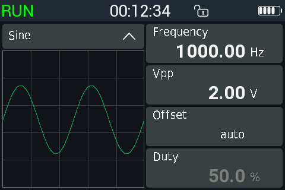

# Signal generator

The generator output is the **GEN** jack. It keeps running on every page,
also while you use the multimeter or the scope.

To open it: main menu, **Signal**, or swipe right from the multimeter page.

**Never connect the GEN output to a voltage source.** It has no protection;
an external voltage can destroy the output.

## The page

- Top bar: **RUN** (green, output on) or **STOP**, the time since power-on,
  lock, Bluetooth, battery.
- Left: the waveform box with a preview of two periods.
- Right: **Frequency**, **Vpp**, **Offset**, **Duty**.

## Use it

1. Tap the waveform box to step through **Sine → Square → Triangle → Ramp**.
2. Tap a value box to type a new value (below).
3. Tap **RUN / STOP** in the top bar, or press **RUN**, to switch the
   output on or off.

The output is off after power-on. The waveform, frequency, amplitude,
offset and duty are kept. On the very first start the generator is set as
on the stock firmware: square, 2 MHz, 3 Vpp.

While the output runs, the scope page shows **G** and the frequency in its
top bar, and the combined view shows **GEN**.

## Limits

| Setting | Range |
|---|---|
| Frequency, sine / triangle / ramp | 1 Hz to 50 kHz |
| Frequency, square | 1 Hz to 10 MHz |
| Amplitude | 0 to 3.00 Vpp |
| Output level | Always between 0 and 3 V; never negative |
| Duty | 0 to 100 %, square only |

- Above 50 kHz a sine, triangle or ramp runs at 50 kHz. The set value stays
  and shows grey with **max 50 kHz**; switch back to Square and it plays
  again.
- A square above 50 kHz is a logic-level square: amplitude and offset
  cannot be set (grey, **logic level**).
- The frequency box shows the real output frequency, which can differ
  slightly from the typed one: 3 decimals below 1 kHz, 2 below 100 kHz.
- The duty box shows the real duty cycle.

## Offset

- **auto** (default): the waveform runs from 0 V to Vpp, as on the stock
  firmware.
- A set offset is the centre level of the waveform. It stays between Vpp/2
  and 3 V − Vpp/2, so the waveform stays inside 0 to 3 V.
- With 0 Vpp and an offset, the output is a DC voltage.
- To return to auto: open the Offset keypad, delete the value and tap
  **OK** with an empty field.

## The keypad

Tap a value box. The keypad opens with the current value selected:

- the first digit replaces the whole value;
- **<** deletes the last character;
- frequency: type whole numbers and choose the unit with **H** (Hz),
  **K** (kHz) or **M** (MHz). To get 32.768 kHz, type `32768` and **H**;
- Vpp, offset and duty: digits and a decimal point;
- **OK** applies; a tap outside the keypad cancels.

## Known limitations

The output has been checked inside the meter, not at the GEN jack: the
real amplitude, the output impedance and the quality above 50 kHz have not
been measured.
