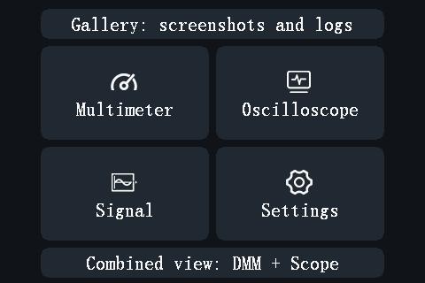

# Getting started

opendm40 is a replacement firmware for the Alientek DM40 (DM40A, DM40B,
DM40C). It keeps the look and the touch control of the stock firmware. The
multimeter, the oscilloscope and the signal generator run at the same time:
the screen only chooses what you see. It adds a power meter, data logging,
remote control over USB and Bluetooth, and more; see
[What's new compared with the stock firmware](whats-new.md).

The firmware installs like a stock update file. It does not touch the
Alientek bootloader, the update loader or the calibration of your meter, so
you can always go back to the stock firmware
([Recovery and back to stock](recovery.md)).

## Install

Before you start:

- Charge the battery.
- Read [Backup](recovery.md#back-up-your-meter). The backup is made with
  opendm40 itself, after the install, and only takes a copy of a folder.

To install opendm40 on a meter that runs the stock firmware:

1. Get the update file `opendm40.bin`. Today you build it from the source
   ([firmware/README.md, Build](../../firmware/README.md#build)).
2. On the meter: **Settings > Other Settings > USB Connect**. Connect the
   meter to the computer with a USB cable. A USB disk appears.
3. Copy the file onto that disk as `dm40_fwrs.bin`. Keep it the only
   `dm40*.bin` file on the disk ([why](recovery.md#install-a-file-from-the-update-loader)).
4. Eject the disk on the computer.
5. Switch the meter off and on again. The stock update procedure installs
   the file.
6. The first start is dark for a few seconds. Do not switch the meter off
   in the first 10 seconds.

If the meter stops on the loader's update screen instead, copy the file onto
the loader's USB disk and press **update** ([Recovery](recovery.md)).

## Update

To install a newer opendm40 (or any other DM40 update file) from a running
opendm40:

1. **Settings > More > More > USB disk**: tap until it reads
   **PC can edit (re-plug)**.
2. Unplug the USB cable and plug it in again. The disk is now writable.
3. Copy the update file onto the disk, into the top folder, as
   `dm40_fwrs.bin` (any `dm40*.bin` name works).
4. The meter checks the file and asks **Firmware received. Install it
   now?** Tap **Yes**. The meter restarts into the update loader, installs
   the file and starts the new firmware.

If you do not answer within 60 seconds, the answer is No and the file is
deleted. A file that is not a DM40 update file is refused with **Not a DM40
update file**.

## Keys

The DM40 has four touch keys below the screen and one power key on the side.

| Key | What it does |
|---|---|
| **MENU** | Opens the main menu. On a settings page: goes one page back. In the main menu: back to the instrument you came from. |
| **RUN** | Multimeter: HOLD on / off. Hold it for 1 s: AutoHold on / off. Scope: run / stop. Generator: output on / off. |
| **AUTO** | Multimeter: back to autorange (also clears HOLD and REL). Scope: auto-set. |
| **MF** | Multimeter: the range page of the function. Scope: the scope menu. |
| **Power** | Press: switches the meter on, or wakes a dimmed screen. Hold 1.5 s: the screen goes dark and the meter beeps; it switches off when you let go. Press twice quickly: touch lock on / off. |

Every key press also silences the danger alarm
([Safety and alerts](safety-and-alerts.md)).

## Gestures

| Gesture | Where | What it does |
|---|---|---|
| Swipe left / right | Multimeter, DMM + Scope (start on the meter strip), Generator (Oscilloscope: see below) | Next / previous view |
| Swipe down with one finger | Multimeter | Start / stop recording ([Logging](logging.md)) |
| Swipe down with three fingers | Anywhere, while the touch lock is off | Screenshot to the disk ([Screenshots and gallery](usb-disk.md#screenshots-and-the-gallery)) |
| Swipe down with two fingers | Anywhere, while the touch lock is off | Asks **Power off?** Tap **Yes** to switch off. The question goes away by itself after 3 s. |

The oscilloscope has its own drags and taps; see [Oscilloscope](scope.md).

## Views and the main menu

The main menu has six tiles:

- **Gallery: screenshots and logs**: view the screenshots and Record-page recordings
  stored on the meter ([USB disk, Gallery](usb-disk.md#screenshots-and-the-gallery)).
- **Multimeter** ([Multimeter](multimeter.md)).
- **Oscilloscope** ([Oscilloscope](scope.md)).
- **Signal**: the signal generator ([Generator](generator.md)).
- **Settings** ([Settings](settings.md)).
- **Combined view: DMM + Scope**: the meter reading above the live scope
  ([Combined view](combined-view.md)).

The four instrument views form a ring. Swipe left for the next one, right for
the previous one:

**Multimeter → DMM + Scope → Oscilloscope → Generator → Multimeter**

On the oscilloscope page, a drag moves the trace, so swipes do not change
the view there. Use **MENU**, or switch on **Settings > More > Scope swipe**:
then a swipe that starts on the top bar or the side panel changes the view.

## The status bar

The top line of the multimeter page shows, from left to right:

- the range mode: **AUTO**, **AUTO+** or **MANU** (a fixed range);
- **RUN**, **HOLD** or **A-HOLD**, or in that place a wrong-connection alert
  ([Safety and alerts](safety-and-alerts.md));
- the time since the meter was switched on (hours:minutes:seconds);
- a lock symbol: open, or closed while the touch lock is on;
- **REC** in red while a recording to the disk runs;
- the Bluetooth symbol while a phone or a computer is connected over
  Bluetooth;
- the battery level; the symbol turns green while the battery charges.

## Touch lock

To lock the screen and the touch keys (for example in a pocket): press the
power key twice quickly. The lock symbol in the status bar closes. Press
twice again to unlock.

While the lock is on, a single press of the power key on the multimeter or
the combined view switches to the next sub-mode of the current function
(for example DC V → AC V), as on the stock firmware.

## Power, battery and sleep

- **Dim screen** (Settings, default 5 min): without a touch or a key press
  for this long, the backlight dims. Any touch or key brings it back; that
  first touch only wakes the screen and does nothing else.
- **Shutdown** (Settings, default 30 min): without input for this long, the
  meter switches off. 30 s before, it beeps and shows **Auto power-off in
  30 s** (then 20, 10); touch the screen or press a key to keep it on.
- The meter does not switch itself off while a recording runs, while a
  MIN/MAX/AVG session runs, or while the power meter counts energy with a
  current flowing. The screen still dims.
- To switch off: hold the power key 1.5 s, or swipe down with two fingers
  and tap **Yes**.
- The battery charges from the USB port.

## What is kept when you switch off

The settings, the generator and scope settings, the limits and the last
multimeter function are kept when you switch off and on. The stock firmware
keeps its own settings separately; switching between the two firmwares does
not mix them.

## On-screen help

**Settings > More > Help** opens seven short help pages: gestures, side
keys, multimeter, limits, recording and alerts, the USB disk, and the power
meter. Tap to turn the page.

## Known limitations

Untested on a real meter: keeping the settings across a full power-off (a
restart keeps them); installing over the stock firmware's **USB Connect**
disk; the update from the **PC can edit** disk.

## Next steps

- [Multimeter](multimeter.md)
- [Connecting from a computer](connecting-from-a-computer.md)
- [Settings](settings.md)
