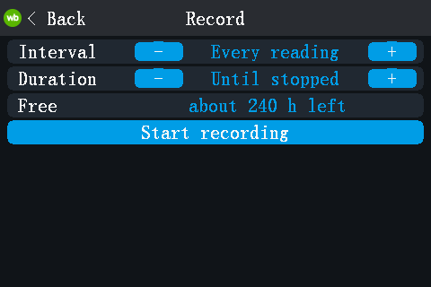

# Recording (data logging)

opendm40 records multimeter readings to the meter's internal disk. You copy
the recordings to a computer from the [USB disk](usb-disk.md) as CSV files,
or view them on the meter in the [Gallery](usb-disk.md#screenshots-and-the-gallery).

There are two recorders:

- **Recording** (the Record page): readings as the multimeter shows them,
  or one mean value per 1 s, 10 s or 1 min. For hours or days.
- **Fast recording**: raw samples of the measuring chip, up to thousands
  per second, for seconds to hours. DC and AC volts and amps only.

## Start and stop a recording

The quick way: on the multimeter page, **swipe down with one finger**. The
meter beeps and shows **Recording CSV**; **REC** appears in red in the
status bar. Swipe down again to stop. When the last rows are on the disk,
the meter shows **Saved LOG007.DLG** (with the file's number).

The quick way uses the interval and duration last set on the Record page.
If the interval there is **Fast**, the swipe still starts a normal recording
with the last other interval.

## The Record page



To open it: on the multimeter page press **MF** (for continuity, diode and
frequency, MF opens the Hold & Limits page directly). On the range page tap
**Hold/Limits**, then tap **Record** at the bottom.

| Row | What it does |
|---|---|
| **Interval** | **Every reading**: one row per reading. **1 s**, **10 s**, **1 min**: one row per interval with the mean of the readings in it. **Fast**: the fast recorder (below). Tap **-** / **+** to change. |
| **Duration** | **Until stopped**, **10 min**, **1 h**, **8 h** or **24 h**. A recording with a duration stops by itself. |
| **Free** | How long the free disk space lasts at this interval, for example **about 120 h left**. |
| **Start recording** / **Stop recording** | Starts the recording and goes back to the multimeter page, or stops a running one. |

You cannot change the interval or the duration while a recording runs; the
meter says **Stop the recording first**.

While a recording runs:

- The multimeter keeps measuring in every view, also on the scope page and
  in the menus.
- The meter does not switch itself off. The screen still dims.
- One recording runs at a time.

The recording stops with a message when the disk is full (**Disk full: log
ended**).

## What is recorded

Each row holds the reading as the multimeter measured it, with REL applied
but without the display smoothing. In the interval modes, a row holds the
mean of the readings of that interval; an interval with an overload reading
becomes an overload row.

The meter has no real-time clock. Times count in seconds from the start of
the recording; the header says how long after power-on it started.

The CSV file looks like this:

```
# Alientek DM40A, opendm40 0.0.1, function DC V, range AUTO, started uptime 12.345 s
# time_s = seconds since the start of this recording (no real-time clock); empty value = overload
time_s,value,unit,flags
0.250,1.23456,V,
0.750,,V,OL
```

| Column | Content |
|---|---|
| `time_s` | Seconds since the start. In interval mode: the end of the interval. |
| `value` | The reading in base units (V, A, Ohm, F, Hz, ...). Empty on overload. |
| `unit` | The unit. |
| `flags` | Any of `OL` (overload), `REL`, `HOLD`, `HI` / `LO` (outside the limits), and `GAP` on the first row after rows were lost. |

Interval files have one more header line that names the interval.

The meter stores the recording in a compact form (`LOGS/LOG007.DLG` on the
internal disk). The USB disk shows it as `LOGS/LOG007.CSV`. The CSV is
generated when you read it.

## Fast recording

The fast recorder writes the raw samples of the measuring chip with
microsecond time stamps. It works in DC V, DC mV, DC A and the AC voltage and
current functions.

1. Choose the function on the multimeter page.
2. Open the Record page and set **Interval** to **Fast**. The **Free** row
   shows the sample rate and the time left, for example **4800/s, 25 min
   left** in AC V. In other functions it shows **-- (DC/AC V or A only)**.
3. Set the **Duration**, then tap **Start recording**.

The meter first prepares the disk (**Preparing disk**, a percentage; tap to
cancel). Then the screen shows the **DATA LOGGING** panel: the sample rate,
the sample count and the file's size. The rest of the screen is paused to
leave the time to the recorder. Tap the panel to stop. The meter shows
**Saved FAST003.DLG**.

The file appears on the USB disk as `LOGS/FAST003.CSV` with the columns
`t_s,raw,value_<unit>,lost_before` (AC functions) or `t_s,raw,lost_before`
(DC functions, raw counts). `lost_before` counts the samples missing before
that row; nothing is lost silently.

The sample rate is set over SCPI ([SCPI reference, Data
logging](scpi-reference.md#data-logging-log)):

- AC V, AC mV, AC A: 4800/s by default; 1200 to 38 400/s, or 76 800/s if
  the meter's flash chip is fast enough.
- DC V, DC mV, DC A: 40/s by default; 2.5 to 640/s.

## Other ways to log

- Over USB or Bluetooth, the `LOG:` SCPI commands stream readings straight
  to a computer, and `MMEM:` commands read the files on the disk
  ([SCPI reference](scpi-reference.md)).
- The scope's **Save CSV** writes the captured waveform
  ([Oscilloscope](scope.md)).

## Known limitations

Untested on a real meter: the fast recorder at 76 800 samples/s.
