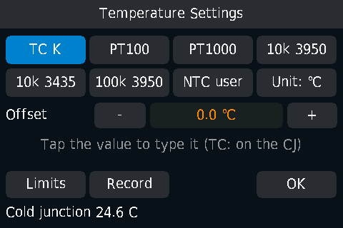
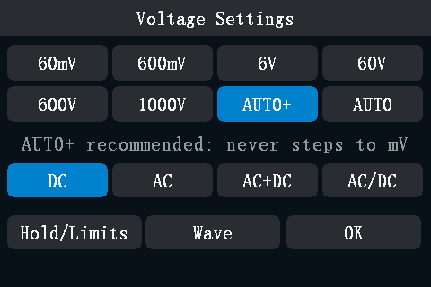
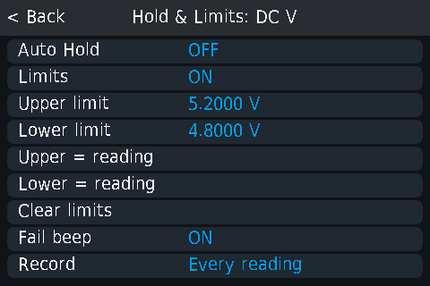

# Multimeter

The multimeter page shows, from top to bottom:

- the status bar: range mode (**AUTO**, **AUTO+** or **MANU**), the hold
  state (**RUN**, **HOLD**, **A-HOLD**) or an alert, the time since
  power-on, the lock, **REC**, Bluetooth and the battery;
- the reading, with the unit and the coupling symbol on the right;
- a row with the bargraph or the last five stored readings;
- the trend chart, with its timebase and the rate on the left, and
  MAX, AVG, REL and MIN on the right;
- seven function buttons: **V**, **A**, **Ω**, capacitance,
  diode / continuity, **Hz / °C** and **W** (the [power meter](power-meter.md)).

The multimeter keeps measuring while you look at another view only if
something needs it (a recording, the power meter, a Bluetooth or USB
client); otherwise it pauses and resumes when you come back.

## Choose a function

Tap a function button. Tap the selected button again for its next
sub-mode:

| Button | Sub-modes, in tap order |
|---|---|
| **V** | DC → AC → AC+DC → AUTO (AC/DC) → DC |
| **A** | DC → AC → AC+DC → AUTO (AC/DC) → DC |
| **Ω** | Normal → Low current → Normal |
| Capacitance | (none) |
| Diode / continuity | Diode → Continuity → Diode |
| **Hz / °C** | Frequency → Temperature → Frequency |
| **W** | Power meter: DC → AC → AC+DC → DC |

A function always starts in autorange; V and A start in DC, the diode
button starts on diode, the Hz / °C button on frequency.

You can also choose the coupling on the range page (MF, below).

Right after a change, the new unit appears at once and the value shows grey
dashes. Values that are not final yet (the first reading, while the range is being found) are
grey. Only final (white or orange) values go into statistics, REL, limits,
the chart, recordings and readings over USB or Bluetooth.

## Functions

### DC and AC voltage

- DC V: the signed voltage.
- AC V: the true RMS voltage, with the frequency and the duty cycle in the
  small rows below.
- Ranges: 600 mV, 6 V, 60 V, 600 V, 1000 V.
- From 30 V the value turns red; from 100 V a lightning symbol appears.

There is no separate mV button: choose the 600 mV range on the range page,
or use AUTO (not AUTO+), which steps down into mV.

### AC+DC

For signals with both a DC and an AC part, for example a ripple on a supply
rail. The meter measures the AC part and the DC part one after the other and
shows:

- the total, √(AC² + DC²), as the main value;
- the AC part and the DC part in the two small rows.

One full cycle takes about 2 s; the first value comes after about 1.3 s.
Until both parts are measured, the parts are grey. After a range change the
meter waits for the AC part to settle. There is no rate choice and no extra
digit in AC+DC.

### AUTO coupling (AC/DC)

AUTO coupling shows the DC part or the AC part, whichever the signal is:

- a DC voltage with a little ripple: the DC value, signed;
- an AC voltage with little DC: the RMS of the AC part.

The coupling symbol next to the unit shows which part you see, and **AUTO**
appears next to it. Both parts are always in the small rows.

- AUTO switches to AC when the AC part is more than 1.5 times the DC part
  and above a floor (1 % of the range for volts, 3 % for amps). It switches
  back to DC when the AC part falls below 0.75 times the DC part or below a
  lower floor (0.5 % for volts, 2 % for amps).
- A switch takes 2 to 4 s (two cycles in a row must agree).
- Open leads read DC. Mains hum picked up by open leads can read as AC.
- When AUTO switches, REL and MIN/MAX/AVG restart.

### Current: A, mA, µA

All current ranges use the **A** jack and **COM**. The meter switches the
shunt inside.

- Ranges: 600 µA, 6000 µA, 60 mA, 600 mA, 6 A, 10 A.
- DC A: the signed current. In the mA ranges the small row shows the
  **4-20 mA** loop percentage: 4 mA = 0 %, 20 mA = 100 %. It is hidden below
  3.6 mA and above 125 %.
- AC A: the RMS current, with frequency and duty cycle.
- Optional: the [burden voltage](#burden-voltage).

The A function starts on a mA range in autorange. In AUTO, a current too
large for the µA or mA ranges moves straight to the 6 A range. On a fixed µA
or mA range, an overload moves the meter to the 10 A shunt and shows
**OVLD** ([Safety and alerts](safety-and-alerts.md)).

### Resistance

- Ranges: 60 Ω, 600 Ω, 6 kΩ, 60 kΩ, 600 kΩ, 6 MΩ, 60 MΩ.
- The 60 Ω range (milliohm resolution) is manual only; AUTO never goes
  below 600 Ω.
- **Low current** (second tap on Ω, or **Low current ON** on the range
  page): a smaller test current, for measuring in a circuit. The Ω button
  shows a small **ON** tag. The 60 Ω range always uses the normal current.
- While the meter looks for the range, the values are grey.

### Continuity

- Shows the resistance with two decimals; **0L** above 1000 Ω.
- A negative result means an external voltage on the circuit: the meter
  shows **LIVE?**.

### Diode

- Shows the forward voltage with four decimals; **0L** above 3.12 V.
- Beeps by forward voltage, as on the stock firmware: a continuous tone
  below 22 mV (a short), three different beep patterns below 0.45 V,
  0.75 V and 1.5 V, silent above. A pattern plays for the first few
  readings only.

### Capacitance

- Ranges: 6 nF to 60 mF, autorange only.
- Large capacitors take longer: from the 600 µF range up the meter first
  discharges, then measures.

### Frequency and duty cycle

- The frequency, with the duty cycle in the small row.
- A new value every 0.35 s. **--** until the first clean result.
- MF opens the Hold & Limits page (there are no range choices).

### Temperature

Tap **Hz / °C** twice. Press **MF** to open the temperature page:

| Sensor | Notes |
|---|---|
| **TC K** (type K thermocouple) | -40 to 1000 °C. The small row shows the cold-junction temperature (the meter's own sensor). About 2 s per reading. |
| **PT100**, **PT1000** | -200 to 850 °C, 2-wire. |
| **10k 3950**, **10k 3435**, **100k 3950** (NTC thermistors, B value 3950 or 3435) | -55 to 300 °C. |
| **NTC user** | Set **R25** (100 Ω to 10 MΩ) and **Beta** (1000 to 10000) with the keypad. |

- The small row shows the sensor's resistance (resistive sensors) or the
  cold junction (TC K); the chip under it names the sensor.
- **Offset**: -20 to +20 °C in 0.1 °C steps, one per sensor. Tap **-** /
  **+**, or tap the value to type it. For TC K the offset corrects the cold
  junction.
- **Unit: C** / **Unit: F** switches between °C and °F for the whole meter (also in
  **Settings > More > Temp unit**).
- The 2-wire leads add their resistance: about 0.4 °C per 0.1 Ω on a PT100.
  Correct it with the offset or with REL.
- The supplied thermocouple is rated to 300 °C.

Owners report early units reading the thermocouple 3.6 to 6 °C low: set
the offset once.

## Ranges: the range page (MF)

Press **MF** to open the range page of the current function (for
continuity, diode and frequency, MF opens Hold & Limits).

- Tap a range to fix it (the status bar shows **MANU**). Tap **AUTO** or
  **AUTO+** to return to autorange, or press the **AUTO** key.
- The coupling row: **DC**, **AC**, **AC+DC**, **AC/DC** (AUTO coupling).
- **Hold/Limits** opens the [Hold & Limits page](#limits-and-autohold).
- **OK** or **MF** goes back.
- Current page only: **Fuse check** ([Safety and alerts](safety-and-alerts.md#fuse-check))
  and **Inrush** ([Power meter, Inrush](power-meter.md#inrush-current)).
- Voltage and current pages: **Wave** opens the oscilloscope on the
  multimeter inputs ([Oscilloscope, Wave view](scope.md#wave-view-the-scope-on-the-multimeter-inputs)).

Choosing a range turns REL off.

### AUTO and AUTO+

| | Voltage | Current |
|---|---|---|
| **AUTO+** | Volt ranges only; never steps down to 600 mV. **Default.** | Steps down to the mA ranges, not to µA. |
| **AUTO** | Also steps down into 600 mV (the stock behaviour). | Steps down to µA. **Default.** |

With AUTO on volts, the range page warns in orange: **AUTO starts on mV:
AUTO+ is safer**.

AUTO+ is the default for volts because owners have linked damaged inputs
to a high voltage applied while the meter sat on the mV range.

### Overload

- **0L** in the reading; the bargraph turns red with an **OL** mark.
- An overload is never stored in MIN/MAX/AVG, the chart or the history.

## Counts, rate and the extra digit

opendm40 uses 60000 counts on every model (ranges 600 mV, 6 V, 60 V ...).

### Rate: FAST, MED, SLOW

The rate sets the speed and the resolution in DC V, DC mV, DC A and Ω:

| Rate | What you get |
|---|---|
| **FAST** | 10 readings/s, 60000 counts. |
| **MED** (default) | 10 readings/s while the input changes, 2.5/s once it is steady. On suitable ranges, an average over 3.2 s gives an extra digit (600000 counts). |
| **SLOW** | As MED, with a 6.4 s average, on every DC V, DC A and Ω range (the extra digit only on the ranges listed below). |

In Ω from 60 Ω to 60 kΩ the averages are twice as long (MED 6.4 s, SLOW
12.8 s). After a step of the
input or a range change the average restarts, so a change shows at once.

- The **rate chip** on the left of the chart shows the rate and the
  measured readings per second. Tap it: FAST → MED → SLOW → FAST.
- **Tap the reading** to step the rate the same way; a message says what you
  get, for example **MED 600000 counts / 3.2 s**.
- In the other functions (AC, AC+DC, capacitance, frequency, temperature,
  continuity, diode) the speed is fixed: the chip shows **n/a**; a tap on the
  reading shows **Fixed rate in this function**.
- Also in **Settings > More > DMM rate**.

The extra digit appears smaller, after the main digits, on these ranges:
DC 600 mV, 6 V, 60 V, 600 V and Ω 600 Ω, 6 kΩ, 60 kΩ. It appears about
3.2 s (MED) after the input settles.

### Smoothing

**Settings > More > Smoothing**: **OFF** (default), **LOW**, **HIGH**. A
moving average of the shown readings, for a calmer display. It restarts on a
real step, so changes still show at once. Smoothing applies to the reading,
the limits, the chart and readings over USB or Bluetooth; not to MIN/MAX/AVG, AutoHold,
recordings or the bargraph. Continuity is never smoothed.

## HOLD, AutoHold and REL

### HOLD

Press **RUN**. The status bar shows **HOLD**; the reading, the statistics
and the chart freeze. The bargraph keeps moving with the live input. Press
**RUN** again to release.

If you press RUN right after a function change, HOLD waits for the first
final reading and holds that.

### AutoHold

To switch AutoHold on or off: hold **RUN** for 1 s (or the first row of the
Hold & Limits page). The status bar shows **A-HOLD**: blue while it waits,
orange while it shows a captured value.

AutoHold captures a reading when it has been stable for about a second (for
example within 0.1 % for 1 s in DC V), beeps and keeps it on the screen
while you lift the probes. It captures again after the input went away (open
leads, OL) or changed by more than about 0.5 %. The statistics and the chart
keep running on the live value.

### REL

Tap the **REL** box on the right. The current reading becomes the zero;
the box shows the REL value. Tap again to turn it off.

- REL works in every function. In V, A, Ω and Hz it also fixes the range.
- Not possible while HOLD is on or the reading is OL.
- REL ends when you change the function, choose a range, press AUTO, or
  AUTO coupling switches.
- Turning REL on or off restarts MIN/MAX/AVG.

## MIN, MAX, AVG

The column on the right of the chart shows **MAX**, **AVG** and **MIN**
since they were last reset, and a timer **T hh:mm:ss**.

- **Tap the column** (outside the REL box): start a session. The
  statistics are cleared, the timer shows **REC hh:mm:ss** in orange, and
  the meter does not switch itself off while the session runs. Tap again
  to stop.
- **Long press the column**: reset MIN/MAX/AVG.

## The bargraph and the history row

**Settings > More > DMM row** chooses what the row under the reading
shows: **Bargraph** (default) or **History**.

- **Bargraph**: 50 segments, each 2 % of the range; centre zero in DC V and
  DC A (25 segments per side, 4 % each), from zero elsewhere, empty in
  temperature. It updates with every measurement, without smoothing or REL,
  and keeps moving during HOLD.
- **History**: five boxes. Tap the row to store the shown value (also a held
  value); the newest is orange. Long press the row to clear it.

## The trend chart

The chart plots the reading over time, 321 points wide.

- Tap the left column of the chart (the timebase label) to switch
  160 → 320 → 640 ms/div; the chart restarts.
- The scale follows the data.
- It stops during HOLD and keeps running during AutoHold.
- It restarts when you change the function.

## Limits and AutoHold

To open: **MF**, then **Hold/Limits** (for continuity, diode and frequency,
MF opens it directly). The title names the quantity, for example **Hold &
Limits: DC V**.

| Row | What it does |
|---|---|
| **Auto Hold** | AutoHold on / off. |
| **Limits** | Limit check on / off. |
| **Upper limit**, **Lower limit** | Type a value with the keypad. |
| **Upper = reading**, **Lower = reading** | Take the current reading as the limit and switch the check on. |
| **Clear limits** | Remove both limits. |
| **Fail beep** | Beep when the reading leaves the limits (default ON). |
| **Record** | Opens the [Record page](logging.md#the-record-page). |

- Each quantity has its own limits: DC V, AC V, DC A, AC A, Ω, diode,
  capacitance, Hz, temperature, power. AC+DC uses the AC limits, continuity
  the Ω limits.
- The limits compare the shown value (after REL).
- Next to the reading: **OK** in green, **HI** or **LO** in red.
- The fail beep sounds when the reading crosses out of the limits, at most
  once per second.

## Burden voltage

A current meter drops a small voltage across its shunt (the burden
voltage), which the circuit under test loses. To show it: **Settings >
More > More > Burden voltage: ON (A, mA, uA)**. Default OFF.

- DC: the burden voltage in the first small row, labelled **Burden**.
- AC: in the second small row, instead of the duty cycle.
- Not shown in AC+DC, AUTO coupling or the power meter.
- It is computed from the shunt resistance alone (10 mΩ for A, 0.5 Ω for
  mA, 47.5 Ω for µA); the fuse and the wiring add a little more.
- At full scale: 100 mV (10 A), 60 mV (6 A), 300 mV (600 mA), 30 mV
  (60 mA), 285 mV (6000 µA), 28.5 mV (600 µA).

## Recording

Swipe down on the multimeter page to start or stop a recording to the disk;
see [Recording](logging.md).

## What is kept

The function, the autorange choices, Low current Ω, the rate, smoothing,
the DMM row, the temperature sensor and unit, the offsets, AutoHold, the
limits and the fail beep are kept when you switch off. After the stock
firmware has run, opendm40 starts on DC V. HOLD, REL, MIN/MAX/AVG, the history and a fixed range are not:
the meter starts in autorange.

## Known limitations

- Untested on a real meter: currents through the A jack (overload
  handling, AUTO coupling on current, burden with current), the
  continuity beeper and the diode beeps, Low current Ω, PT100, PT1000 and the
  NTC sensors.
- A false **A-JACK** in Ω and continuity:
  [Safety and alerts](safety-and-alerts.md#known-limitations).
- A fast square wave reads about 0.2 % high while the scope is powered:
  [Combined view](combined-view.md#known-limitations).
