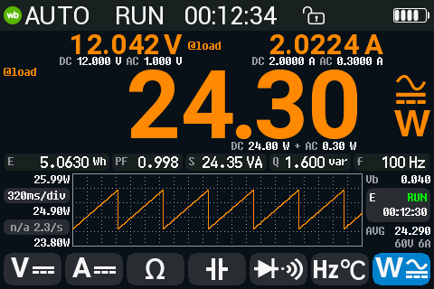
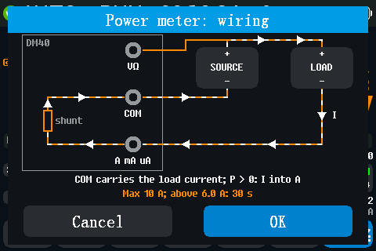
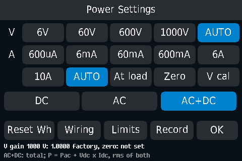
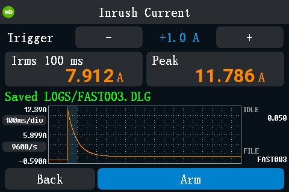

# Power meter and inrush current

The power meter measures the voltage and the current of a load at the same
time and shows the power, the energy and, for AC, the power factor.

## Wiring

The V and A inputs share **COM**, so the current flows through COM:

1. Break the **return** wire (−) between the source and the load.
2. Load − → **A** jack; **COM** → source −.
3. **V** jack → the + wire, on the source side.

The current into the A jack counts as positive: a load reads positive
power, a source negative.

Maximum 10 A. Above 6 A the meter counts down 30 s, then warns (below).

## Start

Tap **W** (the seventh function button). The first time, the wiring
picture opens: tap **OK** to start. Later, W starts at once; to see the
picture again, long press the **A** button, or **MF > Wiring**.

On entry both inputs autorange: V starts on 600 V, I on 10 A and steps
down. Until the current range is found, the page shows the voltage and **I
ranging...** (a few seconds).

## The screen

- **Top**: the voltage (left) and the current (right).
- **Main value**: the power P, with the coupling symbol. Tap it to step
  **P → Wh → VAh → P**.
- **Row of five boxes**: the energy **E** (or **P** while the main value
  shows energy), the power factor **PF**, the apparent power **S** (VA),
  the reactive power **Q** (var), the frequency **f**. **--** where there is
  no value (for example PF in DC).
- **Right column**: **Vb** (the voltage drop in the meter itself), **VAh**,
  the energy timer (**RUN** / **PAUSE** and the elapsed time), **AVG** (the
  mean power since the start), and the ranges.
- **Trend chart** of the main value.

In AC+DC the page also shows the DC and AC parts: under V, under I and under
P (`DC x W + AC y W`). The parts add up to the totals.

## Coupling: DC, AC, AC+DC

Tap **W** again to step **DC → AC → AC+DC**, or choose it on the settings
page. Entering the power meter always starts in DC.

| Coupling | Power | Use for |
|---|---|---|
| **DC** | P = Vdc × Idc. No PF, S, Q, f. | Batteries, DC supplies. Most precise for DC. |
| **AC** | Only the AC parts (DC removed): P, S, Q, PF, f. | Mains-type loads, transformers. |
| **AC+DC** | The total: P = Pac + Vdc × Idc; V and I are the RMS of both parts. | Rectified or chopped signals, DC with ripple. |

In AC and AC+DC the meter measures the power, the voltage and the current in
turn; a full set takes about 1.3 s.

Hints (grey, with a short message): **DC?** in AC+DC when there is no AC
part (**No AC: DC is more precise**); **AC?** in DC when the voltage has an
AC part (**AC present: use AC+DC**).

## Energy

- Wh and VAh count from the start of the power meter. A source counts
  negative Wh.
- Tap the energy timer box: pause / resume counting.
- **Reset**: long press the right column or the energy box; answer **Yes**
  to **Reset energy?**. Or **MF > Reset Wh** (no question).
- Energy restarts from zero when you leave the power meter or switch off.
- While the energy counts with a current flowing, the meter does not switch
  itself off.

## Power Settings (MF)

| Item | What it does |
|---|---|
| **V** ranges 6V, 60V, 600V, 1000V, AUTO | Fix the voltage range, or autorange. |
| **A** ranges 600uA, 6mA, 60mA, 600mA, 6A, 10A, AUTO | Fix the current range, or autorange. |
| **At load** | OFF (default): V and P at the jacks. ON: subtracts the meter's own voltage drop, so V and P are those at the load. **@load** marks the values. Use it when the V lead is on the source side (the normal wiring). |
| **Zero** | Measures and stores the zero offsets. Disconnect the leads and nothing in A; takes about 12 s. Refused if a signal is present. |
| **V cal** | Calibrates the power meter's voltage against the multimeter's own DC V or AC V on the current range: apply a steady voltage of 10 % to 70 % of the range (DC: up to 100 %); takes about 8 s. |
| **DC / AC / AC+DC** | The coupling; the help line explains the chosen one. |
| **Reset Wh** | Resets Wh, VAh and the time at once. |
| **Wiring** | Shows the wiring picture. |
| **Limits** | Hold & Limits for the power: AutoHold, upper and lower limits in W, fail beep, Record. |
| **OK** | Back. |

The status line shows the running job or its result, or the voltage gain
in use and whether a zero is stored.

The meter's own drop used by **At load** and **Vb** is the current shunt
alone (10 mΩ, 0.5 Ω or 47.5 Ω); the fuse and the wiring add a little. It can
be changed over SCPI (`POW:BURD`).

## Current limit

Above 6 A the right column shows a countdown (**I>LIM 23s**, amber). After
30 s it shows **I>LIM!** in red, says **Current too high: reduce it** and
beeps every 2 s until the current falls below 5.7 A. The limit and the time
can be changed over SCPI (`POW:LIM`).

Above 10 A for 1 s the [danger alarm](safety-and-alerts.md#the-danger-alarm)
sounds.

## Inrush current

Captures the current of a load that is switched on: motors, lamps,
capacitive power supplies.

To open: **A** function, **MF**, **Inrush**.

1. Connect the load through the **A** jack and **COM** (the 10 A range).
2. Set the **Trigger** step with **-** / **+**: 0.2, 0.5, 1 (default), 2, 5
   or 10 A.
3. The page opens armed: **Armed: 0.123 A now**. Switch the load on.
4. The meter records 2 s (0.2 s before the trigger, 1.8 s after) and shows:
   - **Irms 100 ms**: the RMS current of the first 100 ms (the usual inrush
     figure);
   - **Peak**: the highest current;
   - **IDLE**: the current before the trigger;
   - the trace, 100 ms/div, with the first 100 ms shaded.
5. The capture is saved to the disk: **Saved LOGS/FAST003.DLG**; on the USB
   disk it is `LOGS/FAST003.CSV`.

**RUN** arms again or cancels. **Back**, **MENU** or **MF** close the page
and restore the A function.

- The trigger is a rise of the current by the step within about 100 ms, in
  either direction. With a load already running, only a step of that size
  triggers. A slow rise does not trigger.
- Works for AC and DC loads. 9600 samples/s: very short spikes read lower
  than they are.
- The meter's rating is 10 A; the capture shows **OL** when the current goes
  beyond what the input can measure.

## Known limitations

- Untested on a real meter: everything with a current flowing (the current
  reading, the sign, PF, the current-limit countdown, the inrush capture).
- The usable frequency range of the power meter is *unknown*.
