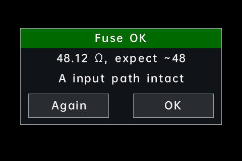

# Safety and alerts

The stock firmware warns only about high voltage (a red value from 30 V, a
lightning symbol from 100 V). opendm40 keeps those and adds alerts for
wrong connections, a loud alarm for dangerous ones, and a fuse check.

The DM40 cannot see which jacks a plug is in. The alerts work from what the
meter measures, so they cannot catch every mistake (see the end of this
page).

## How an alert looks

- A **badge** in the status bar, where **RUN** normally is (in the combined
  view: in the meter strip).
  - Red (white text): **A-JACK**, **A-PROT**, **OVLD**.
  - Amber: **V-JACK?**, **LIVE?**, **10A**.
  - Grey: the hints **DC?**, **AC?**, **FUSE?**.
- A **message** once, when the alert starts (1.5 s).
- During HOLD, A-JACK, A-PROT, LIVE? and OVLD alternate with **HOLD** every
  second.
- One alert at a time, the most serious one.

## The alerts

| Badge | Message | When | Where |
|---|---|---|---|
| **A-JACK** | Current in A jack: check leads | A current (from about 0.5 mA) flows through the A jack while you measure something else, for example the leads are still in A and COM while measuring volts. | DC V (6 V range), DC mV, AC V, AC mV, Ω, continuity, diode, temperature, capacitance 6 nF to 60 µF, AC+DC V (600 mV and 6 V). |
| **A-PROT** | A jack current: 10 A shunt on | The current through the A jack would overheat the small current shunt (300 mA at once, or 125 mA for 0.4 s). The meter switches the A jack to the 10 A shunt to protect it. | DC V, DC mV. |
| **OVLD**, then **10A** | Overload: 10 A shunt selected | On a fixed µA or mA range the current is too large. The meter moves to the 10 A shunt at once. After 3 s the badge turns amber **10A**: the meter measures fine, but not on your range. | A functions and the power meter, fixed range. In autorange the meter just moves up to 6 A. |
| **V-JACK?** | Voltage on V jack, no current | In a current function: no current, but a voltage on the V jack (DC above about 21 V, or AC from about 2 V). The leads may be in the wrong jacks. | Current functions (DC, AC, AC+DC, AUTO). |
| **LIVE?** | Voltage on circuit - power off | A reading only an external voltage can cause (a negative resistance). | Ω, continuity, diode. |
| **DC?** | DC voltage here: use DC V? | AC V sees a DC voltage and almost no AC. | AC V. |
| **AC?** | AC voltage here: use AC V? | DC V (6 V range) sees a voltage swinging both ways. | DC V. |
| **FUSE?** | 0 A for 60 s: check the fuse? | A current function read zero for a minute. The fuse may be blown. | A functions. |

How they end:

- A-JACK, LIVE?, DC?, AC?: 1 s after the cause is gone; V-JACK? and FUSE?
  after 0.5 s.
- A-PROT stays until you choose a function, a range or press AUTO, and the
  current is below 50 mA for 1 s. Choosing a current function ends it at
  once.
- OVLD / 10A: the meter returns to your range when the current stays below
  85 % of it for 5 s. If it trips again within 30 s, it stays on 10 A until
  you choose a range or function.

Sounds: A-JACK and A-PROT sound the [danger alarm](#the-danger-alarm).
LIVE? beeps once. OVLD beeps once (300 ms). The others are silent.

## The danger alarm

A loud two-tone alarm for connections that can damage the meter or the
circuit:

- **A-JACK** in the functions where a current really flows through the A
  jack: DC V, DC mV, AC V, AC mV, thermocouple, AC+DC V. (In Ω, continuity,
  diode, capacitance and the resistive temperature sensors, A-JACK shows
  silently.)
- **A-PROT** while the current still flows.
- **A current above 10 A** for 1 s on the 10 A range (also in the power
  meter).

The pattern: high-low-high-low, once per second for 30 s, then once every
10 s until the cause is gone.

To silence it (for this event): tap the badge or the message, or press any
key (the key still does its job), or the power key. A new event sounds
again.

**Settings > More > More > Danger alarm**:

- **Loud** (default): full volume, also when the key/alert volume is 0.
- **Volume**: at the key/alert volume.
- **Off**: badge and message only.

The alarm sounds only while the multimeter is powered.

## Settings

**Settings > More > More > Jack alerts**: **ON** (all alerts above,
default), **A-JACK only** (A-JACK and A-PROT), **OFF** (none of them, and no
A-PROT protection). OVLD and the 10 A alarm are always on. The danger alarm
has its own row ([Settings, page 3](settings.md#page-3)).

## Fuse check

Checks the fuse and the current path inside the meter without opening it.

1. **A** function, **MF**, **Fuse check**.
2. Plug one test lead from the **V/Ω** jack into the **A** jack. Nothing
   else: remove the other lead.
3. Tap **Start**. The meter measures the path (about 48 Ω through the fuse
   and the shunts).

| Result | Meaning |
|---|---|
| **FUSE OK** (about 48 Ω) | The fuse and the A input path are intact. |
| **FUSE OPEN** (OL) | No path from V to A: replace the fuse (10 A ceramic). |
| **Check leads** | A reading far from 48 Ω or none: one lead from V/Ω to A only. |

**Again** repeats, **OK** returns to the function you were in. Cancel or
any key stops it.

It cannot tell whether the 10 A shunt is intact: its 10 mΩ is lost in the
48 Ω.

## What cannot be detected

- A lead in the A jack with no current flowing.
- A voltage source across A and COM while you measure current: it reads as
  a current. Mains blows the fuse in under a millisecond.
- A blown fuse: the meter reads 0 A. FUSE? appears after a minute; the fuse
  check confirms it.
- A positive voltage on a circuit in Ω, continuity or diode: it looks like
  an open circuit. LIVE? needs a negative or alternating voltage.
- No A-JACK in DC V above the 6 V range (60 V, 600 V, 1000 V), in AC+DC V
  above 6 V, in frequency, and in the higher capacitance ranges. The power
  meter has no jack alerts.

## Known limitations

- Untested on a real meter: the alerts that need a current through the A
  jack (A-JACK, A-PROT, OVLD) and the danger alarm's sound.
- With 5 V or more between the V and COM jacks, Ω and continuity can show a false **A-JACK**
  (without the alarm).
- The fuse check needs a re-check on a real meter.
