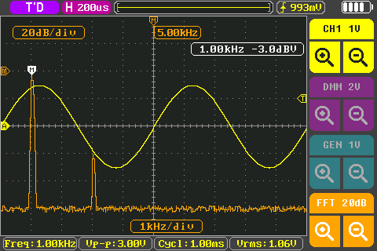
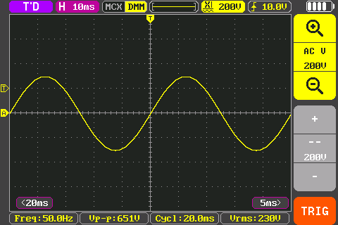

# Oscilloscope

The oscilloscope uses the **CHA** jack. The Wave view shows the signal on
the multimeter inputs instead
([below](#wave-view-the-scope-on-the-multimeter-inputs)).

To open it: main menu, **Oscilloscope**, or swipe from the combined view.

## The screen

- **Top bar**, from the left: the run state, the timebase (**H 200us**),
  the record bar, the V/div with the probe and coupling, the trigger (edge
  and level), the battery.
  - Run state: **WAIT** (waiting for a trigger), **AUTO** (no trigger, frame
    shown anyway), **T'D** (triggered), **RUN** (roll), **STOP**.
  - Record bar: while stopped, brackets show which part of the stored
    record is on screen; **ROLL** in roll mode; **G 1.00kHz** while the
    generator runs.
  - **MCX | DMM**: the input source (MCX is the **CHA** jack); tap to switch to the [Wave view](#wave-view-the-scope-on-the-multimeter-inputs).
- **Graph**: 10 × 8 divisions. On the left edge, the markers **A** (the
  trace's zero) and **M** (math / FFT); on the right edge, **T** (trigger
  level). On the top edge, **T** marks the trigger position.
- **Timebase tabs** in the bottom corners of the graph, for example
  **<500us** and **100us>**: the next slower and faster timebase.
- **CUR** tab at the bottom of the graph: cursors.
- **Right panel**: zoom in (magnifier +), **CHA** with the V/div, zoom out
  (magnifier −), the math scale +, the math button (**FFT**), math scale −,
  **TRIG**.
- **Measurement row** at the bottom: up to four measurements.

## Keys

| Key | What it does |
|---|---|
| **RUN** | Run / stop. Also: tap the run state in the top bar. |
| **AUTO** | Auto-set (below). |
| **MF** | The scope menu, Measure tab. |
| **MENU** | Main menu. Also closes a popup. |

## Timebase

- Range: 100 ns/div to 50 s/div. Up to 50 MS/s.
- **Tap a corner** of the graph: bottom left = slower, bottom right =
  faster. Keep the finger on the corner to repeat. The timebase in the top
  bar flashes on every change.
- **Tap the timebase** in the top bar: a list; drag to scroll, tap to
  choose.
- **Pinch** horizontally with two fingers: spread = faster, pinch = slower.
  A bubble shows the new value; it applies when you lift the fingers.
- **Roll mode**: from 200 ms/div the trace scrolls continuously (on by
  default; **MF > Display > Roll**). Without roll, the slowest timebase is
  1 s/div. Roll-only timebases are orange in the list.

The tap behaviour is set in **Settings > More > Scope tap step**:
**Corners** (default, only the two corners step), **Halves (stock)** (a tap
in the left or right half of the graph steps), **Off**.

## Vertical: V/div, position, coupling, probe

- V/div: 10 mV to 10 V per division (times the probe factor).
- Tap the **magnifier +** to zoom in (smaller V/div), **magnifier −** to
  zoom out. Or pinch vertically.
- **Drag up or down** in the graph to move the trace.
- Tap **CHA** (or the V/div in the top bar) for the channel popup:
  - **Coupling**: DC or AC.
  - **Probe**: ×0.1 to ×1000 (13 steps). It only changes the labels and
    readings, not the hardware.
  - **Color** of the trace.
- Bandwidth: owners report flat to about 3 MHz.

## Trigger

- **Drag** the **T** marker on the right edge up or down to set the trigger level.
- **Drag sideways** to move the trigger position (the **T** on the top
  edge).
- **Long press** a marker to centre it: the trigger level goes to the middle
  of the signal, the trigger position to the centre, the trace to 0 V in the
  centre.
- **Double tap** where a tap does nothing: the trace to the centre and the
  trigger position to 50 %.

Open the Trigger tab: tap **TRIG**, or the trigger in the top bar.

| Item | Choices |
|---|---|
| **Edge** | Rising, Falling. |
| **Mode** | **Auto** (shows the signal also without a trigger), **Normal** (waits for a trigger), **Single** (one frame, then STOP). Choosing a mode also starts the scope. |
| **Type** | **Edge**, **Pulse**, **Runt**. |

- **Pulse**: triggers on a pulse wider than (**>**), narrower than
  (**<**) or equal to (**=**, within 5 %) a width. Set the width with
  **-** / **+**, 20 ns to 10 s. Rising = a positive pulse.
- **Runt**: triggers on a pulse that crosses the first level but not the
  second. Drag the orange **T** to set the second level.
- Pulse and runt triggers look at each complete capture; a pulse in the
  short gap between captures can be missed. They do not work in roll mode.

The edge trigger uses the trigger hardware where it can, so it does not miss
edges between captures.

## Moving things with a finger

A drag moves the selected marker: a vertical drag moves the selected level
(the trace, the trigger level, a Y cursor, the FFT), a horizontal drag the
selected time item (the trigger position, an X cursor, the FFT centre).
Press on a marker to select it; markers that overlap are selected in turn.
A drag that starts on a marker moves only along that marker's axis until you
lift the finger: up and down for the level markers, sideways for the time
markers.

**Settings > Scope drag** sets how a drag starts:

- **Stock** (default): each movement goes to the axis it moves most.
- **Axis lock**: the first 15 pixels decide the axis; then only that axis
  moves.
- **Hold 300 ms**: hold the finger still first; the meter beeps, then the
  drag moves.

A second finger during a drag undoes it.

## Auto-set

Press **AUTO**. The scope looks for a signal and sets the V/div, the
position, the trigger level (middle of the signal) and the timebase (about 2
to 6 periods on screen). It takes 1 to 2 s and leaves the trigger mode on
Auto. **MENU** cancels (the old settings come back) and opens the main
menu.

- AC coupling stays AC. Only if nothing is found in AC does it switch to DC
  and say **AUTO: DC (no AC signal)**.
- Nothing found: **AUTO: no signal found**, the settings stay.

## Measurements

Press **MF**: the **Measure** tab lists 20 measurements. Tap up to four;
tap a selected one to remove it. **Clear** removes all, **Default**
restores Freq, Vp-p, Cycl, Vrms.

| Item | What it is |
|---|---|
| **Freq** | Frequency. |
| **+Duty**, **-Duty** | Positive and negative duty cycle. |
| **+Wid**, **-Wid** | High and low time of a cycle. |
| **+Pul**, **-Pul** | Number of high and low pulses on screen. |
| **X2-1** | Time between the X cursors. |
| **Xf** | 1 / (X2-1). |
| **Cycl** | Period. |
| **Vp-p** | Peak to peak; **--** when the signal is clipped. |
| **Vrms** | RMS of the screen. |
| **Vmax**, **Vmin** | Highest and lowest value. |
| **Vtop**, **Vbas** | The top and base levels (the most common value in the upper and lower 30 %). |
| **Vamp** | Vtop − Vbas. |
| **Y2-1** | Voltage between the Y cursors. |
| **Vcrm** | RMS over whole cycles. |
| **Vavg** | Mean. |

The measurements use the part of the signal on screen and update up to
about three times a second.

## Cursors

Tap **CUR** at the bottom of the graph: **CUR X** (two time cursors), **CUR
Y** (two voltage cursors), off. The measurement row shows X2-1 and Xf, or
Y2-1. Drag the **1** / **2** markers or the cursor lines.

## FFT

Tap the math button (**FFT**) on the right panel. The spectrum is drawn
over the trace; tap the button again while its popup is open to turn it off.

- The boxes show the dB/div, the centre frequency, the Hz/div and the
  strongest peak, for example **1.00kHz -3.0dBV**.
- **Math scale +** / **−**: dB per division.
- Drag the **M** marker up or down to move the spectrum; drag sideways to
  move the centre frequency.
- The math popup: **Mode** FFT or ABS (the absolute value of the trace),
  **Color**, **Hz/Div**, and under **Other** the **Window** (Rectangular,
  Blackman, Hanning (default), Hamming, Triangular, Flat-top) and the
  **FFT Unit** (dB or Vrms).
- 2048 points. No FFT in roll mode.

## Stop, zoom and pan

Press **RUN** (or tap the run state) to stop. The last capture (26 624
samples) stays in memory:

- change the timebase to zoom in or out of the stored capture;
- change the V/div to scale it;
- drag sideways to pan through it;
- double tap to centre it on the trigger point.

## Display settings

**MF > Display**: **Roll** on / off; **Persist** OFF, MIN, 1S, INF;
**Brightness** and **Grid** intensity.

## Save CSV and screenshots

**MF > Settings**:

- **Save CSV**: saves the whole stored capture (up to 26 624 samples, not
  only the screen). Stop the scope first (**Please stop sample**
  otherwise). The meter shows **Saved SCOP004.DLG**; the USB disk shows it as
  `SCOPE/SCOP004.CSV`.
- **PriScr**: a screenshot (or swipe down with three fingers).

The CSV starts with comment lines (timebase, V/div, probe, coupling,
sample rate, trigger), then `time_s,volts`. Time 0 is the trigger point
(the screen centre if the capture did not trigger); the values are volts at
the probe tip.

## Wave view: the scope on the multimeter inputs

The Wave view shows the signal on the multimeter's **V** or **A** jacks as
a waveform: a slow scope on the isolated multimeter inputs, for volts and
currents, within the meter's ratings.

To open it:

- in the multimeter, function V or A (DC or AC): **MF**, then **Wave**; or
- on the scope page, tap the **MCX | DMM** badge.

- The badge shows **DMM** highlighted; the channel button names the
  function, for example **AC V**.
- V/div follows the multimeter range: the range fills half the screen
  (6 V → 2 V/div, 600 mV → 200 mV/div, 10 A → 5 A/div). **Magnifier +** /
  **−** step the range.
- If the multimeter was in autorange, the Wave view steps up a range when
  the signal nears the top.
- Timebase: 1 ms/div to 50 s/div. Sample rate: 76 800/s at 1 ms/div, down
  to 1200/s from 200 ms/div. Opens at 10 ms/div the first time, then at the timebase you last used in
  it (until you switch the meter off).
- Coupling: AC V is AC-coupled; tap the V/div in the top bar or **CHA** to
  switch between the DC V and the AC V signal path. AC mV and the current
  paths are DC-coupled. DC A uses the AC A path (DC-coupled).
- Triggers (edge, pulse, runt), measurements (in amps on the current
  paths), cursors, FFT and Save CSV work. Every sample is checked for the
  trigger, so nothing is missed between frames.
- Auto-set is not available (**AUTO: MCX scope only**).
- The multimeter reading is not shown while the Wave view runs; the
  multimeter's alerts and the Bluetooth phone protocol pause.

To leave: tap the badge (back to the CHA input), press **MENU** or change
the view.

The Wave view is not available in AC+DC, AUTO coupling and the power
meter, nor while a recording runs; the meter says why.

## What is kept

The timebase, V/div, coupling, probe, trigger settings (except the mode),
positions, measurements, display settings and the FFT settings are kept when
you switch off. The scope starts running, in trigger mode Auto.

## Known limitations

- Untested on a real meter: pulse and runt triggers, cursors, pinch,
  double tap, long-press centring, holding a corner to repeat, Axis lock
  and Hold drag, the persistence modes, auto-set keeping AC coupling.
