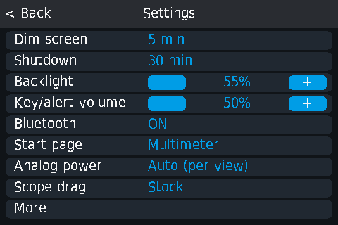
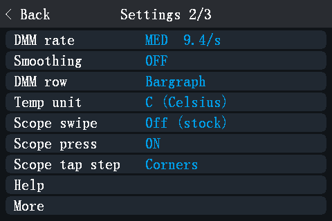
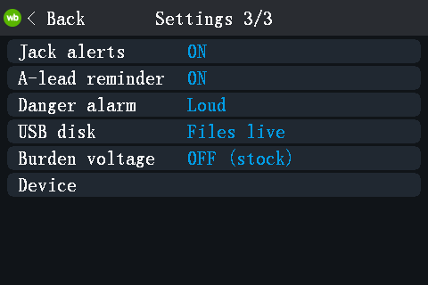
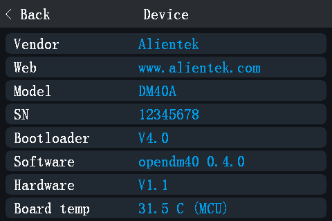

# Settings

To open: main menu, **Settings**. There are three pages; on pages 1 and 2
the last row, **More**, opens the next page. **< Back** in the title bar or
**MENU** goes one page back (from page 1: to the main menu). Tap a row to step to its next value; rows with **-** / **+**
change in steps.

All settings are kept when you switch off, except **USB disk**.

## Page 1

| Row | Values | Default | What it does |
|---|---|---|---|
| **Dim screen** | 5 min, 10 min, 30 min, Never | 5 min | Dims the backlight after this time without input. |
| **Shutdown** | 10 min, 30 min, 1 hour, Never | 30 min | Switches the meter off after this time without input; it warns 30 s before. Not during a recording, a MIN/MAX/AVG session, or while the power meter counts energy. |
| **Backlight** | 10 % to 100 %, steps of 10 from the default (15, 25 ... 95, and 10 and 100 at the ends) | 55 % | Screen brightness. |
| **Key/alert volume** | 0 % to 100 %, steps of 10 | 50 % | Loudness of key beeps and alerts. The auto power-off warning always sounds at least at 50 %; the danger alarm has its own setting (page 3). |
| **Bluetooth** | ON, OFF | ON | The Bluetooth module ([Remote control](remote-control.md)). |
| **Start page** | Multimeter, Oscilloscope, Signal, Main menu | Multimeter | The view after power-on. |
| **Analog power** | Auto (per view), Both always | Auto (per view) | Which analog parts are powered ([Combined view, Analog power](combined-view.md#analog-power)). |
| **Scope drag** | Stock, Axis lock, Hold 300 ms | Stock | How a drag on the scope graph starts ([Oscilloscope](scope.md#moving-things-with-a-finger)). |
| **More** | | | Page 2. |

## Page 2

| Row | Values | Default | What it does |
|---|---|---|---|
| **DMM rate** | SLOW, MED, FAST | MED | Multimeter speed and resolution; shows the readings per second, or **(n/a here)** where the current function has a fixed rate ([Multimeter, Rate](multimeter.md#rate-fast-med-slow)). |
| **Smoothing** | OFF, LOW, HIGH | OFF | Moving average of the multimeter display ([Multimeter, Smoothing](multimeter.md#smoothing)). |
| **DMM row** | Bargraph, History | Bargraph | What the row under the multimeter reading shows. |
| **Temp unit** | C (Celsius), F (Fahrenheit) | C | Temperature unit everywhere. |
| **Scope swipe** | Off (stock), Top bar | Off | Top bar: a swipe that starts on the scope page's top bar or side panel changes the view. |
| **Scope press** | ON, OFF (stock) | ON | The scope's side buttons light up briefly when pressed. |
| **Scope tap step** | Corners, Halves (stock), Off | Corners | Which taps on the scope graph change the timebase ([Oscilloscope, Timebase](scope.md#timebase)). |
| **Help** | | | The [on-screen help](getting-started.md#on-screen-help). |
| **More** | | | Page 3. |

## Page 3

| Row | Values | Default | What it does |
|---|---|---|---|
| **Jack alerts** | ON, A-JACK only, OFF | ON | Wrong-connection alerts. ON: all of them (A-JACK, A-PROT, V-JACK?, LIVE? and the hints DC?, AC?, FUSE?). A-JACK only: A-JACK and A-PROT. OFF: none of these ([Safety and alerts](safety-and-alerts.md)). |
| **Danger alarm** | Loud, Volume, Off | Loud | The alarm for dangerous connections. Loud: full volume, whatever the key volume. Volume: at the key/alert volume. |
| **USB disk** | Files live, PC can edit | Files live | Whether the computer may delete files and copy an update file. Takes effect at the next USB plug; until then the row shows **(re-plug)**. Back to Files live at every power-on ([USB disk](usb-disk.md#two-modes-files-live-and-pc-can-edit)). |
| **Burden voltage** | OFF (stock), ON (A, mA, uA) | OFF | Shows the voltage drop of the current shunt ([Multimeter, Burden voltage](multimeter.md#burden-voltage)). |
| **Device** | | | The Device page (below). |

## The Device page

**Settings > More > More > Device** shows:

| Line | Content |
|---|---|
| Vendor, Web | Alientek, www.alientek.com |
| Model | DM40A, DM40B or DM40C (from the meter's calibration data) |
| Bootloader | The version of the Alientek bootloader |
| Software | The opendm40 version |
| Hardware | The hardware version |
| Board temp | The temperature of the main chip, as a rough indication |

Tap anywhere to go back to Settings; **MENU** goes to the main menu.
