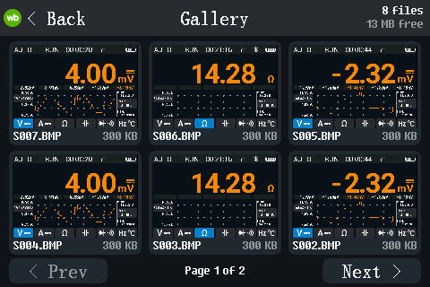
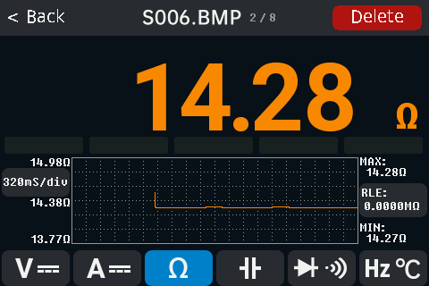

# USB disk, screenshots and the gallery

## The USB disk

Connect the meter to a computer with a USB cable. A drive named **DM40**
appears. It needs no driver. At the same time the meter is also a
measuring instrument on the same cable ([Connecting from a
computer](connecting-from-a-computer.md)); you do not have to switch
between the two, as on the stock firmware ("USB Connect").

| Folder or file | What is in it |
|---|---|
| `README.TXT` | A short version of this page. |
| `LOGS/` | Recordings of the multimeter: `LOGnnn.CSV` ([Recording](logging.md)), `FASTnnn.CSV` (fast recordings). |
| `SCOPE/` | Scope captures saved with **Save CSV**: `SCOPnnn.CSV` ([Oscilloscope](scope.md)). |
| `SHOTS/` | Screenshots: `Snnn.BMP`, 480 × 320. |
| `INFO/` | Your meter's calibration, boot data, chip ID and the running firmware as an update file. Copy it once as a backup ([Recovery](recovery.md#back-up-your-meter)). |
| `DEBUG/SPIFLASH.BIN` | A raw copy of the meter's 16 MB internal disk. |

The meter keeps its files in a compact form and converts them to CSV when
the computer reads them. A CSV file can therefore be much larger than the
space it takes on the meter.

### Two modes: Files live and PC can edit

Set in **Settings > More > More > USB disk**.

- **Files live** (default): the drive is read-only for the computer. New
  recordings and screenshots appear while the drive is connected; refresh
  the folder in the file manager (F5) to see them.
- **PC can edit**: you can delete files in `LOGS/`, `SCOPE/` and `SHOTS/`
  from the computer, and copy a firmware update file into the top folder
  ([Getting started, Update](getting-started.md#update)). New files from the
  meter appear only after an eject or a re-plug. Nothing else can be
  changed: other files copied onto the drive are gone at the next eject or
  re-plug, and `INFO/` and `DEBUG/` stay read-only.

A change of the mode takes effect at the next USB plug: unplug the cable
and plug it in again. Until then the row shows **(re-plug)**. The meter
always starts in **Files live**.

A file deleted in a file manager usually goes to the trash first; the meter
deletes it at the eject.

### Eject

After you eject the drive on the computer, it stays ejected until you
unplug and re-plug the cable. The measuring connection (SCPI) keeps working.

### Delete files

- On the meter: in the [Gallery](#screenshots-and-the-gallery).
- From the computer: in **PC can edit** mode, or with the SCPI command
  `MMEM:DEL` in any mode ([SCPI reference](scpi-reference.md)).

### Two meters on one computer

Each meter has its own serial number (the chip's unique ID, 24 hex digits),
so two meters show up as two drives and two instruments.

## Screenshots and the gallery

### Take a screenshot

Swipe down with three fingers, in any view. The meter beeps and shows
**Saved S012.BMP**. The file is in `SHOTS/` on the USB disk, a 480 × 320
BMP, the same format as on the stock firmware.

Messages: **Disk busy** (another recording or file job is running; try
again), **Disk full**, **No disk**, **Screenshot failed**.

Over SCPI, a screenshot can also be read straight to the computer
([SCPI reference](scpi-reference.md)).

### The gallery

To open it: main menu, **Gallery: screenshots and logs** (the top tile).

- The grid shows six files per page, newest first: screenshots, then
  recordings. Each tile has a thumbnail (a small chart for a recording), the
  name and the size. The title bar shows the number of files and the free
  space.
- **Prev** / **Next** or a swipe left / right turns the page.
- Tap a tile to open the file full screen. A recording shows its function,
  minimum, mean and maximum and a value-over-time chart.

- In the viewer, tap to show the bar: **< Back**, the name and number, and
  **Delete**. Swipe left / right for the next or previous file.
- **Delete** asks for confirmation (**Cancel** / **Delete**).
- **< Back** in the title bar or **MENU** goes back.

The gallery also shows the screenshots made by the stock firmware.

## Known limitations

Untested: the USB disk on macOS; **PC can edit** mode (deleting files,
installing an update) on a real meter.
