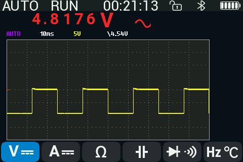
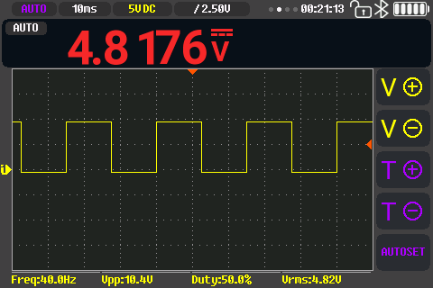
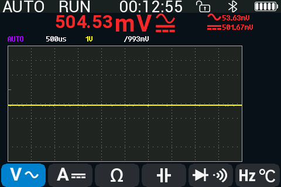
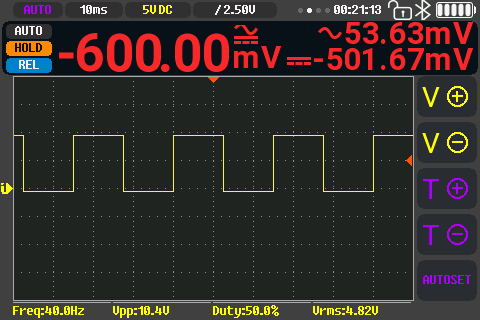

# DMM+Scope combined view: design

The combined view (`View::DmmScope`) is the stock-replica scope page with a
56 px meter strip between the top bar and a shorter graph. This document
describes its layout, the strip, touch and keys, the scope gestures it
shares with the Scope page, and the renderer choice. §8 lists what became of
the 2026-10-13 redesign proposal (8714bdd) that led here. The user-facing
description is in the [manual](../../docs/manual/README.md#combined-view).

Code: [`src/scope_ui.rs`](../src/scope_ui.rs) (page widgets, meter strip
section, `strip_hit`), [`src/scope_page.rs`](../src/scope_page.rs) (page
interaction, the combined-view branch of the gesture handler),
[`src/ui.rs`](../src/ui.rs) (`strip_data`, `func_band`, `func_band_hit`),
[`src/app.rs`](../src/app.rs) (`band_open` / `band_close`, `sp_throttled`).
The scope page itself follows the stock spec,
[stock-scope-ui.md](stock-scope-ui.md). Host checks:
[`tools/ui-render`](../tools/ui-render/main.rs) (layout rules over every
strip case) and [`tools/touch-test`](../tools/touch-test/main.rs) (hit maps).
Reference mockups `mk01-combined` / `mk02-combined-hold-stop` are scenes of
[`tools/stock-ui`](../tools/stock-ui/README.md). All of it is untested on the
device unless [TODO.md](../TODO.md) says otherwise.

---

## 1. Layout (480x320)

| Element | Rect (x, y, w, h) | Notes |
|---|---|---|
| Top bar | (0,0,480,20) | the stock scope top bar, unchanged |
| Meter strip | `STRIP` (13,21,401,54) | grey 1 px ring (red 0xc9a0 at >= 100 V), dark inner box (14,22,399,52) |
| Graph frame | (13,76,401,225) | `COMBINED_TOP` 76; the stock frame is (13,20,401,281) |
| Right panel | `PANEL` (414,20,66,300) | the stock 7 buttons `B_RECT` |
| Measurement bar | `MEAS_BAR` (0,301,414,19) | stock |

The graph keeps the stock 280-row model; rows are scaled to the 225 px frame.
Every scope widget other than the frame is drawn as on the Scope page.

## 2. Meter strip

Drawn by `scope_ui::meter_strip` from a `StripData` that
`ui::strip_data` builds from the shown reading. Each field is repainted only
when it changes (`STRIP_SHOWN`; `strip_invalidate` forces a full draw).

| Field | Rect | Content |
|---|---|---|
| Function badge | `ST_FUNC` (19,25,62,17) | purple r5 badge, 12 px font: AC V, DC V, AC A, DC A, OHM, CONT, DIODE, CAP, FREQ, AC+DC, POWER, TEMP; AutoAC / AutoDC with AUTO coupling |
| State badge | `ST_BADGE` (19,46,62,17) | one badge by priority (below) |
| Reading | `ST_VALUE` (84,24,108,30) | the stock 20 px digit font (`SC_DIGITS`), right-aligned, `fmt7` without the extra digit, OL = "0L"; grey while the reading is provisional |
| Unit | from x 196 (`st_unit`) | `SC_DIGITS` up to 59 px, else the 20 px or 16 px face; LETTERS where the digit font lacks a glyph (deg C / F, uA) |
| Sub rows | y 25 / 43, h 14 (`st_sub`) | 12 px ASCII, left-aligned 4 px after the unit: AC+DC parts tagged "AC " / "DC ", Hz and duty, burden "Bd ", the 4-20 mA percentage ("4-20 "), the temperature sensor name, "Overload" with 0L |
| GEN column | `ST_GEN` (344,25,64,17) + (344,46,64,17) | GEN badge and the generator frequency while the generator runs; the sub rows end 15 px before it |

State badge priority (`ui::strip_data`): HOLD / A-HOLD; a wrong-connection
alert (A-JACK / V-JACK? / LIVE?, [`src/sentinel.rs`](../src/sentinel.rs))
alternating with HOLD / A-HOLD at the 1 s cadence; HV (>= 30 V); REC; REL or
the limit verdict (PASS / HI / LO, alternating); the range mode (AUTO / AUTO+
/ MANU).

The strip passes the layout rules that the stock page does not: every ink
box >= 3 px from the others and inside its container
([`tools/ui-render`](../tools/ui-render/main.rs) checks every strip case x
HOLD x verdict x REL x HV x REC x GEN, plus A -> B updates without stale
pixels).

## 3. Touch and keys

The combined-view branch of the scope page's gesture handler
([`src/scope_page.rs`](../src/scope_page.rs)) runs before the Scope page
handling:

| Where | Gesture | Action |
|---|---|---|
| Strip, badge column (x < 86, `strip_hit`) | tap | REL on/off (`rel_toggle`) |
| Strip, elsewhere | tap | open the function band (§4) |
| Strip | long press | the DMM page |
| Strip (not a drag area) | swipe left/right | previous / next view |
| Top bar, graph, panel, measurement bar | any | as on the Scope page (§6) |
| Side keys | press | DMM meaning: RUN = HOLD (1 s = AutoHold), AUTO = autorange, MF = range / limits page; MENU = menu |

Scope run/stop is the run badge in the top bar. Scope auto-set is not
available in this view: AUTO belongs to the DMM.

## 4. Function band

`ui::func_band`: the DMM page's seven function buttons (`dmm_button`, 36 px
high) in a band from `FUNC_Y` 258 (a 1 px 0xad55 line, 3 px under the
panel's T- button) down to the measurement bar. In the panel column the band
starts at the V/div "-" key (`B_RECT[5]`) and runs to the screen bottom, so
no half key shows. A tap acts as on the DMM page (`func_band_hit`). The band
closes 4 s after the last tap (`BAND_MS`), on a tap elsewhere or on MENU;
`band_close` repaints the page. The page is not repainted while it is open.

## 5. Frame rate

While the scope runs (not Single, not roll, not the wave view), the combined
view paints at most one frame per 40 ms (`COMBO_FRAME_MS`, 25 fps,
`App::sp_throttled`), so the DMM side keeps its share of the loop (c864f65).

## 6. Scope gestures (Scope page and the combined graph)

### 6.1 One finger

The stock model ([stock-scope-ui.md](stock-scope-ui.md) §10): a press
selects the marker under the finger (32x32 zones, the stock search order),
then each move event moves the selected level item by dy if |dx| <= |dy|,
else the selected time item by dx. opendm40 locks a drag that starts on a
marker zone to that marker's axis. While a drag is active, the acquisition is
not polled and each event re-renders the shown frame from its cached column
rows; the settings reach the hardware on release. The tap step, the tap
zones and the badge popups are in [scope-scale-ux.md](scope-scale-ux.md).
Double tap where a tap does nothing: CH1 to the centre, trigger at 50 %
(UF-09).

Settings "Scope drag" cycles Stock (per event) -> Axis lock (the first 15 px
decide the axis) -> Hold (§6.2).

### 6.2 Hold-to-grab (A/B experiment)

`gesture::GRAB_MS` (0 = direct drag, the default; Settings "Scope drag: Hold"
sets `GRAB_DEFAULT_MS` 300; `DBG:GRAB <ms>` / `DBG:GRAB?`). In hold mode the
finger must stay within 8 px (`GRAB_SLOP`) until the grab; the long press
moves to 1200 ms (`LONG_HOLD_MS`). `DBG:GEST?` returns the last 32 drags for
comparing the modes. The A/B session on the device (five tasks, five runs
per mode: set a trigger level, move the trace one division, shift time two
divisions, place a cursor, a mixed sequence; compare wrong-object drags and
total time) has not run (TODO.md "G4 A/B on device").

### 6.3 Two fingers

[`src/gesture.rs`](../src/gesture.rs) tracks both fingers (identity by
nearest match between frames). Once the separation along the dominant axis
changes by 20 px (`PINCH_MIN`) before the centroid moves 30 px down
(`PINCH_SWIPE`), the touch is a pinch: `Pinch(axis, span0, span)` per frame,
`PinchEnd` on release. Otherwise a downward 2-finger move is the power-off
swipe and a 3-finger one the screenshot (stock). Horizontal pinch =
timebase, vertical = V/div, with a value bubble and a scaled preview of the
shown frame, applied on release (`scope_page::sp_pinch` / `sp_pinch_end`).
`DBG:PINCH 0|1|2` selects the step rule (`scope_ui::PINCH_STOCK` /
`PINCH_STEP`, default / `PINCH_LIVE`). In the wave view a vertical pinch does
nothing (its V/div is the DMM range).

The two-finger report rate and tracking quality of the touch controller
([hw/README.md](../../hw/README.md#touch-panel-and-touch-keys)) are
unmeasured.

## 7. Renderer: own composition, no GUI library

Decision (TODO.md "UI toolkit decision", 2026-10-13): keep the own renderer.
Every widget is one LCD window whose pixels are computed from its layers
(`stockfont::paint`), with no frame buffer, so a repaint of any part is exact
and flicker-free. The graph keeps per-column trace rows and repaints only the
rows that change (`Graph::flush`).

Why:
* **RAM, not speed, is the limit.** A full RGB565 frame buffer is 307 200 B,
  more than the 192 KiB SRAM; the full graph alone is 225 362 B. Any renderer
  has to work in windows, lines or strips. The current budget is in
  [native-boot.md](native-boot.md) "Memory budget".
* **Speed.** The FSMC write timing of the stock firmware gives about
  20-25 ns per pixel: a full screen is 3.1-3.8 ms, the full graph 2.3-2.8 ms.
  No library draws faster than the bus.
* **Libraries considered.** `embedded-graphics` (overdraw unless drawn into
  a strip buffer; needs an adapter for the stock 4 bpp fonts), Slint's MCU
  renderer (needs an allocator and a heap; GPLv3 or commercial for
  embedded; all screens rewritten), LVGL via C (a draw buffer plus a heap;
  C toolchain + FFI), egui (needs std and a frame buffer). The flash and RAM
  sizes for these were order-of-magnitude estimates, not measured.

Revisit with a one-screen Slint/LVGL prototype if the hand-made widgets stay
clumsy.

## 8. The 2026-10-13 proposal and what became of it

The proposal (8714bdd) answered the owner's feedback on the first combined
view ("fonts of different sizes, everything overlaps; maybe embed the DMM
data into the oscilloscope interface in this mode?"). Option A was
implemented in aa51ae5 on the pre-stock scope UI, then replaced by the
stock-replica page with a meter strip (d323565); the old scope UI was
removed in 29ba03c. It amended
[scope-ui-plan.md](../../docs/history/scope-ui-plan.md) and built on
[ui-review.md](../../docs/history/ui-review.md).

| Proposal | Status |
|---|---|
| Option A: a meter strip inside the scope page | taken, in the stock visual language (§2) |
| Option B: a floating meter tile over the full graph | not implemented (it hides trace and collides with markers) |
| Own 20 px chip top bar with page dots, uptime, lock, BT | not implemented: the stock top bar |
| 5-button panel (V+ V- T+ T- AUTOSET) | not implemented: the stock 7-button panel; no scope auto-set in this view |
| F39 font (F78 digits halved) for the reading | not implemented: the stock 20 px digit font |
| Three type tiers (F39 / LETTERS / F14) | replaced by the stock fonts (20 px digits, 12 px ASCII) |
| Strip tap = function band, badge column = REL, long press = DMM page, swipes from the strip | taken (§3, §4) |
| Side keys keep their DMM meaning | taken |
| Zone-table drag with axis lock at 12 px (`gesture::target`) | removed with the old UI; the stock per-event drag plus the "Scope drag" alternatives (§6.1) |
| Dashed trigger line, readout bubbles, ◀ / ▼ markers | replaced by the stock markers and guide lines |
| Runtime hold-to-grab switch, `DBG:GRAB`, `DBG:GEST?` | taken (§6.2); the device A/B session is open |
| Pinch = scale | taken (§6.3) |
| Own layered compositor instead of a GUI library | taken (§7) |
| 4 bpp indexed graph canvas | not implemented |
| General UI review items (typeface mix, status cluster, colour tokens, menu / settings fonts, history placeholders) | superseded: the menus, settings and pages follow the stock UI |

## 9. Mockup index (`mockups/`)

Drawn at 480x320 with the real stock font data
([`src/stockfont_data.rs`](../src/stockfont_data.rs)) by the renderer in
[`mockups/tools/`](mockups/tools/final.py) (`sim.py` = a host copy of the
`stockfont.rs` drawing code, `render.py` / `mock.py` / `final.py`):
`/usr/bin/python3 firmware/docs/mockups/tools/final.py firmware/docs/mockups [<screenshot dir>]`.
The screenshot dir is only needed to refresh the `cur-*` images. These
mockups show the pre-stock UI and the 2026-10-13 proposal, not the current
look; the current look is in the manual
([combined.png](../../docs/manual/img/combined.png),
[combined-band.png](../../docs/manual/img/combined-band.png)).

| File | Shows |
|---|---|
| [`cur-combined.png`](mockups/cur-combined.png), [`cur-combined-pwm-acv.png`](mockups/cur-combined-pwm-acv.png), [`cur-combined-pwm-freq.png`](mockups/cur-combined-pwm-freq.png) | device screenshots of the first combined view, build db679a3 |
| [`cur-combined-acdc-head.png`](mockups/cur-combined-acdc-head.png) | the 40d9a76 AC+DC compact layout rendered over a screenshot |
| [`a1-dcv.png`](mockups/a1-dcv.png) … [`a5-temp.png`](mockups/a5-temp.png) | Option A states: DC V; AC+DC with HOLD + REL; Hz with duty; 230 V AC with HV; thermocouple with OL |
| [`a6-function-picker.png`](mockups/a6-function-picker.png) | strip tap -> function row |
| [`a7-trigger-drag.png`](mockups/a7-trigger-drag.png) | trigger-level drag: dashed line, readout, marker |
| [`a8-pinch-timebase.png`](mockups/a8-pinch-timebase.png) | horizontal pinch -> timebase bubble |
| [`b1-floating-tile.png`](mockups/b1-floating-tile.png) | Option B |
| [`fonts-hierarchy.png`](mockups/fonts-hierarchy.png) | the proposed type tiers |

| Before (db679a3) | Option A proposal |
|---|---|
|  |  |
|  |  |
