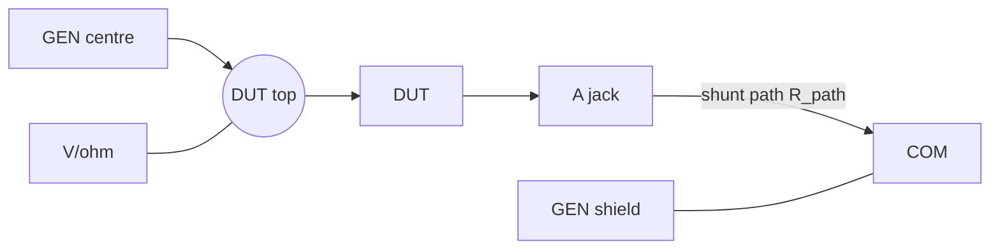

# LCR meter

Impedance at 100 Hz or 1 kHz from the power meter's simultaneous U and I
converters and the built-in generator: |Z|, θ, then L or C, ESR (or the
parallel R), D and Q. User-facing: [manual, LCR meter](../../docs/manual/README.md#lcr-meter);
SCPI: [scpi-reference.md, LCR meter](../../docs/manual/scpi-reference.md#lcr-meter).
Code: [`src/lcr.rs`](../src/lcr.rs) (the fit and the impedance math, host
tests), [`src/app_lcr.rs`](../src/app_lcr.rs), [`src/ui_lcr.rs`](../src/ui_lcr.rs).

Device status: no DUT measurement yet (needs the wiring below).

## Wiring

- GEN centre to the DUT and to V/ohm (a short jumper at the DUT), the DUT's
  other end to A, the GEN shield to COM. The last link joins the isolated
  DMM to the USB / generator ground: the DUT must not be connected to
  anything else. Discharge capacitors first; an electrolytic's + goes to
  the GEN side (the drive has a positive DC part, below).
- V–COM sees the DUT plus the A–COM path: U = U_DUT + I R_path.

## Measurement

- **Drive**: generator sine, 3 Vpp around 1.5 V (the output is unipolar
  0..3 V, [hw/README.md Generator](../../hw/README.md#generator)). A DC
  current of up to ~30 mA flows through a resistive or inductive DUT; the
  fit removes it, but an inductor is measured with that DC bias.
  Generator output impedance ~50 Ω (*inferred*).
- **Capture**: the Power Wave frame ([power-meter-and-misconnect.md 3.18](power-meter-and-misconnect.md#318-power-wave-u-and-i-waveforms)):
  AD3 (U) and AD2 (I) convert together, read alternately every 156.25 µs,
  each sample stamped; 3200 samples/s per channel, 200 ms per frame (20
  cycles at 100 Hz, 200 at 1 kHz; also whole 50 / 60 Hz cycles). U on
  the 6 V range.
- **Fit**: per channel a least-squares sine at the generator's actual
  frequency (`gen.actual_hz`) plus a DC term, on the stamped times and
  only over whole test cycles. The times carry the U / I alternation (56°
  at 1 kHz), so it cancels exactly; a lag common to both channels cancels
  in U / I. Z = U / I (complex).
- **Corrections** (RAM only, lost at power-off; `LCR:CORR`), 4 frames
  averaged each:
  1. Short (DUT clips joined), per frequency: taken on the 60 mA range (a
     short draws ~30 mA), stored as the excess over the 0.5 Ω shunt (fuse,
     MOSFET, leads) and added to each range's shunt: Z_s = R_shunt + excess
     (`POW:BURD` sets R_shunt; the excess on the 47.5 Ω ranges is
     *inferred* to be the same). Default: the bare shunt. Z' = Z − Z_s.
  2. Delay τ per I range, from a resistor (`LCR:CORR:PHAS`): τ = arg(Z')
     / ω; Z' ·= e^(−jωτ). Default 0. Sources: the AD2 / AD3 grid skew
     (~10 µs, *inferred*, doc 3.18) and OP1 x10 (~0.3° at 1 kHz, *inferred*
     from its 2 MHz GBW). The power meter's SPHACAL (`POW:PHAS`) applies.
  3. Open (DUT removed), per frequency, on the 600 µA range: Y_o = 1 /
     Z'_open; Z_DUT = 1 / (1 / Z' − Y_o).
- **Results**: R = Re Z, X = Im Z, θ = atan2(X, R). Series: Ls = X / ω,
  Cs = −1 / (ωX), ESR = R. Parallel: Rp = |Z|² / R, Xp = |Z|² / X. D = R /
  |X|, Q = 1 / D. L when θ > 0, C when θ < 0; R as the main reading when
  |θ| < 5.7° (Q < 0.1). AUTO model: series below 1 kΩ, parallel above.
- **I range**: 600 µA (47.5 Ω x10), 6 mA (47.5 Ω x1), 60 mA (0.5 Ω x10),
  chosen on the frame's peak (DC + AC): up above 0.6 V at the converter
  (OP1 output swing, *inferred* from the 0.7 V of doc 3.2), down below
  0.05 V. Starts on 60 mA (a short draws ~30 mA peak). A range change
  drops that frame.
- **Guard**: a U or I sample on a converter rail on the 60 mA range (12 V,
  ~245 mA: more than the generator can drive) closes the page into the
  power meter.

## Ranges (*inferred*: noise from doc 3.5, not yet measured with a DUT)

U noise ~2.4 mV RMS per sample, I assumed alike in codes; a 640-sample fit
cuts it by ~18. For ~1 % |Z| from noise, before gain errors:

| | 100 Hz | 1 kHz |
|---|---|---|
| \|Z\| | ~1 Ω .. ~300 kΩ | ~1 Ω .. ~300 kΩ |
| L | 1.6 mH .. 480 H | 160 µH .. 48 H |
| C | 5 nF .. 1.6 mF | 0.5 nF .. 160 µF |

Low end: U_DUT = |Z| x ~21 mA RMS against 0.13 mV fit noise, and the short
correction (contact resistance of 2-wire leads). High end: the 600 µA
range's ~0.03 µA fit noise; lead capacitance (~10 pF = 16 MΩ at 1 kHz):
use Open. |Z| gain error: the V and AC A calibrations (~0.5 % each). D / Q:
~0.01 at the range ends, ~0.001 mid-range, after the delay correction.

Not reachable on this path: 10 kHz (Nyquist 1.6 kHz per channel; the read
time stamps are 4 µs = 14° there). 100 Hz is a mains harmonic: pickup on
the leads adds to it.
