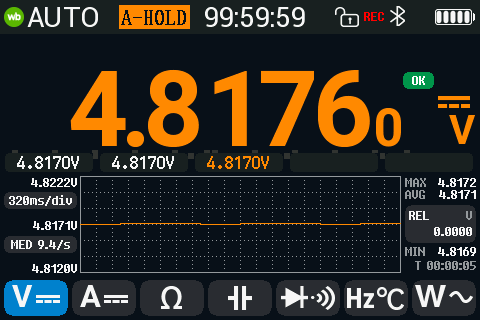
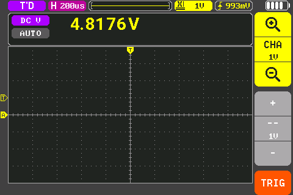
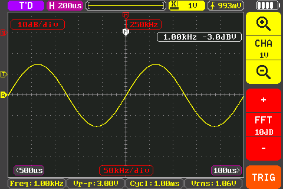
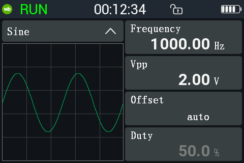
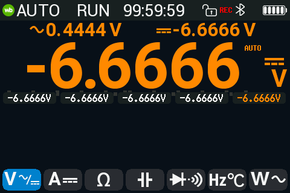
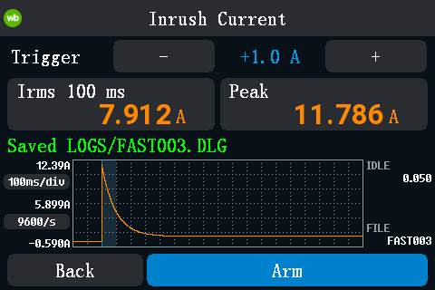
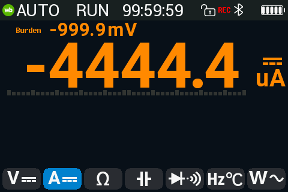
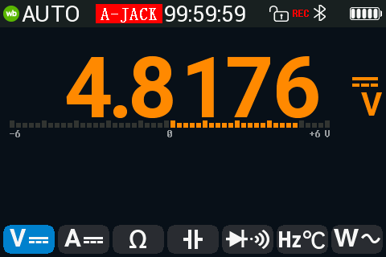
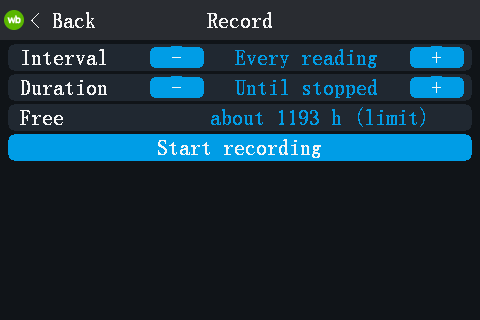

# fw-rs: open firmware for the Alientek DM40

fw-rs is a replacement firmware, written in Rust, for the Alientek DM40
multimeter, oscilloscope and signal generator. The multimeter, the scope and
the generator run at the same time; you only switch what the screen shows.
It keeps the stock look and touch model and adds a power meter, data
logging, USBTMC/SCPI and more. It installs like a stock update file and
leaves the vendor bootloader, the vendor update loader and the calibration
untouched.

**Status: experimental.** Developed and tested on one DM40A. DM40B and DM40C
ran only in the emulator. In the table, *device* means checked on that DM40A
([device check log](docs/device-check-2026-10-21.md)); *emulator* means
checked only in the emulator or in host tests.



## Features

| Feature | What it does | Checked |
|---|---|---|
| Multimeter | All 16 stock functions. 60000-count ranges and AC+DC on every model. HOLD, AutoHold, REL, MIN/MAX/AVG, limits, trend chart, bargraph. | device |
| DMM + scope at once | Combined view: the DMM reading in a strip above the live scope. | device |
| Scope | Stock timebases and V/div, Auto/Normal/Single, hardware trigger, 20 measurements, FFT, Save CSV; pulse and runt trigger, cursors. | device; pulse / runt trigger and cursors: emulator |
| Generator | Sine, triangle and ramp up to 50 kHz, square up to 10 MHz, DC offset; keeps running on every page. | ran on the device; output not measured there |
| Power meter (W) | V and I at the same time: P, S, Q, PF, f, Wh, VAh. DC, AC or AC+DC coupling, with the DC and AC parts. | device without current; with current: emulator |
| AUTO AC/DC | Shows the DC or the AC part, whichever the signal is. | device on V; on A: emulator |
| Inrush current | 10 A range: triggers on a current step, shows the RMS of the first 100 ms and the peak, saves the trace. | emulator |
| Burden voltage | Voltage drop across the shunt in the A / mA / uA functions (off by default). | device without current |
| Misconnect alerts | A-JACK (current in the A jack while measuring volts), A-PROT, "Leads in A jack?" reminder, fuse check. | reminder: device; A-JACK / A-PROT: emulator (no current through A on the device yet); fuse check: not yet |
| Record page | Logs the DMM to the internal disk: every reading, or the mean per 1 s / 10 s / 1 min, until stopped or for 10 min .. 24 h. | device |
| Fast logger | Raw ADC samples to the disk at up to 38.4 kS/s (76.8 kS/s if the SPI flash is fast enough). | device up to 38.4 kS/s; 76.8 kS/s: emulator |
| USB disk | Read-only drive with `LOGS/`, `SCOPE/`, `SHOTS/` (CSV and BMP files) and `INFO/` (calibration copy, running firmware). New files appear while it is mounted. Optional "PC can edit" mode: delete files, drop in an update file. | device (Linux); Windows 11 read-only (VM); macOS untested |
| USBTMC / SCPI | 34401A-style `CONF` / `MEAS?` / `READ?`, plus the scope, the generator, the power meter and the loggers. | device |
| sigrok | A libsigrok `scpi-dmm` profile for the DM40 (not upstream yet); a 34401A emulation for unpatched sigrok / SmuView. | profile: device (sigrok-cli, every selectable function); emulation: emulator |
| Bluetooth | The stock phone-app protocol, plus SCPI over the same link. | device |
| Screenshots, gallery | 3-finger swipe saves a BMP (as on stock); a gallery shows screenshots and logs on the meter. | device |

| | | |
|---|---|---|
|  DMM + scope, generator on |  Scope with FFT |  Generator |
|  Power meter, AC+DC parts |  AUTO AC/DC |  Inrush current |
|  Burden voltage |  A-JACK alert |  Record page |

The screens are renders of the firmware's own drawing code with synthetic
values (`tools/ui-render/run.sh OUT --readme`), not photos.

Known open issues ([TODO.md](TODO.md)): with 5-10 V on V-COM, the ohm and
temperature functions can show a false A-JACK. While the scope is powered
(combined view, scope page), a fast square on the DMM input reads about
0.2 % high. In the combined view, power units are clipped ("mW" looks like
"mV").

## Differences from the stock firmware (V2.6)

| | Stock | fw-rs |
|---|---|---|
| Instruments | One at a time (the generator keeps running with the scope) | DMM, scope and generator together; combined view |
| Ranges | By model: 400 mV, 4 V ... (A), 500 mV ... (B), 600 mV ... (C) | 600 mV, 6 V ... (60000 counts) on every model |
| AC+DC | DM40B / C only | Every model |
| Power meter, inrush, burden, AUTO AC/DC, misconnect alerts | No | Yes |
| Data logging | No | Record page, fast logger |
| USB | Mass storage ("USB Connect") | USBTMC/SCPI + a generated drive with CSV files |
| Bluetooth | Phone-app protocol | Same, plus SCPI |
| Languages | Chinese (simplified, traditional), English | English only |

## Install

**Back up first.** Each meter has its own calibration record and boot data,
and an update file cannot restore them. Make a backup with the memrw kit
([firmware/patch/kit/README.md](../firmware/patch/kit/README.md)) and keep it
off the meter. Charge the battery.

1. Build `dm40-fw-native.bin` (see "Build" below).
2. On the stock meter: Settings > Other Settings > USB Connect.
3. Copy the file onto that USB disk as `dm40_fwrs.bin`. It must be the only
   `dm40*.bin` on the disk. Eject.
4. Power the meter off and on (a cold boot): the stock update procedure.
   `tools/reload.sh --from-stock` stages the file for you and waits for fw-rs.
5. **The first boot is dark for a few seconds.** Do not power-cycle in the
   first 10 s.

What is verified: fw-rs installs from a running fw-rs (`tools/reload.sh`)
and from the vendor loader's update screen. Steps 2-4 were used on this meter
with a stock-size image (the patched stock of the memrw kit) but **not yet
with an fw-rs image**. The stock app can also flash a `dm40*.bin` from its
disk by itself when USB is unplugged; that is not checked for an fw-rs image
either. If the meter stops on the loader's update screen, copy the file onto
the loader's USB disk and press "update" (see Recovery).

**USB on a PC.** The drive needs no driver. After Eject it stays ejected
until the cable is re-plugged. SCPI is USBTMC: Linux has a driver, Windows
has none (the interface sits under "Other devices", code 28). On Windows,
install NI-VISA or Keysight IO Libraries, or bind WinUSB with Zadig and use
pyvisa-py ([docs/bt-scpi.md](docs/bt-scpi.md#usbtmc-on-windows)).
Each meter has its own serial number: the chip's unique ID as 24 hex
digits (USB serial, the disk's SCSI serial, the third field of `*IDN?`; the
same digits as `INFO/UID.BIN`). Two meters on one PC are two drives
([docs/native-boot.md](docs/native-boot.md#usb-serial-number-srcuidrs)).

## Recovery

An update only rewrites the application area. The vendor bootloader and the
vendor update loader stay, so a bad image cannot brick the meter: after a
failed or bad file, the loader shows its update screen with a working USB
disk on every boot until a good file is installed.

To reach the update screen from fw-rs:

- `python3 tools/dm40dbg.py update` while fw-rs answers on USB (device-checked);
- from off, hold the power key ~4 s until the beep, then 0.5 s more
  (not yet checked on the device);
- automatically after a second watchdog reset within 60 s of the first (not
  yet checked on the device).

Then copy a good image onto the loader's disk as `dm40_fwrs.bin` and press
"update". `INFO/FIRMWARE.BIN` on the fw-rs USB drive is the running image as
an update file; keep a copy.

**Back to stock:** copy the official `dm40_v_2_6.bin` (not in this repo)
onto the loader's disk and press "update", or run
`tools/reload.sh --stock FILE` while fw-rs runs (device-checked with patched
stock). Details: [docs/native-boot.md](docs/native-boot.md).

## Build

```
./build.sh                    # -> dm40-fw-native.bin (needs ../toolchain)
tools/reload.sh               # build, upload over USBTMC, install, check
tools/ui-render/run.sh OUT    # render every screen to PNG + layout check
../emu/run.py fwrs --run-for 4 --shot out.png   # run fw-rs in the emulator
```

The emulator ([emu/README.md](../emu/README.md)) runs both the stock
firmware and fw-rs. It needs a flash dump of your own meter (not in the
repo).

## More

- [TODO.md](TODO.md): what is done and what is open
- [docs/dev-notes.md](docs/dev-notes.md): USB debug link, SCPI list, developer workflow
- [docs/native-boot.md](docs/native-boot.md): update format, shim, recovery
- [docs/parity.md](docs/parity.md): item-by-item comparison with the stock firmware
- [docs/device-check-2026-10-21.md](docs/device-check-2026-10-21.md): device test log
- Feature docs: [power meter and alerts](docs/power-meter-and-misconnect.md),
  [inrush](docs/inrush-current.md), [AC+DC](docs/acdc-stock-vs-fwrs.md),
  [log format](docs/compact-log-format.md), [Bluetooth SCPI](docs/bt-scpi.md),
  [DM40A / B / C](docs/model-variants.md)
