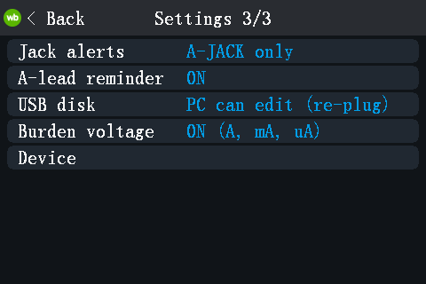

# fw-rs: open firmware for the Alientek DM40

fw-rs is a replacement firmware, written in Rust, for the Alientek DM40
handheld multimeter + oscilloscope + signal generator. The multimeter, the
scope and the generator run at the same time; you only switch what the
screen shows. It keeps the stock look and touch model, and it adds a power
meter, data logging, USBTMC/SCPI and more. It installs like a stock update
file and leaves the vendor bootloader, the update loader and the calibration
untouched.

**Status: experimental.** Developed and tested on one DM40A. DM40B and DM40C
were never run. In the tables, *device* means checked on that DM40A
([device check log](docs/device-check-2026-10-21.md)); *emulator* means
checked only in the emulator or on the host.


## Features

| Feature | What it does | Checked |
|---|---|---|
| Multimeter | All 16 stock functions, ported from the stock behaviour. 60000 counts on every model; AC+DC on every model. HOLD, AutoHold, REL, MIN/MAX/AVG, limits, trend chart, bargraph. | device |
| DMM + scope at once | Combined view: the DMM reading in a strip above the live scope. | device |
| Scope | Stock timebases and V/div, Auto/Normal/Single, hardware trigger, pulse and runt trigger, cursors, 20 measurements, FFT, Save CSV. | device |
| Power meter (W) | V and I at the same time: P, S, Q, PF, f, Wh, VAh. DC, AC or AC+DC coupling, with the DC and AC parts shown. | device without current through the A jack (V side, coupling, zero, V cal, energy UI); readings with current: emulator |
| AUTO AC/DC | Shows the DC or the AC part, whichever the signal is. | device on V; on A: emulator |
| Inrush current | Arms on the 10 A range, triggers on a current step, shows the RMS of the first 100 ms and the peak, saves the trace. | emulator |
| Burden voltage | Voltage drop across the shunt in the A / mA / uA functions (off by default). | device without current; values: emulator |
| Misconnect alerts | A-JACK (current in the A jack while measuring volts), A-PROT, "Leads in A jack?" reminder, guided fuse check. | A-JACK, A-PROT, reminder: device; fuse check: not yet |
| Record page | Logs the DMM to the internal disk: every reading, or the mean per 1 s / 10 s / 1 min, until stopped or 10 min .. 24 h. | device |
| Fast logger | Raw ADC samples to the disk at up to 38.4 kS/s (76.8 kS/s on a fast SPI flash). | device up to 38.4 kS/s; 76.8 kS/s: emulator |
| Compact logs | Recordings are stored as compact `.DLG` files and served to the PC as CSV. | device |
| USB disk | A read-only drive with `LOGS/`, `SCOPE/`, `SHOTS/` and `INFO/` (calibration backup). New files appear while it is mounted. Optional "PC can edit" mode: delete files, drop in an update file. | device (Linux); Windows / macOS untested |
| USBTMC / SCPI | 34401A-style `CONF` / `MEAS?` / `READ?`, plus the scope, the generator, the power meter and the loggers. | device |
| sigrok | A libsigrok `scpi-dmm` profile for the DM40 (not upstream yet), and a 34401A emulation for unpatched sigrok / SmuView. | device (sigrok-cli, every function) |
| Bluetooth | The stock phone-app protocol, plus SCPI over the same link. | device |
| Screenshots, gallery | 3-finger swipe saves a BMP; the gallery shows screenshots and logs on the meter. | screenshots: device; gallery: not logged |
| Generator | Sine, square, triangle, ramp; square up to 10 MHz; offset; keeps running on every page. | no device check logged |
| Emulator | A Renode model of the whole meter runs both the stock firmware and fw-rs ([emu/README.md](../emu/README.md)). | — |

| | | |
|---|---|---|
|  DMM + scope (host render, no signal) |  Scope |  Power meter, AC+DC parts |
|  AUTO AC/DC |  Inrush current |  Record page |
|  Burden voltage |  A-JACK alert |  Settings 3/3 |

Screens are 1x renders of the firmware's own drawing code
([tools/ui-render](tools/ui-render/run.sh)); the status-bar items are worst
cases, not a real state.

Known open issues (see [TODO.md](TODO.md)): with 5-10 V on V-COM, the ohm
and temperature functions can show a false A-JACK. With the scope powered
(combined view), a fast square on the DMM input reads about +0.2 % high.

## Differences from the stock firmware (V2.6)

| | Stock | fw-rs |
|---|---|---|
| Instruments | One at a time | DMM, scope and generator run together; combined DMM + scope view |
| Counts | 4000 / 5000 / 6000-style ranges by model | 60000 counts on every model |
| AC+DC | DM40B / C only | Every model |
| Power meter, inrush, burden, AUTO AC/DC, misconnect alerts | No | Yes |
| Data logging | No | Record page, fast logger |
| USB | Mass storage ("USB Connect") | USBTMC/SCPI + a generated drive with CSV files |
| Bluetooth | Phone-app protocol | Same, plus SCPI |
| Languages | Chinese (2 variants), English | English only |
| Settings | `config.bin` on the internal disk | Backup SRAM |
| Update file, loader, calibration | — | Same format, same loader; calibration read only, never written |

## Install

Before anything: **back up the calibration and the boot data.** Each meter
has its own, and an update file cannot restore them. Use the memrw kit
([firmware/patch/kit/README.md](../firmware/patch/kit/README.md)) and keep
the backup off the meter.

1. Build `dm40-fw-native.bin` (below).
2. Get to a USB disk of the meter: the stock firmware's "USB Connect" disk,
   or the update screen of the vendor loader.
3. Copy the file there as `dm40_fwrs.bin`. It must be the only `dm40*.bin`
   on the disk. Eject.
4. Power-cycle, or press "update" on the loader screen.
5. **The first boot is dark for several seconds** (it writes the
   calibration backup). Do not power-cycle in the first 10 s.

The logged device installs went through the loader screen and through
`tools/reload.sh`; the stock "USB Connect" path is documented but not
logged. Charge the battery first. The stock firmware installs any
`dm40*.bin` it finds on its disk, so do not leave such files there.

## Recovery

An update only rewrites the application area. The vendor bootloader and the
update loader (flash `0x080A0000`) stay, so a bad image cannot brick the
meter: the loader checks the file's CRC before it writes, and it can always
install a good file.

To reach the loader's update screen (it brings up its own USB disk):

- while fw-rs still answers on USB: `python3 tools/dm40dbg.py update`
  (device-checked);
- from off, hold the power key ~4 s until the beep, then 0.5 s more
  (designed, not yet checked on the device);
- after two watchdog resets in a row, fw-rs opens it by itself (designed;
  one reset and the normal reboot after it were seen on the device, two in
  a row were not).

Then copy a good image onto the loader's disk as `dm40_fwrs.bin` and press
"update". fw-rs keeps the previous image as `_DM40PRV.BIN` on its internal
disk, and the running one as `INFO/FIRMWARE.BIN` on the USB drive.

**Back to stock:** copy the official `dm40_v_2_6.bin` (not in this repo)
onto the loader's disk and press "update", or run
`tools/reload.sh --stock FILE` while fw-rs runs. Going back to a (patched)
stock image this way was checked on the device. Details:
[docs/native-boot.md](docs/native-boot.md).

## Build and emulator

```
./build.sh                    # -> dm40-fw-native.bin (needs ../toolchain)
tools/reload.sh               # build, upload over USBTMC, install, check
tools/ui-render/run.sh OUT    # render every screen to PNG + layout check
../emu/run.py fwrs --run-for 4 --shot out.png   # run fw-rs in the emulator
```

The emulator needs a flash dump of your own meter (not in the repo).

## More

- [TODO.md](TODO.md): what is done and what is open
- [docs/dev-notes.md](docs/dev-notes.md): USB debug link, SCPI list, reply timing, developer workflow
- [docs/native-boot.md](docs/native-boot.md): install format, shim, recovery
- [docs/device-check-2026-10-21.md](docs/device-check-2026-10-21.md): device test log
- [docs/power-meter-and-misconnect.md](docs/power-meter-and-misconnect.md): power meter, alerts, burden
- [docs/acdc-stock-vs-fwrs.md](docs/acdc-stock-vs-fwrs.md), [docs/acdc-approaches.md](docs/acdc-approaches.md): AC+DC and AUTO
- [docs/inrush-current.md](docs/inrush-current.md): inrush current
- [docs/compact-log-format.md](docs/compact-log-format.md): the `.DLG` format
- [docs/bt-scpi.md](docs/bt-scpi.md): SCPI over Bluetooth
- [docs/model-variants.md](docs/model-variants.md): DM40A / B / C
- [docs/parity.md](docs/parity.md): item-by-item comparison with the stock firmware
- [docs/decisions-2026-10-22.md](docs/decisions-2026-10-22.md), [docs/ram-budget.md](docs/ram-budget.md), [docs/fonts.md](docs/fonts.md)
