# DM40 hardware

What is inside the Alientek DM40 (DM40A / DM40B / DM40C), compiled from the
code and docs of this repo, the teardown photos in [photos/](photos/README.md)
and the mysku.club review they come from (CTAHOK, 2025-04-25,
https://mysku.club/blog/aliexpress/103047.html). Datasheets are in
[datasheets/](datasheets/README.md).

All photos on this page are © CTAHOK (mysku.club review, 2025-04-25), kept
for reference only and not under this repo's license; sources and details in
[photos/README.md](photos/README.md).

This page is about hardware only: chips, pins, circuits. Flash layout and boot
chain: see [firmware/docs/native-boot.md](../firmware/docs/native-boot.md) (and
[`fsloader-install-trigger.md`](../firmware/docs/fsloader-install-trigger.md), [`stock/re/ANALYSIS.md`](../stock/re/ANALYSIS.md)).

No schematic of the DM40 is public. Facts are verified unless marked
*inferred* or listed under [Unknowns](#unknowns). The pointer after a fact
says where to check it: stock code (RE headers in
[`stock/re/analysis/`](../stock/re/analysis)), opendm40 code, a photo or a
datasheet. *Inferred*: deduced from register settings, scaling constants, the
community BOM or the photos. *BOM only*: the community BOM is the only
source.

Name clash: the [HY3131](datasheets/hycon-hy3131-datasheet-v10.pdf) has its own analog pins called PA0..PA9 and PB0..PB8.
On this page they are always written "HY3131 PBn"; a bare "PBn" is an MCU pin.

Sources used most: [`firmware/src/board.rs`](../firmware/src/board.rs) and the other drivers in [`firmware/src/`](../firmware/src),
`stock/re/analysis/*_v2_6.h`, [`firmware/docs/dac-adc-paths.md`](../firmware/docs/dac-adc-paths.md),
[`firmware/docs/power-meter-and-misconnect.md`](../firmware/docs/power-meter-and-misconnect.md), [`emu/hy3131/RESEARCH.md`](../emu/hy3131/RESEARCH.md),
the community BOM of board V1.1 ("BOM" below: posted by jebem in the
[EEVblog DM40C thread](https://www.eevblog.com/forum/testgear/alientek-dm40c-multimeter-%28dm40a-dm40b-dm40c%29/),
retold from the [mydigit.cn teardown](https://www.mydigit.cn/thread-486604-1-1.html),
registration needed; first collected in this repo in
[docs/dm40-feature-request.md](../docs/dm40-feature-request.md)), the DM40
manual V1.5 ([ManualsLib](https://www.manualslib.com/manual/3720530/Alientek-Dm40.html)),
[`firmware/docs/user-feedback.md`](../firmware/docs/user-feedback.md) (reports from the DM40 owners' Telegram chat [@S2084K](https://t.me/S2084K),
cited by message number).

## Contents

- [Block diagram](#block-diagram)
  - [Isolation boundary](#isolation-boundary)
- [Main parts](#main-parts)
- [MCU and clocks](#mcu-and-clocks)
- [SPI flash (USB disk)](#spi-flash-usb-disk)
- [LCD](#lcd)
- [Touch panel and touch keys](#touch-panel-and-touch-keys)
- [Power key, PA2, buzzer](#power-key-pa2-buzzer)
- [Debug header and hardware recovery](#debug-header-and-hardware-recovery)
  - [Hardware recovery](#hardware-recovery)
- [USB](#usb)
- [Bluetooth](#bluetooth)
- [DMM front end (HY3131)](#dmm-front-end-hy3131)
- [Oscilloscope](#oscilloscope)
- [Generator](#generator)
- [Power and battery](#power-and-battery)
- [Pin table](#pin-table)
- [Models DM40A / B / C](#models-dm40a--b--c)
- [Unknowns](#unknowns)

## Block diagram

The DMM part is galvanically isolated from the rest of the meter. The barrier
is the [CA-IS3741](datasheets/chipanalog-ca-is374x-v1.08.pdf) digital isolator (SPI), the optocouplers and the two
[VPS8504B](datasheets/vpsc-vps8504b-cn.pdf) + LT61 isolated supplies (markings in [Main parts](#main-parts), photos in
[Isolation boundary](#isolation-boundary)). Everything else shares one ground.

In the two block diagrams: dashed outline = inferred, rounded nodes are jacks,
edge labels are MCU buses and pins, the thick box is the isolation barrier. The
DMM front end is a simplified schematic with its own legend. Sources and
`render.sh`: [diagrams/](diagrams/).

**Overview.**


**Rest of the meter: MCU, scope, generator.**


**DMM front end (isolated).**

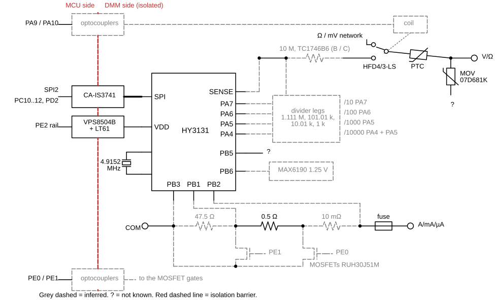

The same as text:

- Rest of the meter (one ground): USB-C with a TVS on VBUS; [TP4056](datasheets/toppower-tp4056-cn.pdf)
  charger and the LN425272 1S 2000 mAh cell with protection PCB; system supply
  (regulators not identified); [GD32F427VGT6](datasheets/gigadevice-gd32f427xx-datasheet-rev1.9.pdf) at 200 MHz from a
  25 MHz crystal, USBFS on PA11 / PA12; [ILI9488](https://www.crystalfontz.com/controllers/uploaded/ILI9488%20Data%20Sheet_100.pdf) 3.5" IPS 480 x 320 LCD on FSMC 16-bit, backlight PWM on PA6; touch
  (Hynitron 0x5A, plus 4 touch keys) on I2C2; [W25Q128JV](datasheets/winbond-w25q128jv-revI.pdf) 16 MiB (USB disk) on SPI1; Jieli BP2A838 BT
  (24 MHz crystal, PCB antenna) on UART4; buzzer PWM on TIM14 PA7; debug
  header: UART PA2 / PA3, SWD PA13 / PA14; scope: CHA jack -> /50 relay PC13, AC/DC
  PE3, offset PC8 -> 4051 + op amp 8091 gain -> [3PA1030](datasheets/3peak-3pa1030-reva1.pdf) 10-bit 50 MS/s on PB0..PB9, clocked by
  PC6 at 50 MHz; generator: DAC0 PA4 or TIM12 PB14 -> SGM3157 (PB12) ->
  output stage -> GEN jack; rails PE2 (to the isolated supplies) and PC4 (scope / generator).
- Isolation barrier: CA-IS3741 carries SPI2
  (PC10..PC12 + CS PD2); optocouplers (2 x EL3H7, 2 x "174 F163H") carry the drive of PA9 / PA10 (relay)
  and PE0 / PE1 (shunt MOSFETs) (*inferred*); 2 x VPS8504B with LT61-117 /
  LT61-113 transformers supply the DMM side.
- DMM (isolated, shielded): [HY3131](datasheets/hycon-hy3131-datasheet-v10.pdf) with 4.9152 MHz crystal, [MAX6190](https://www.analog.com/media/en/technical-documentation/data-sheets/MAX6190-MAX6198.pdf)
  1.25 V reference, 10 M divider with taps (TC1746B6 on B / C, discrete on
  A), [HFD4/3-LS](datasheets/hongfa-hfd4.pdf) latching relay, V/Ω input network (PTC, MOVs), fuse and shunt
  chain 10 mΩ + 0.5 Ω + 47.5 Ω with RUH30J51M MOSFETs; jacks V/Ω, COM,
  A/mA/µA.

### Isolation boundary

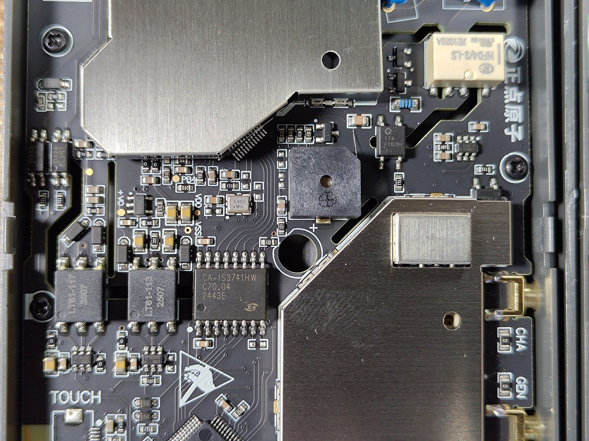

*The isolation strip: CA-IS3741HW, LT61-117 / LT61-113 with VPS8504B drivers, EL3H7 and "174 F163H" optocouplers, HFD4/3-LS relay, HY3131 shield can, CHA / GEN jacks.*

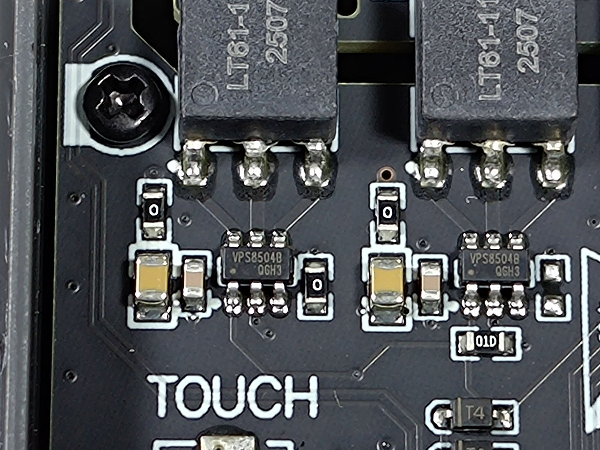

*The two isolated supplies: VPS8504B drivers under the LT61-1xx transformers.*

The DMM part ([HY3131](datasheets/hycon-hy3131-datasheet-v10.pdf), reference, divider, relay, shunts, banana jacks)
is galvanically isolated from the rest of the meter through the
[CA-IS3741](datasheets/chipanalog-ca-is374x-v1.08.pdf) digital isolator, the optocouplers and the
[VPS8504B](datasheets/vpsc-vps8504b-cn.pdf) + LT61 isolated supplies. Everything else (MCU, USB, battery,
scope, generator) shares one ground.

## Main parts

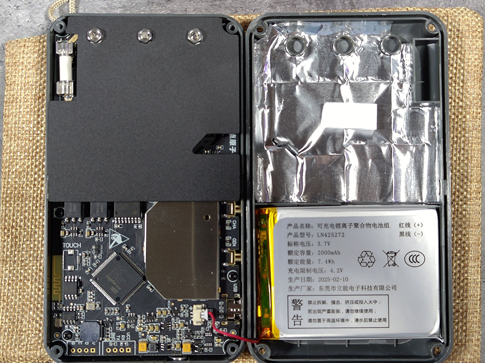

*The case opened: main board with the shield plate over the DMM area (fuse top left), MCU area below; back cover with foil lining and the battery.*

| Function | Part | Source |
|---|---|---|
| MCU | GigaDevice [GD32F427VGT6](datasheets/gigadevice-gd32f427xx-datasheet-rev1.9.pdf), Cortex-M4F, LQFP100 | marking `GD32F427 VGT6` in photo [main-board-mcu-gd32f427.jpg](photos/main-board-mcu-gd32f427.jpg); review; BOM |
| MCU crystal | 25.000 MHz | photo ([main-board-mcu-gd32f427.jpg](photos/main-board-mcu-gd32f427.jpg), crystal next to the SPI flash) and PLL read back ([`firmware/src/clock.rs`](../firmware/src/clock.rs)). The community BOM says 26 MHz (contradiction, see [Unknowns](#unknowns)) |
| SPI flash | Winbond [W25Q128JV](datasheets/winbond-w25q128jv-revI.pdf), 16 MiB | code ([`firmware/src/spiflash.rs`](../firmware/src/spiflash.rs), JEDEC check at boot); BOM. The BOM calls it QSPI: the chip can do quad I/O, but the board wires it as a plain 4-wire SPI ([SPI flash](#spi-flash-usb-disk)) |
| LCD controller | [ILI9488](https://www.crystalfontz.com/controllers/uploaded/ILI9488%20Data%20Sheet_100.pdf) (ID read 0x9488) | ID 0x9488 read by `board::init` ([`firmware/TODO.md`](../firmware/TODO.md) T1); stock init sequence [`lcd_buzzer_v2_6.h`](../stock/re/analysis/lcd_buzzer_v2_6.h). Not in the BOM |
| LCD panel | 3.5" IPS, 480 x 320, active area 74 x 50 mm | review |
| Touch | Hynitron CST-type controller at I2C 0x5A (chip type byte 0xA8) on this unit; the stock also supports a Goodix GT1158 at 0x14 | [`firmware/src/touch.rs`](../firmware/src/touch.rs); GT1158 path from the stock code only. Not in the BOM (the touch controller sits on the panel FPC) |
| Bluetooth | Jieli BP2A838-20A2, 24 MHz crystal, PCB meander antenna | BOM (custom Jieli chip, no public datasheet); antenna and 24.000 MHz crystal next to a chip with the Jieli logo in [main-board-mcu-gd32f427.jpg](photos/main-board-mcu-gd32f427.jpg) |
| DMM front end | Hycon [HY3131](datasheets/hycon-hy3131-datasheet-v10.pdf) | code (register protocol, [`hy3131_v2_6.h`](../stock/re/analysis/hy3131_v2_6.h)); the chip itself is under the shield can (4.9152 MHz crystal and VDD/VSS silkscreen next to it in [dmm-isolation-hy3131-shield-area.jpg](photos/dmm-isolation-hy3131-shield-area.jpg)) |
| HY3131 crystal | 4.9152 MHz | photo and stock constant 4915.2 ([`hy3131_v2_6.h`](../stock/re/analysis/hy3131_v2_6.h)) |
| Voltage reference | [MAX6190](https://www.analog.com/media/en/technical-documentation/data-sheets/MAX6190-MAX6198.pdf) (1.25 V, 5 ppm/°C) on HY3131 PB6 | BOM only for the part (placement: see [Unknowns](#unknowns)); the 1.25 V value matches the stock scaling ([`emu/hy3131/RESEARCH.md`](../emu/hy3131/RESEARCH.md) 7) |
| Divider network | TC1746B6 (B / C), 0.1 %, 10 ppm/°C; discrete resistors on the A | BOM only; chat reports [#25087](https://t.me/S2084K/25087), [#51830](https://t.me/S2084K/51830) ([`firmware/docs/user-feedback.md`](../firmware/docs/user-feedback.md) 12) |
| Digital isolator | Chipanalog [CA-IS3741HW](datasheets/chipanalog-ca-is374x-v1.08.pdf) | marking in photos [dmm-isolation-hy3131-shield-area.jpg](photos/dmm-isolation-hy3131-shield-area.jpg), [main-board-mcu-gd32f427.jpg](photos/main-board-mcu-gd32f427.jpg) |
| Isolated supplies | 2 x [VPS8504B](datasheets/vpsc-vps8504b-cn.pdf) push-pull driver + transformers LT61-117 and LT61-113; micropower (hundreds of mW, BOM) | markings in photos [isolated-supply-vps8504b-lt61.jpg](photos/isolated-supply-vps8504b-lt61.jpg), [dmm-isolation-hy3131-shield-area.jpg](photos/dmm-isolation-hy3131-shield-area.jpg) |
| Optocouplers | 2 x EL3H7, 2 x "174 F163H" | what they carry is *inferred*: the BOM guesses the HY3131 INT plus the relay and MOSFET drive; see [Unknowns](#unknowns). BOM; the "174 F163H" (4-pin) next to the relay and the EL3H7 (marked "D424 EL3H7") are in [dmm-isolation-hy3131-shield-area.jpg](photos/dmm-isolation-hy3131-shield-area.jpg) |
| DMM relay | Hongfa [HFD4/3-LS](datasheets/hongfa-hfd4.pdf) (DPDT, 3 V, latching per BOM) | marking in photos [input-jacks-shunts-fuse-relay.jpg](photos/input-jacks-shunts-fuse-relay.jpg), [relay-hfd4-and-varistor-closeup.jpg](photos/relay-hfd4-and-varistor-closeup.jpg); review |
| Input protection | varistors 07D681K (680 V), blue disc parts, 2 W wirewound/film resistors; FMMT619 pair (*inferred*, chat report [#41820](https://t.me/S2084K/41820)) | photos ([relay-hfd4-and-varistor-closeup.jpg](photos/relay-hfd4-and-varistor-closeup.jpg), [input-jacks-shunts-fuse-relay.jpg](photos/input-jacks-shunts-fuse-relay.jpg)); which disc is a PTC and which a MOV is *inferred* from the markings |
| Current shunts | 10 mohm (wire shunt), 0.5 ohm (SMD 2512 "R500"), 47 ohm (MELF 0207, *inferred*; uA shunt 0.5 + 47 = 47.5 ohm) | 0.5 ohm: marking in [input-jacks-shunts-fuse-relay.jpg](photos/input-jacks-shunts-fuse-relay.jpg); values from the stock scaling and opendm40 checks (below) |
| Current range MOSFETs | RUH30J51M dual N-MOSFET, 30 V / 50 A; switch the current ranges inside the one A jack | BOM only |
| Fuse | ceramic cartridge in clips, next to the A jack | photo [input-jacks-shunts-fuse-relay.jpg](photos/input-jacks-shunts-fuse-relay.jpg) and [opened-case-overview.jpg](photos/opened-case-overview.jpg); rating unknown |
| Scope ADC | 3PEAK [3PA1030](datasheets/3peak-3pa1030-reva1.pdf), 10 bit, 50 MSPS, parallel | BOM; 10-bit parallel bus on PB0..PB9 in code ([`firmware/src/scope.rs`](../firmware/src/scope.rs)) |
| Scope gain mux | [HC4051](datasheets/ti-cd74hc4051-schs122o.pdf) (header says "HCF4051") | BOM, [`scope_gen_v2_6.h`](../stock/re/analysis/scope_gen_v2_6.h) |
| Scope op amp | "8091" (Gainsil [GS8091](datasheets/gainsil-gs8091.pdf)?) | BOM only, after gadefox in the EEVblog thread |
| Generator path switch | SGM3157 SPDT | *inferred* from chat report [#24902](https://t.me/S2084K/24902); [`firmware/docs/dac-adc-paths.md`](../firmware/docs/dac-adc-paths.md) 1 |
| Charger | [TP4056](datasheets/toppower-tp4056-cn.pdf) (marked "TP4056 2413"), linear, 1 cell, not isolated (on VBUS) | marking in photo [charger-tp4056-and-power.jpg](photos/charger-tp4056-and-power.jpg); review |
| Battery | LN425272 Li-ion polymer, 3.7 V, 2000 mAh, 7.4 Wh, 4.2 V charge limit, made 2025-02-10 by 东莞市立能电子科技有限公司, with protection PCB | label in [battery-ln425272-label.jpg](photos/battery-ln425272-label.jpg) |
| Connectors | USB-C; two coaxial (MCX per BOM) jacks silkscreened CHA (scope) and GEN (generator); banana V/ohm, COM, A/mA/uA | photos; review ("coaxial, not BNC") |
| Debug header | two rows of 4 holes: "VCC RX TX GND" (TX = PA2, the boot strap) and "V D C G" (SWD: D = PA13 SWDIO, C = PA14 SWCLK; the BOM lists only this 4-pin service header) | see [Debug header and hardware recovery](#debug-header-and-hardware-recovery). Flash read protection is set (level 1 in the option bytes; [`stock/re/ANALYSIS.md`](../stock/re/ANALYSIS.md) 1) |

Small SOT-23 / SOT-89 / MSOP parts in [charger-tp4056-and-power.jpg](photos/charger-tp4056-and-power.jpg)
("A2SHB", "93N44", "XFHVB", "K14", "S1K", "NE.", inductor "2R2", tantalum
"J227") are not identified; they make up the power path and regulators.

## MCU and clocks

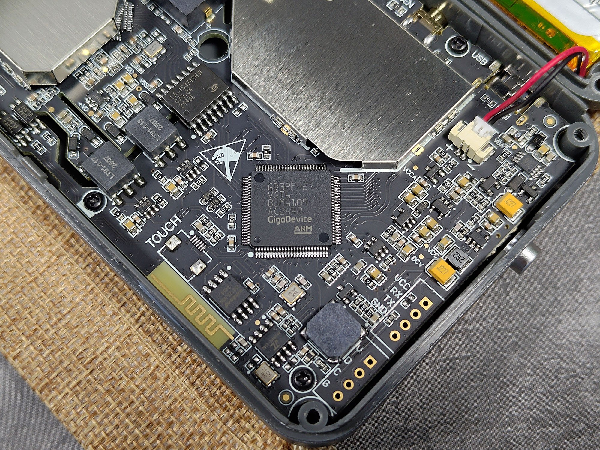

*MCU area: GD32F427VGT6, SPI flash, 25 MHz crystal, Bluetooth chip with 24 MHz crystal and antenna, CA-IS3741HW, LT61 transformers, USB-C, debug pads.*

- [GD32F427VGT6](datasheets/gigadevice-gd32f427xx-datasheet-rev1.9.pdf): Cortex-M4F, 1 MB internal flash, 256 KB SRAM as 64 KB TCM
  (0x10000000) + 128 KB SRAM0/1 (0x20000000) + 64 KB ADDSRAM (0x20020000).
  ([`stock/re/ANALYSIS.md`](../stock/re/ANALYSIS.md) 4: dump sizes and stack top).
- HXTAL 25 MHz, PLL M=25 N=400 P=2 -> 200 MHz SYSCLK / HCLK; APB1 50 MHz,
  timer kernel clocks 200 MHz (TIMPRE). RCU_PLL read back on the device
  ([`firmware/src/clock.rs`](../firmware/src/clock.rs), [`firmware/src/genplan.rs`](../firmware/src/genplan.rs)).
- USB 48 MHz: the stock PLLQ gives 44.4 MHz; opendm40 runs PLLSAI (P=6 -> 48 MHz)
  for USBFS ([`firmware/src/usb.rs`](../firmware/src/usb.rs)).
- On-chip blocks the board uses: USBFS, two 12-bit DAC channels (both used,
  [Generator](#generator) and [Oscilloscope](#oscilloscope)), DMA, ADC0.
- Backup domain (RTC, backup SRAM): not powered while the meter is off. After
  a power-off by the key, the next boot shows the POR and BOR reset flags and
  the 4 KiB backup SRAM content is gone; a reset or a firmware update keeps
  it. opendm40 therefore keeps a copy of its settings on the SPI flash
  ([`firmware/src/setfile.rs`](../firmware/src/setfile.rs)). LSE (32 kHz crystal): not traced.

## SPI flash (USB disk)

[W25Q128JV](datasheets/winbond-w25q128jv-revI.pdf), 16 MiB, on SPI1 (GD32 naming; base 0x40003800): SCK PD3, MISO PC2,
MOSI PC3 (AF5), CS PE4 (GPIO, active low), mode 3. The stock runs it at
3.125 MHz, opendm40 at 12.5 MHz after a boot self-check. The whole chip is one
FAT16 volume with 4096-byte sectors: the USB disk of the meter
([`firmware/src/spiflash.rs`](../firmware/src/spiflash.rs), [`spiflash_v2_6.h`](../stock/re/analysis/spiflash_v2_6.h)). The FS-loader also uses it for
updates.

## LCD

- [ILI9488](https://www.crystalfontz.com/controllers/uploaded/ILI9488%20Data%20Sheet_100.pdf), 16-bit 8080 bus on FSMC bank 1 NE1: D0..D15 on PD0 PD1 PD8 PD9
  PD10 PD14 PD15 PE7..PE15, NOE PD4, NWE PD5, NE1 PD7, RS = A16 on PD11
  (command 0x6001FFFE, data 0x60020000). No reset GPIO, no DMA
  ([`firmware/src/board.rs`](../firmware/src/board.rs), [`firmware/src/lcd.rs`](../firmware/src/lcd.rs), [`lcd_buzzer_v2_6.h`](../stock/re/analysis/lcd_buzzer_v2_6.h)).
- FSMC timing as the stock: BCR1 0x5091, BTR1 0x0F04, BWTR1 0x0FF00201
  (device read-back, [`firmware/TODO.md`](../firmware/TODO.md) T1).
- Pixel format RGB565 on writes; reads return RGB666 ([`lcd.rs`](../firmware/src/lcd.rs)).
- Backlight: PA6 AF9 = TIM13_CH1, 20 kHz PWM ([`board.rs`](../firmware/src/board.rs)).
- Panel: 3.5" IPS 480 x 320 (review). The panel's FPC pinout is unknown.

## Touch panel and touch keys

- I2C2 (GD32 naming; STM32 "I2C3", base 0x40005C00): SCL PA8, SDA PC9 (AF4),
  INT PE5 (falling edge), reset PE6 ([`firmware/src/touch.rs`](../firmware/src/touch.rs),
  [`touch_v2_6.h`](../stock/re/analysis/touch_v2_6.h)).
- This unit: Hynitron CST-type at 7-bit 0x5A, chip type byte 0xA8. The stock
  probes a Goodix GT1158 at 0x14 first (absent here), so other units may carry
  it.
- The four touch keys left of the screen (MENU, RUN, AUTO, MF) are reported by the touch controller itself as key codes 0..3,
  not by GPIOs ([`touch.rs`](../firmware/src/touch.rs), measured X 372/628/884/1140).
- Pull-up strength unknown; opendm40 measures the rise time before going to
  400 kHz.

## Power key, PA2, buzzer

- **Power key PD6**: the one physical button (side). Input with pull-down,
  pressed = 1 ([`firmware/src/boot.rs`](../firmware/src/boot.rs) `PD6_PRESSED_HIGH`, stock
  FUN_0800b7e0). How the key also switches the unit on from off (it must reach
  the power path) is unknown.
- **PA2**: the "TX" pad of the debug header. The Alientek primary bootloader and the FS-loader enable a
  pull-up on PA2 and poll it ~1000 times each at boot; low for the whole poll
  sends the boot to the FS-loader's install state ([`firmware/docs/fsloader-install-trigger.md`](../firmware/docs/fsloader-install-trigger.md) 1). PA2 is not the power key.
  See [Debug header and hardware recovery](#debug-header-and-hardware-recovery).
- **Buzzer**: PA7 AF9 = TIM14_CH1 PWM,
  200 MHz / 5 / 11200 = 3.57 kHz, loudness = duty
  ([`lcd_buzzer_v2_6.h`](../stock/re/analysis/lcd_buzzer_v2_6.h), opendm40 [`app.rs`](../firmware/src/app.rs)). The continuity / diode beep is not
  made by the MCU: the stock only toggles the [HY3131](datasheets/hycon-hy3131-datasheet-v10.pdf) CMP pin buffer (ENPCMPO),
  so the HY3131 comparator output drives the buzzer stage (*inferred*,
  [`firmware/docs/parity.md`](../firmware/docs/parity.md)). The only buzzer-like part in
  the photos is a magnetic buzzer in the DMM area next to the HY3131 can
  ([dmm-isolation-hy3131-shield-area.jpg](photos/dmm-isolation-hy3131-shield-area.jpg)); how PA7 reaches it across the
  isolation is unknown.

## Debug header and hardware recovery

**Where.** At the end of the main board opposite the banana jacks, next to
the Bluetooth antenna and the 24 MHz crystal: two rows of four through-holes,
unpopulated, silkscreened. Seen with the board as in
[opened-case-overview.jpg](photos/opened-case-overview.jpg) (jacks at the top), left to right:

| Group | Pads, left to right | Square pad |
|---|---|---|
| left | G, C, D, V | V |
| right | GND, TX, RX, VCC | VCC |

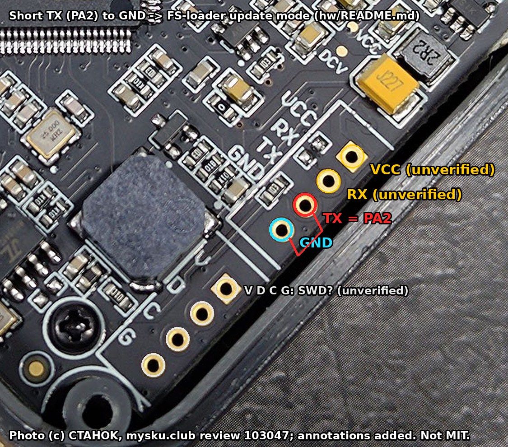

*A marked-up crop of [main-board-mcu-gd32f427.jpg](photos/main-board-mcu-gd32f427.jpg)
(photo © CTAHOK, mysku.club, see [photos/README.md](photos/README.md)).*

| Pad | Signal |
|---|---|
| TX | **PA2** (pull-up enabled by the bootloader and the FS-loader) |
| GND | MCU-domain ground, next to TX |
| RX | **PA3** (USART1_RX on the GD32F4; unused by the stock firmware and opendm40) |
| VCC | ~3.1 V while the meter is on (measured); **not** wired directly to the MCU supply; what sits in between is not traced |
| V, D, C, G | SWD: V = VCC, D = **PA13** (SWDIO), C = **PA14** (SWCLK), G = GND |

SWD itself has not been tried. The option bytes (dumped from the running
firmware, [`stock/re/ANALYSIS.md`](../stock/re/ANALYSIS.md) 1) show read protection level 1:
with it a debugger cannot read or write the flash, and lifting it
mass-erases the whole MCU flash: the Alientek bootloader, the FS-loader, the
calibration and the UID-bound boot data. Use SWD only as a last resort, after
the opendm40 backup (root README, [Back up with opendm40](../README.md#back-up-with-opendm40)),
and restore in the order given there.

PA2's alternate function on the GD32F4 is USART1_TX, so the pad is labelled
as a UART TX. The stock firmware never enables USART1 (per the RE notes), and
neither does opendm40: in practice the pad is only the boot strap.
PA2 reads low only when it is shorted to GND, or when something connected to
the header pulls it low.

### Hardware recovery

It works whatever the application does, because the decision is taken by the Alientek
bootloader and the FS-loader before the application runs.

1. Switch the meter off. Open the case (back cover) to reach the header.
2. Short the **TX** pad (PA2) to the neighbouring **GND** pad (a tweezers or a
   wire), then switch on with the power key.
3. Keep the short until the update screen appears ("open file error" and the
   FS-loader's own USB disk on the PC).
4. Copy an update file onto that disk under a `dm40*.bin` name: the official
   [`dm40_v_2_6.bin`](../stock/vendor/dm40_v_2_6.bin) from [`stock/vendor/`](../stock/vendor) in this repo (back to stock) or an opendm40 image (e.g. `dm40_opendm40_v0.1.bin`),
   then press "update" on the screen.
5. Remove the short.

Not verified yet: the exact timing, i.e. whether the short must be in place at power-on
(as written above) or also works when applied during a reset, and how long
it must be held.

Software ways to the same screen while opendm40 runs (`DBG:UPDATE`, the key-hold
recovery, the double-hang rule) are in [README.md, Recovery](../README.md#recovery).

## USB

USB-C, USBFS only: DM PA11, DP PA12 (AF10). No VBUS sensing (PA9/PA10, the
usual VBUS/ID pins, drive the relay) ([`firmware/src/usb.rs`](../firmware/src/usb.rs)). The USB port
also charges the battery ([TP4056](datasheets/toppower-tp4056-cn.pdf)). USB data and the DMM are galvanically
separate ([Isolation boundary](#isolation-boundary)); USB ground is the MCU,
scope and generator ground (*inferred*).

## Bluetooth

- Module / chip: Jieli BP2A838-20A2 (BOM and the photo), own 24 MHz crystal, PCB meander antenna at the board edge
  ([main-board-mcu-gd32f427.jpg](photos/main-board-mcu-gd32f427.jpg)). Classic SPP (RFCOMM channel 1,
  [`docs/bt-protocol.md`](../docs/bt-protocol.md)) and BLE ([`firmware/src/bt.rs`](../firmware/src/bt.rs)).
- UART4: TX PA0, RX PA1 (AF8), 115200 8N1, no RTS/CTS ([`bt.rs`](../firmware/src/bt.rs)).
- PC0 = module power, **low = on**, high = off ([`bt.rs`](../firmware/src/bt.rs),
  [`bt_meas_v2_6.h`](../stock/re/analysis/bt_meas_v2_6.h); [`board.rs`](../firmware/src/board.rs) sets it high at boot = off, as the stock).
- PC14 = link status input, high = connected ([`power.rs`](../firmware/src/power.rs), [`bt.rs`](../firmware/src/bt.rs)).
- AT commands the firmware sends: `AT+SBN<name>`, `AT+SLED0`, `AT+RESET`,
  `AT+CBN` ([`bt.rs`](../firmware/src/bt.rs), [`docs/bt-protocol.md`](../docs/bt-protocol.md)).

## DMM front end (HY3131)

Overview of the chip: [emu/hy3131/RESEARCH.md](../emu/hy3131/RESEARCH.md) 2
and the datasheet in [datasheets/](datasheets/README.md). The 60 stock
configuration rows (R20..R35 per mode and range) and their decoding are in
[`stock/re/analysis/hy3131_v2_6.h`](../stock/re/analysis/hy3131_v2_6.h); the terminal-level model is
[emu/hy3131/README.md](../emu/hy3131/README.md).

**Bus.** SCK PC10, MISO PC11, MOSI PC12, CS PD2 (active low), mode 0. The stock
bit-bangs it; opendm40 uses SPI2 (AF6) at 3.125 MHz
([`firmware/src/hy3131.rs`](../firmware/src/hy3131.rs), [`firmware/docs/dmm-input-scope-feasibility.md`](../firmware/docs/dmm-input-scope-feasibility.md) 8). The
signals cross the [CA-IS3741](datasheets/chipanalog-ca-is374x-v1.08.pdf) isolator (the channel assignment is *inferred*: it has 3 forward and 1
reverse channel, which fits SCK, MOSI, CS out and MISO back; datasheet
[`chipanalog-ca-is374x-v1.08.pdf`](datasheets/chipanalog-ca-is374x-v1.08.pdf)). The [HY3131](datasheets/hycon-hy3131-datasheet-v10.pdf) IRQ output is not used.

**Converters** (datasheet facts, [`RESEARCH.md`](../emu/hy3131/RESEARCH.md) 2; SYSCLK = 4.9152 MHz):

| Block | What | Rates on the DM40 |
|---|---|---|
| AD1 | 24-bit sigma-delta, IG 0.9..3.6, reference PB6 (1.25 V) or internal | AD1CLK = SYSCLK / 30; OSR 256..32768. Stock steady 32768, moving 8192 ([`firmware/src/dmm.rs`](../firmware/src/dmm.rs)) |
| AD2 / AD3 | 19-bit fast converters, shared clock and OSR | 76.8 kS/s in the stock AC rows (SYSCLK / 2 / 32); ladder down to 600 S/s ([`dmm-input-scope-feasibility.md`](../firmware/docs/dmm-input-scope-feasibility.md) 1.1) |
| RMS / LPF | digital true RMS (sum X^2 or X*Y) and low-pass of AD2 | ~106.7 ms per result measured with LPFBW 111 (half the datasheet formula, [`RESEARCH.md`](../emu/hy3131/RESEARCH.md) 8) |
| Peak hold | on AD2, AD1<23:5> or LPF | used by opendm40's A-jack probe ([`firmware/src/sentinel.rs`](../firmware/src/sentinel.rs)) |
| Comparator | window comparator, thresholds from R21; output CMPO / CMP pin | continuity beeper, capacitance ramp, frequency, opendm40 sentinels |
| Counter | CTA / CTB / CTC, gate preset 0xFC0000 = 0x40000 SYSCLK = 53.3 ms | frequency (reciprocal), capacitance (RC oscillator) |
| Op amps | OP1, OP2 (2 MHz), OP3 (ohm / diode source) | x1 / x10 gain stages on the shunt and mV paths |

AD1 on a periodic input aliases (the "AD1 beat"): see `firmware/docs/dc-aliasing.md` (on branch `dcalias`, not merged yet).
AC bandwidth is about 20 kHz (-3 dB, chat reports [#24765](https://t.me/S2084K/24765),
[#16732](https://t.me/S2084K/16732)); the AC V path has an external coupling capacitor with a time constant
of ~0.3 s ([`firmware/docs/acdc-approaches.md`](../firmware/docs/acdc-approaches.md), [`acdc-stock-vs-opendm40.md`](../docs/history/acdc-stock-vs-opendm40.md)).

**MCU GPIOs on the DMM side** (the complete list the stock drives,
[`hy3131_v2_6.h`](../stock/re/analysis/hy3131_v2_6.h) lines 14-18, [`firmware/src/dmm.rs`](../firmware/src/dmm.rs) `relay_pa` / `relay_pe`):

| MCU pin | Function | Notes |
|---|---|---|
| PA9 / PA10 | [HFD4/3-LS](datasheets/hongfa-hfd4.pdf) latching relay, 10 ms pulse. Arg 0: PA10 = 1, PA9 = 0; arg 1: PA10 = 0, PA9 = 1 | V/A path vs the ohm / mV network. One latching relay with a single coil driven in either polarity is *inferred* from the drive pattern (one relay in the photos; the BOM says DPDT, 3 V, latching); the drive crosses the isolation (optocouplers, *inferred*) |
| PE0 / PE1 | shunt MOSFETs: PE0 = 1 -> A (10 mohm), PE1 = 1 -> mA (0.5 ohm), both 0 -> uA (47.5 ohm chain) | the resting state in every non-current mode is both 0 ([`power-meter-and-misconnect.md`](../firmware/docs/power-meter-and-misconnect.md) 4.1) |
| PC7 | 1 only in the frequency mode (mode 14) | what it switches is unknown |

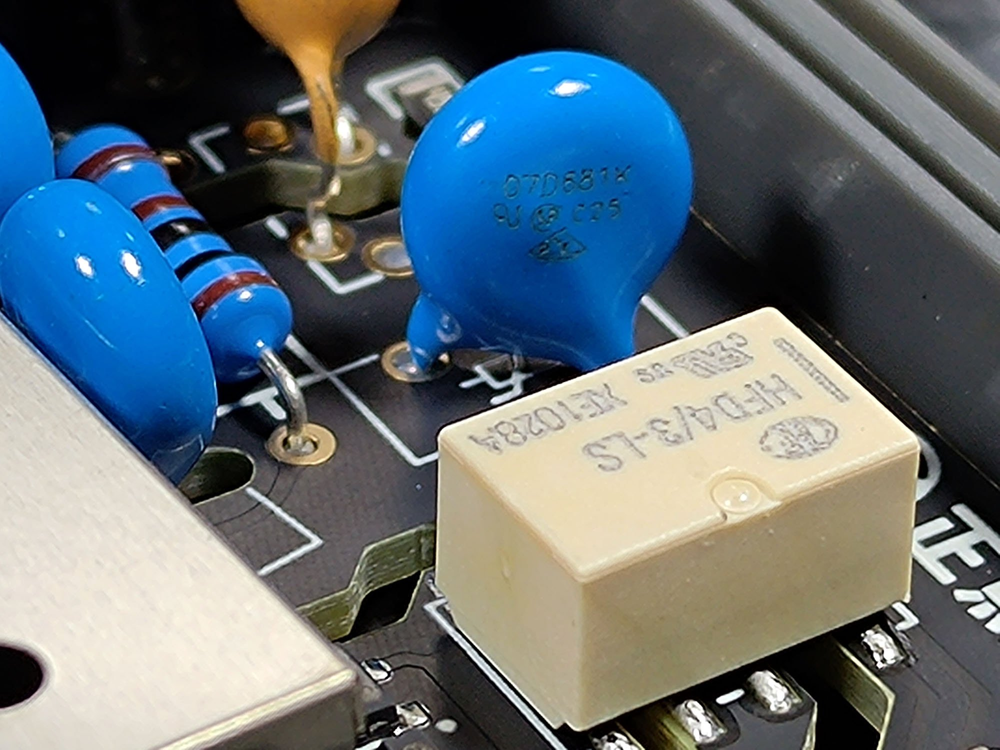

*Input network: HFD4/3-LS relay and a 07D681K (680 V) varistor.*

**Input network (HY3131 pins, *inferred* from the stock rows and scaling):**

- V/ohm input through a 10 M divider with taps: /10 on HY3131 PA7, /100 PA6,
  /1000 PA5, /10000 PA4 + PA5; the buffered input appears as SENSE
  ([`power-meter-and-misconnect.md`](../firmware/docs/power-meter-and-misconnect.md) 3.1, [`RESEARCH.md`](../emu/hy3131/RESEARCH.md) 7). The taps follow the
  datasheet's 10 M / 1.111 M / 101.01 k / 10.01 k / 1 k network.
- Ohm: OP3 drives reference resistors on HY3131 PA2..PA7 (Rref 1 k .. 63 M per
  range); ratiometric AD1 ([`hy3131_v2_6.h`](../stock/re/analysis/hy3131_v2_6.h) mode 10). Ohm source
  short-circuit current per range (600 Ω / 6 k / 60 k / 600 k / 6 MΩ):
  0.90 mA / 197 µA / 20 µA / 2.2 µA / 215 nA in the default variant (OP3
  VREF tap VDS15), 0.28 mA / 58 µA / 6.6 µA / 0.66 µA / 86 nA in the "ON"
  variant (AGNDP7; AGNDP8 on 6 MΩ). Open-circuit voltage at the jack (the
  MR9270S+ calibrator's voltage input): 2.12 V (default), 0.67 V (ON). Measured
  on one unit with `DBG:SRC`, jacks shorted / open
  ([`device-check-2026-10-21.md`](../firmware/docs/device-check-2026-10-21.md#ohm-test-current-map-dbgsrc),
  `dmm::OHM_ISC` in [`firmware/src/dmm.rs`](../firmware/src/dmm.rs)).
  60 Ω and 60 MΩ (the current-source row) not measured; the firmware shows
  the 600 Ω default value on 60 Ω (*inferred*). *Inferred* from the drops:
  only 600 Ω is limited by OP3; above it the ~2 V source behind Rref sets
  the current. Diode test 0.756 mA, open-circuit 3.23 V (measured on one unit, the RLD current-source path; device check).
- Diode: OP3 source with the 900 k / 100 k divider on HY3131 PB0 / PB8.
- Capacitance: RC relaxation (R = 1020 k .. 1.5 k) or constant-current ramp
  switched on HY3131 PA4..PA7.
- mV / thermocouple: HY3131 PB0 through OP1 x10. Cold junction = the HY3131
  die sensor.
- AC V: OP1 output -> external coupling capacitor -> HY3131 PB4 -> AD2.

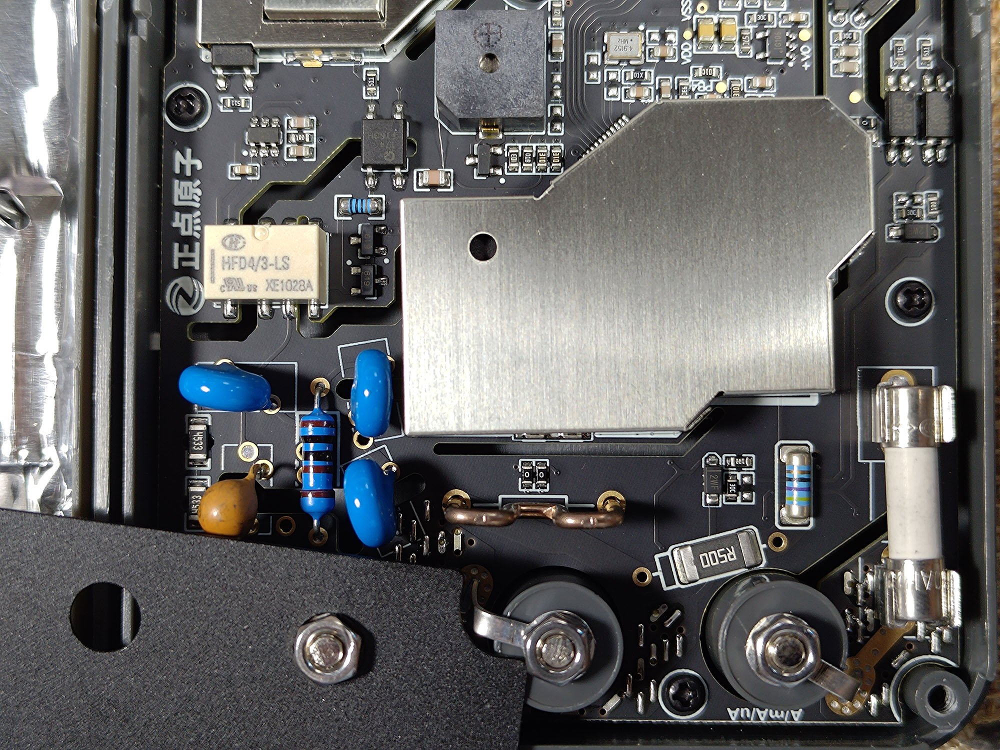

*DMM input area under the shield plate: relay, input resistors and varistors, 0.5 ohm "R500" shunt, wire shunt between the jacks, fuse in clips, COM and A/mA/uA jacks.*

**Current path.** One A jack for A / mA / uA (silkscreen "A/mA/uA"); the
MOSFETs switch the range, not the user (chat report [#26977](https://t.me/S2084K/26977)). Series chain
from the A jack: fuse -> 10 mohm -> 0.5 ohm -> 47 ohm -> COM, with PE0 / PE1
MOSFETs shorting the lower parts (*inferred* from the mode table;
[`sentinel.rs`](../firmware/src/sentinel.rs) fuse check, [`power-meter-and-misconnect.md`](../firmware/docs/power-meter-and-misconnect.md) 4.1 / 4.8).
Measurement nodes: HY3131 PB2 = top of the 10 mohm element (every A-jack
current passes it), PB1 = the node between 10 mohm and 0.5 ohm, PB3 = the low
side at COM (*inferred*: with PE1 shorting the 47 ohm resistor, PB1 - PB3
reads 0.5 ohm in mA and 0.5 + 47 = 47.5 ohm in uA, the stock's two shunt
values). Shunt values: 0.5 ohm from the "R500" marking; 10 mohm and
47.5 ohm (0.5 + 47) *inferred* from the stock scaling and the opendm40 fuse check, which
reads ~48 ohm A-COM through the whole chain on the device
([`sentinel.rs`](../firmware/src/sentinel.rs)). The 10 mohm element is the bent
copper-coloured wire bridge between the jacks in
[input-jacks-shunts-fuse-relay.jpg](photos/input-jacks-shunts-fuse-relay.jpg) (*inferred*).

| Range | Shunt | Burden at full scale (*inferred*) |
|---|---|---|
| 10 A | 10 mohm | 0.2..0.5 V incl. fuse and MOSFET |
| mA | 0.5 ohm | 0.24..0.6 V |
| uA | 0.5 + 47 = 47.5 ohm | ~0.19 V |

The 47 ohm part is the blue MELF resistor between "R500" and the fuse in
[input-jacks-shunts-fuse-relay.jpg](photos/input-jacks-shunts-fuse-relay.jpg) (*inferred* from its position).
Scaled against the 2512 "R500" next to it (6.4 x 3.2 mm), its body is about
5.5 x 2 mm: a MELF 0207, a size usually rated 0.4..1 W depending on the
series (*inferred*). Its colour bands read yellow-violet-black-brown, i.e.
47 ohm 1 % (*inferred* from the photo). With the 0.5 ohm above it this gives
the stock's 47.5 ohm uA shunt.

**No jack sensing.** The DM40 has no jack sense switches or pins: the stock
DMM GPIO list is the one above. opendm40 detects leads in the wrong jack only
through the shunt node (HY3131 PB1 comparator) and the divider tap
([`sentinel.rs`](../firmware/src/sentinel.rs), [`power-meter-and-misconnect.md`](../firmware/docs/power-meter-and-misconnect.md) 4.1). A blown fuse cannot be
seen by the meter (the A side of the fuse has no path into the chip); opendm40's
"Fuse check" measures A-COM in ohm mode instead.

## Oscilloscope

- ADC: [3PA1030](datasheets/3peak-3pa1030-reva1.pdf), 10 bit, data on PB0..PB9 read as GPIOB IDR by DMA1, clocked by
  TIM8_CH1 on PC6 (AF3) at 50 MHz ([`firmware/src/scope.rs`](../firmware/src/scope.rs)).
- Sample rates: 50 MS/s down to 50 S/s (timer-paced DMA from the 50 MHz
  stream). The ADC never runs faster than 50 MS/s; at 100 and 200 ns/div the
  display upsamples. Record 26 K samples ([`scope.rs`](../firmware/src/scope.rs) TB table). Spec 10 MHz bandwidth,
  10 mV..10 V/div (x1), 100 ns..50 s/div (review); chat reports measure flat to
  ~3 MHz and -3 dB at 11.5..17 MHz, input capacitance ~30..35 pF
  ([`user-feedback.md`](../firmware/docs/user-feedback.md) 6.3).
- Front end (meaning of the pins *inferred* from the gain steps,
  [`scope_gen_v2_6.h`](../stock/re/analysis/scope_gen_v2_6.h), [`dac-adc-paths.md`](../firmware/docs/dac-adc-paths.md) 3):
  - PC13: input attenuator relay, 1 = direct, 0 = /50; 200 ms settle.
  - PB15 / PD12 / PD13: 4051 select code, gain x0.5 .. x20 in the amplifier
    feedback (which pin is A / B / C is unknown).
  - PE3: coupling, 1 = DC, 0 = AC.
  - PC8 = TIM3_CH3 (AF2) PWM ~10 kHz: vertical offset.
  - Trigger (stock only): DAC channel 2 on PA5 sets the level of an external
    comparator (chip not identified) whose output goes to PA15 = TIM2_CH1
    (AF1); the output is inverted and ~2 us late ([`firmware/src/hwtrig.rs`](../firmware/src/hwtrig.rs)).
- Supply: PC4 rail (below). Ground: shared with USB and the MCU (*inferred*).
- Connector: coaxial "CHA" (MCX per BOM); probe x1/x10 with compensation
  trimmer.

## Generator

- DAC path: DAC channel 1 (`DAC_OUT0`) on PA4, paced by TIM6 TRGO,
  DMA0 stream 5. Up to 10 MS/s. Output 0..3 V unipolar (DAC
  reference 3.0 V, assumed in code); the stock turns the DAC output buffer
  off for sine / triangle / ramp, so an external buffer stage follows
  (*inferred*) ([`firmware/src/gen.rs`](../firmware/src/gen.rs), [`scope_gen_v2_6.h`](../stock/re/analysis/scope_gen_v2_6.h)).
- PWM path (square above 50 kHz): TIM12_CH1 on PB14 (AF9), 200 MHz / D.
- PB12 selects the path: 1 = PWM, 0 = DAC; the switch is the SGM3157
  (*inferred* from a chat report). No attenuator or relay after it.
- PA4 can be read back by ADC0 channel 4 (`DIAG:DAC?`).
- Connector: coaxial "GEN". No protection: 12 V on the output killed the
  switch in one chat report ([#24902](https://t.me/S2084K/24902)).
- Spec (review): sine / triangle / sawtooth 1 Hz..50 kHz, square up to 10 MHz,
  0.5..3 V.

## Power and battery

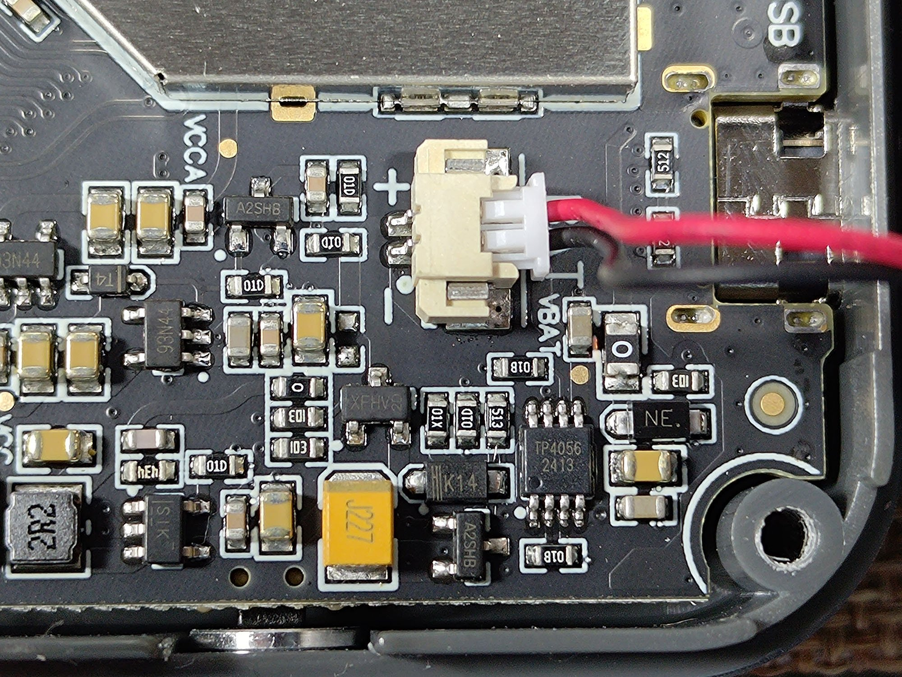

*Power section: TP4056 charger, VBAT connector, USB-C, unidentified regulators, 2R2 inductor.*

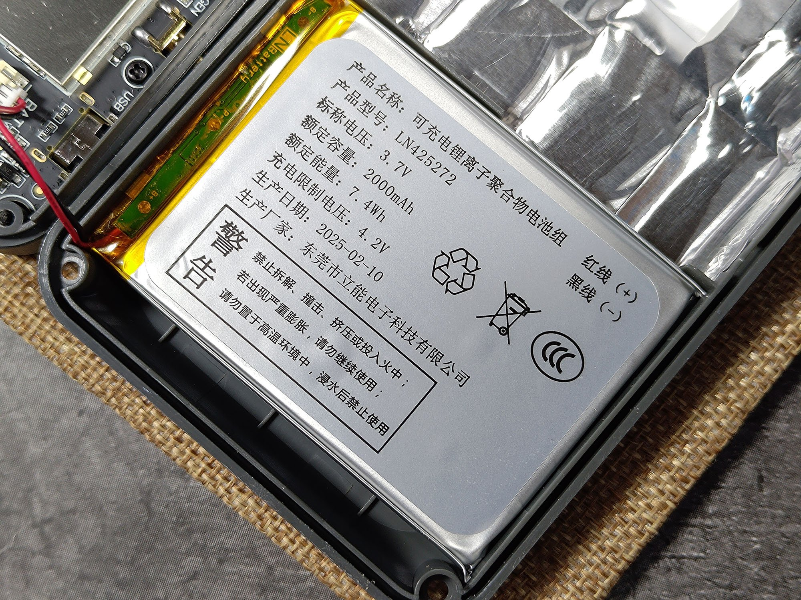

*Battery label: LN425272, 3.7 V, 2000 mAh, 7.4 Wh, made 2025-02-10.*

- Battery: 1-cell Li-ion polymer LN425272, 2000 mAh, with protection PCB,
  2-pin connector "VBAT" (photo). Runtime 10..15 h (chat reports; review:
  12 h DMM / 10 h scope).
- Charger: [TP4056](datasheets/toppower-tp4056-cn.pdf), linear, from USB VBUS. Charging takes ~2 h 35 min (chat
  report [#16625](https://t.me/S2084K/16625)). Status: PB10 / PB11 inputs (meaning guessed; the two RE
  headers disagree, see [Unknowns](#unknowns)).
- Battery voltage: PC5 = ADC0 channel 15, 1:2 divider, 3.0 V reference
  assumed: Vbat = raw * 3.0 / 4096 * 2. Firmware powers off below ~3.31 V.
  ([`firmware/src/power.rs`](../firmware/src/power.rs), [`dmm_v2_6.h`](../stock/re/analysis/dmm_v2_6.h)); the divider ratio is
  *inferred* from the scaling.
- Rails switched by the MCU ([`board.rs`](../firmware/src/board.rs), [`scope.rs`](../firmware/src/scope.rs) `rails`,
  [`boot.rs`](../firmware/src/boot.rs)):
  - **PE2** = DMM analog supply (the isolated side, via a [VPS8504B](datasheets/vpsc-vps8504b-cn.pdf), *inferred*)
    and part of the power hold.
  - **PC4** = scope / generator analog supply.
  - The Alientek primary bootloader raises PE2 and PC4 first thing on every
    reset; the stock power-off drops both and the unit switches off once the
    key is released (on battery). Which of the two, or both, keeps the system
    supply on is unknown.
  - PC0 = Bluetooth module power (low = on).
- MCU die temperature: ADC0 channel 16 (internal sensor), typical constants.

## Pin table

GD32 peripheral names (UART4, SPI1, SPI2, I2C2, DMA0 / DMA1) follow the
GD32F4xx user manual as the opendm40 sources do. The source column names the
opendm40 or stock code that drives the pin.

| Pin | Function | Dir | Source |
|---|---|---|---|
| PA0 | UART4_TX -> Bluetooth (AF8) | out | [`bt.rs`](../firmware/src/bt.rs) |
| PA1 | UART4_RX <- Bluetooth (AF8) | in | [`bt.rs`](../firmware/src/bt.rs) |
| PA2 | debug header "TX" pad: boot strap of the bootloader / FS-loader (pull-up, low = update mode); AF USART1_TX unused | in | bootloader / FS-loader code |
| PA4 | DAC channel 1: generator; ADC0 ch4 read-back | analog | [`gen.rs`](../firmware/src/gen.rs), [`power.rs`](../firmware/src/power.rs) |
| PA5 | DAC channel 2: scope trigger level (stock) | analog | stock, [`hwtrig.rs`](../firmware/src/hwtrig.rs) |
| PA6 | TIM13_CH1 (AF9) backlight PWM 20 kHz | out | [`board.rs`](../firmware/src/board.rs) |
| PA7 | TIM14_CH1 (AF9) buzzer | out | [`lcd_buzzer_v2_6.h`](../stock/re/analysis/lcd_buzzer_v2_6.h) |
| PA8 | I2C2 SCL, touch (AF4) | od | [`touch.rs`](../firmware/src/touch.rs) |
| PA9 | DMM relay drive (pulse) | out | [`dmm.rs`](../firmware/src/dmm.rs) |
| PA10 | DMM relay drive (pulse) | out | [`dmm.rs`](../firmware/src/dmm.rs) |
| PA11 | USB DM (AF10) | io | [`usb.rs`](../firmware/src/usb.rs) |
| PA12 | USB DP (AF10) | io | [`usb.rs`](../firmware/src/usb.rs) |
| PA13 / PA14 | SWD (pads "D" / "C") | io | debug header |
| PA15 | TIM2_CH1 (AF1): scope trigger comparator (stock) | in | stock, [`hwtrig.rs`](../firmware/src/hwtrig.rs) |
| PB0..PB9 | [3PA1030](datasheets/3peak-3pa1030-reva1.pdf) data D0..D9 | in | [`scope.rs`](../firmware/src/scope.rs) |
| PB10 | charge status / control (meaning *inferred*) | in / od | stock code, [`dmm_v2_6.h`](../stock/re/analysis/dmm_v2_6.h), [`power.rs`](../firmware/src/power.rs) |
| PB11 | charge status (meaning *inferred*) | in, pull-up | stock code, [`dmm_v2_6.h`](../stock/re/analysis/dmm_v2_6.h), [`power.rs`](../firmware/src/power.rs) |
| PB12 | generator path select, 1 = PWM, 0 = DAC | out | [`gen.rs`](../firmware/src/gen.rs) |
| PB14 | TIM12_CH1 (AF9) generator square | out | [`gen.rs`](../firmware/src/gen.rs) |
| PB15 | scope 4051 select bit | out | [`scope.rs`](../firmware/src/scope.rs) |
| PC0 | Bluetooth module power, low = on | out | [`bt.rs`](../firmware/src/bt.rs) |
| PC2 | SPI1 MISO, flash (AF5) | in | [`spiflash.rs`](../firmware/src/spiflash.rs) |
| PC3 | SPI1 MOSI, flash (AF5) | out | [`spiflash.rs`](../firmware/src/spiflash.rs) |
| PC4 | scope / generator analog rail | out | [`scope.rs`](../firmware/src/scope.rs) |
| PC5 | ADC0 ch15, battery / 2 | analog | [`power.rs`](../firmware/src/power.rs) |
| PC6 | TIM8_CH1 (AF3) 50 MHz scope ADC clock | out | [`scope.rs`](../firmware/src/scope.rs) |
| PC7 | DMM frequency mode (1 only in mode 14) | out | [`dmm.rs`](../firmware/src/dmm.rs); function unknown |
| PC8 | TIM3_CH3 (AF2) scope offset PWM | out | [`scope.rs`](../firmware/src/scope.rs) |
| PC9 | I2C2 SDA, touch (AF4) | od | [`touch.rs`](../firmware/src/touch.rs) |
| PC10 | SPI2 SCK -> [HY3131](datasheets/hycon-hy3131-datasheet-v10.pdf) (AF6) | out | [`hy3131.rs`](../firmware/src/hy3131.rs) |
| PC11 | SPI2 MISO <- HY3131 (AF6) | in | [`hy3131.rs`](../firmware/src/hy3131.rs) |
| PC12 | SPI2 MOSI -> HY3131 (AF6) | out | [`hy3131.rs`](../firmware/src/hy3131.rs) |
| PC13 | scope attenuator relay, 1 = direct, 0 = /50 | out | [`scope.rs`](../firmware/src/scope.rs) |
| PC14 | Bluetooth link up (high = connected) | in | [`power.rs`](../firmware/src/power.rs) |
| PD0, PD1, PD8, PD9, PD10, PD14, PD15 | FSMC data (AF12) | io | [`board.rs`](../firmware/src/board.rs) |
| PD2 | HY3131 CS (active low) | out | [`hy3131.rs`](../firmware/src/hy3131.rs) |
| PD3 | SPI1 SCK, flash (AF5) | out | [`spiflash.rs`](../firmware/src/spiflash.rs) |
| PD4 / PD5 | FSMC NOE / NWE | out | [`board.rs`](../firmware/src/board.rs) |
| PD6 | power key, pressed = 1 (pull-down) | in | [`boot.rs`](../firmware/src/boot.rs) |
| PD7 | FSMC NE1 (LCD CS) | out | [`board.rs`](../firmware/src/board.rs) |
| PD11 | FSMC A16 = LCD RS | out | [`board.rs`](../firmware/src/board.rs) |
| PD12 / PD13 | scope 4051 select bits | out | [`scope.rs`](../firmware/src/scope.rs) |
| PE0 | A shunt MOSFET (10 mohm) | out | [`dmm.rs`](../firmware/src/dmm.rs) |
| PE1 | mA shunt MOSFET (0.5 ohm) | out | [`dmm.rs`](../firmware/src/dmm.rs) |
| PE2 | DMM analog rail / power hold | out | [`boot.rs`](../firmware/src/boot.rs) |
| PE3 | scope coupling, 1 = DC, 0 = AC | out | [`scope_gen_ui_v2_6.h`](../stock/re/analysis/scope_gen_ui_v2_6.h) |
| PE4 | SPI1 CS, flash | out | [`spiflash.rs`](../firmware/src/spiflash.rs) |
| PE5 | touch INT (falling edge) | in | [`touch.rs`](../firmware/src/touch.rs) |
| PE6 | touch reset | out | [`touch.rs`](../firmware/src/touch.rs) |
| PE7..PE15 | FSMC data (AF12) | io | [`board.rs`](../firmware/src/board.rs) |
| PH0 / PH1 | 25 MHz HXTAL | - | *inferred* (standard pins) |

Not used by the stock firmware or opendm40 as far as traced: PA3 (the debug
header's RX pad), PB13, PC1, PC15. Whether they are connected is unknown.

## Models DM40A / B / C

- The firmware tells the models apart only by one byte in the calibration
  record; the stock [HY3131](datasheets/hycon-hy3131-datasheet-v10.pdf) rows, relays and scope / generator code are the
  same for all three ([firmware/docs/model-variants.md](../firmware/docs/model-variants.md)).
- Hardware difference reported in the chat: the A has a discrete divider instead
  of the TC1746B6 network ([#25087](https://t.me/S2084K/25087), [#34902](https://t.me/S2084K/34902), [#51830](https://t.me/S2084K/51830)). Whether anything else
  differs (reference, shunts) is unknown.
- The A measures AC+DC as well; the stock hides it by model (chat reports,
  [`user-feedback.md`](../firmware/docs/user-feedback.md) UF-03).
- Chat reports say units before 2025 are unshielded; the reviewed unit (2025, battery
  dated 2025-02-10) has shield cans and a foil-lined back cover (photos,
  [`user-feedback.md`](../firmware/docs/user-feedback.md) 12).

## Unknowns

1. No schematic; circuit details beyond the parts list are inferred from the
   BOM and the photos.
2. Which rail(s) hold the power on: PE2, PC4 or both; how the power key turns
   the unit on from off. [`firmware/src/boot.rs`](../firmware/src/boot.rs) and [`native-boot.md`](../firmware/docs/native-boot.md) (shim
   steps) treat PE2 as the power hold; [`native-boot.md`](../firmware/docs/native-boot.md) section 1 (older text)
   says no self-hold GPIO is evident and calls it unverified.
3. Whether anything else on the board drives PA2.
4. The MCU crystal: 25 MHz by the PLL read-back and the photo, 26 MHz in the
   community BOM (jebem, EEVblog thread, after mydigit.cn). The 25 MHz value
   is the one the running firmware depends on.
5. Charge status pins: [`dmm_v2_6.h`](../stock/re/analysis/dmm_v2_6.h) says the stock shows the charging icon
   when PB10 = 1 and PB11 = 0; [`bt_meas_v2_6.h`](../stock/re/analysis/bt_meas_v2_6.h) and [`firmware/src/power.rs`](../firmware/src/power.rs) use
   PB10 = 1 and PB11 = 1 for "charging". Both are guesses about the meaning.
6. Fuse rating and type (A input), and whether there is a separate mA fuse.
   The 47 ohm resistor's exact power rating (MELF 0207 by size, series unknown).
7. PC7's function in the frequency mode; the [HY3131](datasheets/hycon-hy3131-datasheet-v10.pdf) CNT pin source; how the
   buzzer is driven (PA7 and the HY3131 CMP pin) across the isolation.
8. The scope trigger comparator chip; which of PB15 / PD12 / PD13 is the 4051
   A / B / C; the exact gain resistors.
9. The scope op amp ("8091") and the generator output stage after the SGM3157.
10. The regulators and the power path parts in [charger-tp4056-and-power.jpg](photos/charger-tp4056-and-power.jpg).
11. The debug headers' VCC pads: ~3.1 V while on, not the MCU supply
    directly; what sits between them is not traced.
12. LCD panel FPC pinout; touch panel vendor beyond the controller ID.
13. Exact HY3131 wiring (ohm reference resistors, divider taps, shunt nodes):
    inferred from the stock scaling only ([`emu/hy3131/RESEARCH.md`](../emu/hy3131/RESEARCH.md) 8.5).
14. [MAX6190](https://www.analog.com/media/en/technical-documentation/data-sheets/MAX6190-MAX6198.pdf) placement: the BOM post says the reference sits outside the
    shielded zone; this page's diagram draws it in the (shielded) DMM domain,
    which is about the isolated side, not the shield can. Not checked on the
    photos.
15. What the four optocouplers carry: the BOM post guesses the HY3131 INT plus
    the relay and MOSFET drive; the stock firmware does not use the HY3131
    IRQ ([DMM front end](#dmm-front-end-hy3131)), and the MCU drives four
    DMM-side GPIOs (PA9 / PA10 relay, PE0 / PE1 MOSFETs) that must cross the
    barrier somehow, so the relay and MOSFET drive is the likelier load.
16. RTC power while off: the feature request (2026-10-13) assumed the RTC is
    always powered from the main battery; nothing in this repo traces VBAT or
    the LSE crystal, and it depends on which rail holds the power (item 2).
